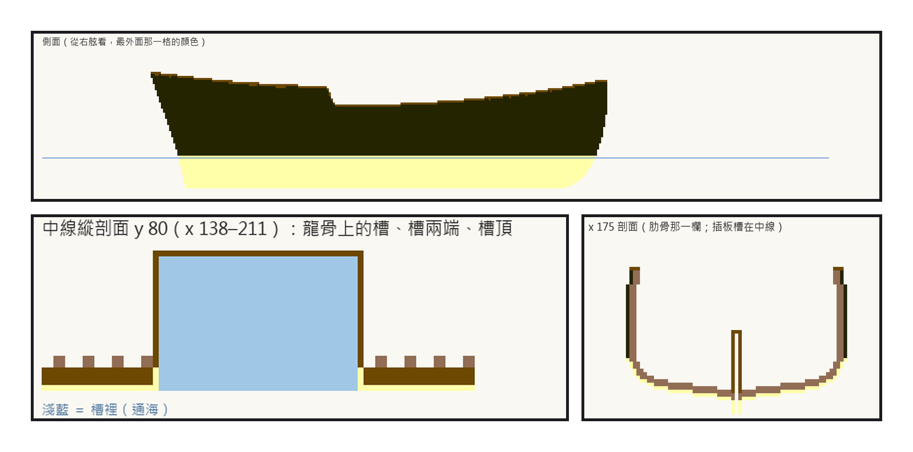
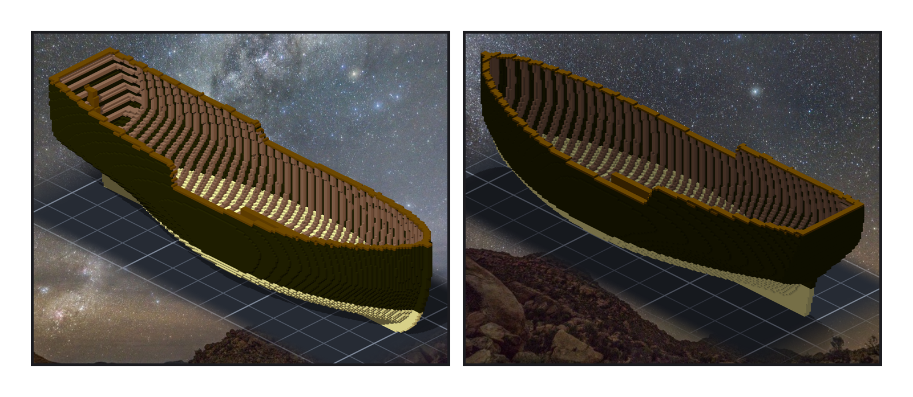
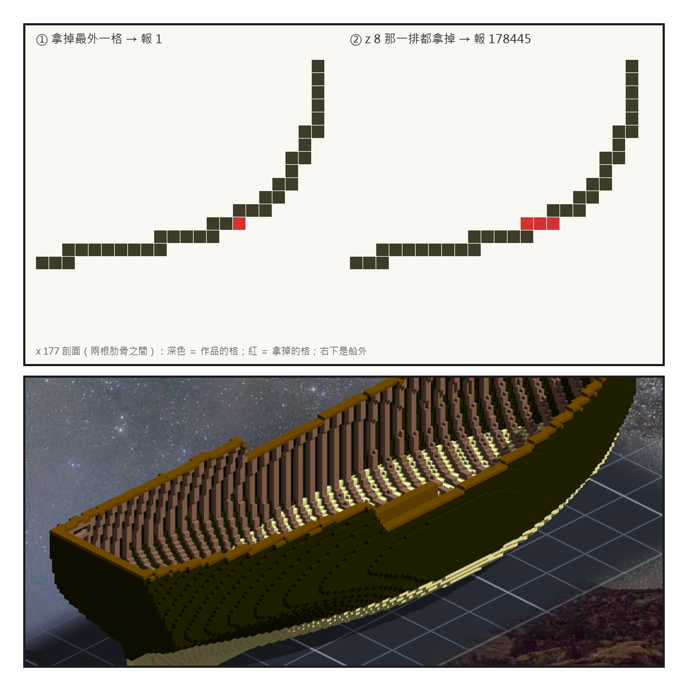

# 第 005 話〈一格的洞〉

## P1 — 槽開在中線

**P1-①**〔新圖紙 03 側面〕水線以下 white stuff，以上近黑，舷牆頂一圈深色蓋板。
　字幕：「外板一格厚，鋪在肋骨外面。水面下塗偏白的獸脂，水面上塗黑 —— 它叫夜隼。」

**P1-②**〔中線縱剖面〕淺藍是槽裡，通海。
　字幕：「插板槽走中線，穿過龍骨。我照 Mercantile 的做法 —— 一艘甲板八十呎、寬二十二呎、插板收起只吃水五呎的雙桅船，尺寸跟夜隼號幾乎一樣。」
　字幕：「她把主桅挪開讓槽走中線；我把槽放在兩根桅中間，桅不用挪。」

**P1-③**〔x 175 剖面〕
　字幕：「槽壁兩片、槽頂一塊蓋，頂在水面上七十公分。槽裡是海，不算船艙。」

---

## P2 — 一艘船的樣子

**P2-①**〔作品，yaw 45〕
　字幕：「肋骨之間的縫補起來，它第一次看起來像一艘船。」

**P2-②**〔作品，yaw −135〕
　字幕：「第一版外板只取跟船外共用一個面的那一層。斜的地方變成階梯，五十八塊碎片只靠邊角相接 —— 水過不去，可是對轟裡會掉下來。多取一條邊的深度，就連成一塊了。」

---

## P3 — 一格的洞

**P3-①**〔漏水測試，x 177 剖面〕紅色是拿掉的格。
　字幕：「量漏水的尺，要先餵它一個已知答案。我在水線下拿掉一格外板 —— 它報一。」
　字幕：「我以為在問『破一格會不會漏』。它答的是『洞自己算不算』：那一格上面還有一排外板，水進得了洞，進不了船艙。把那一排都拿掉，它報十七萬八千四百四十五 —— 整個船艙。」
　字幕：「尺是對的。題目是我出錯的。」

**P3-②**〔作品，yaw 135〕
　字幕：「然後我替那個『一』編了原因：『那裡外板三格厚』。畫出剖面才看到，外板還是一格 —— 只是船舭在那一層幾乎是平的，三格橫著並排。」

▸註：讀數在 `verify_planking.json`（每份清單的格數與 sha256、設計上的漏水）、`verify_planking_post.json`（讀作品本身算的漏水、已知答案、探針與反向對照：23 根偏 3 全報 3）。槽的參照：Mercantile 的尺寸是 Wikipedia 直接讀的；「主桅挪開讓槽」是搜尋摘要轉述 NPS 文件，那兩份 PDF 是掃描圖，我讀不到原文。
本話的錯：
① 外板第一版只取一層面，斜面上 58 塊碎片只靠邊角相接。
② 漏水的已知答案出錯了題：拿掉一格，問到的是洞本身。
③ 替一個數字編原因（「三格厚」）—— 沒看圖就說的，看了圖就不是。
④ 我跟 Tim 說 Mercantile「跟我第零階段記的不一樣」—— 回頭重讀，第零階段寫的就是對的；錯的是我沒重讀就說它錯。
