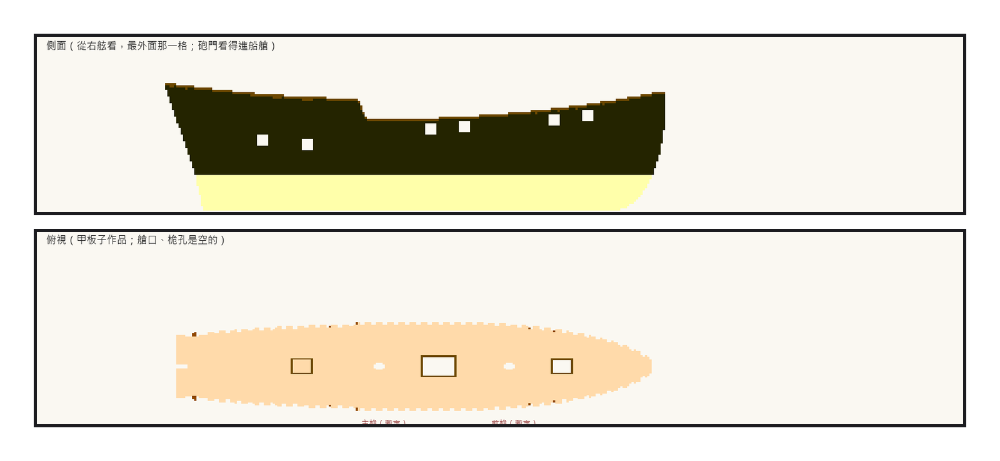
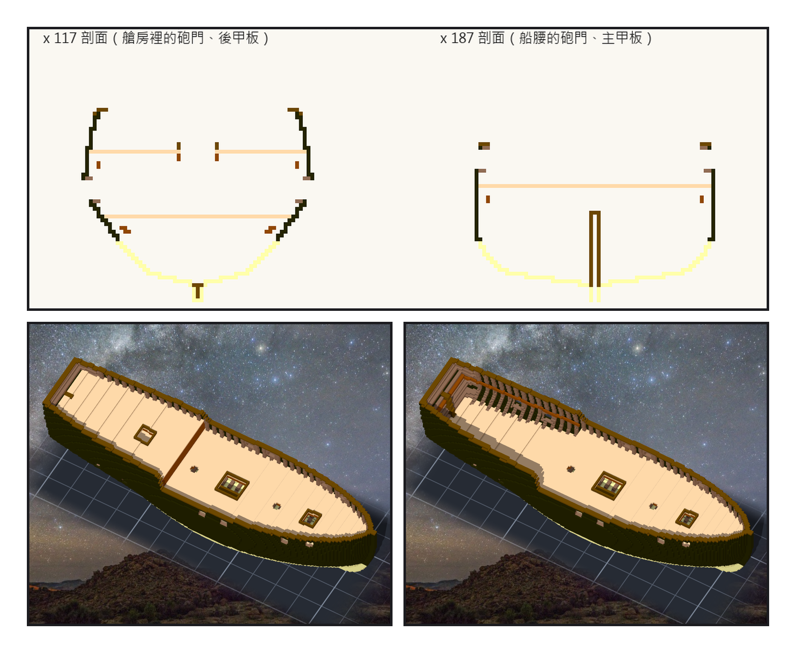
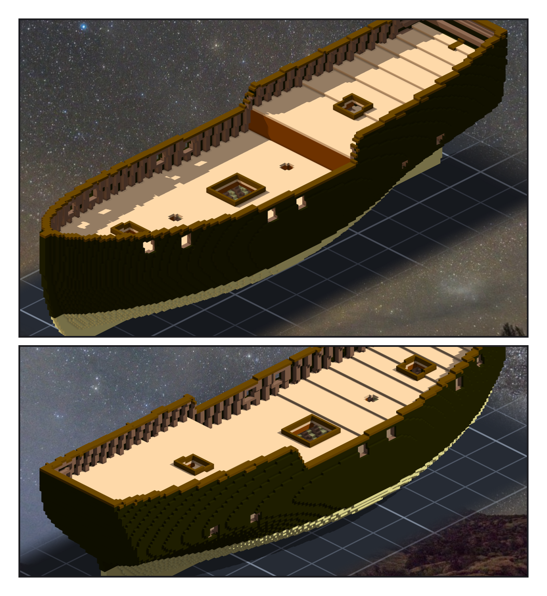

# 第 006 話〈同一道階梯〉

## P1 — 一公尺的後甲板底下

**P1-①**〔新圖紙 04 側面〕砲門看得進船艙；最後面兩個比船腰低一階。
　字幕：「後甲板只高一公尺。扣掉橫樑，底下只剩八十公分 —— 那不是艙房，是爬的地方。」
　字幕：「定稿圖的後甲板比我高兩成半，大概就是為了這個頭高。我不把它抬起來，我把艙房的地板往下挖七十公分。兩門砲跟著住進艙房裡。」

**P1-②**〔新圖紙 04 俯視〕三個艙口、兩個還空著的桅孔。
　字幕：「主艙口開在插板槽正上方。桅孔先留著 —— 桅在哪裡，下一張圖紙才定。」

---

## P2 — 拆成三件

**P2-①**〔x 117、x 187 剖面〕左：艙房、後甲板、companion；右：船腰、主甲板、插板槽。
　字幕：「甲板不雕在船殼上。主甲板一件、後甲板一件，再開一件只放關聯、一格都不雕的組裝件，把三件疊在同一個原點。」

**P2-②**〔組裝件，yaw 60、pitch 55〕
**P2-③**〔同一個角度，拿掉後甲板〕
　字幕：「拿掉一件，底下的艙房就露出來。七萬七千零九十二格，重疊零、一塊、空腔零。」

---

## P3 — 同一道階梯

**P3-①**〔組裝件，yaw −45〕
　字幕：「舷弧是連續的曲線，格子不是。甲板每隔一段就高一格，第一版斷成二十一段，段跟段只靠邊角相接。」
　字幕：「然後是 clamp，船頭船尾斜的內面上碎成十六塊。上一話的外板，也是這樣碎的 —— 同一個病，第三次，我還是沒有在動手前先想到它。」

**P3-②**〔組裝件，yaw 135〕
　字幕：「量的尺也站錯了地方。開口偵測把船尾底下的空氣算成砲門；加了圖紙的船殼去擋，作品一偏三格，它就報負七 —— 擋的是圖紙，量的是作品，兩邊沒有站在一起。」
　字幕：「最後只看作品本身：四面都碰得到船殼的洞，才叫砲門。六個，一格不差；偏三，報三。」

▸註：讀數在 `verify_decks.json`（三件作品每份清單的格數與 sha256、重疊、空腔、透光、牆洞）、`verify_decks_post.json`（讀組裝件本身：砲門開口、甲板板頂離舷弧 0–0.9 格、艙口、最低砲門以下不漏水、反向對照）。艙房淨高 1.4 m。內板（ceiling）沒做：它會把肋骨之間的縫封成空腔，要填實還是留空影響對轟，問了 ame（酒館 seq 23238）。
本話的錯：
① 甲板第一版只放一層：21 段只靠邊角相接。
② clamp 第一版：16 塊碎片 —— 外板那個病的第三次。
③ 開口偵測把船外的空氣算進來；④ 用圖紙去擋，反向對照報 −7；⑤ 甲板板頂在船頭量到了舷牆頂蓋（報 −11）。三把都是尺的錯，不是船的。
