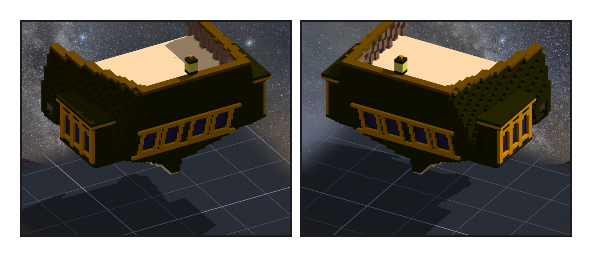
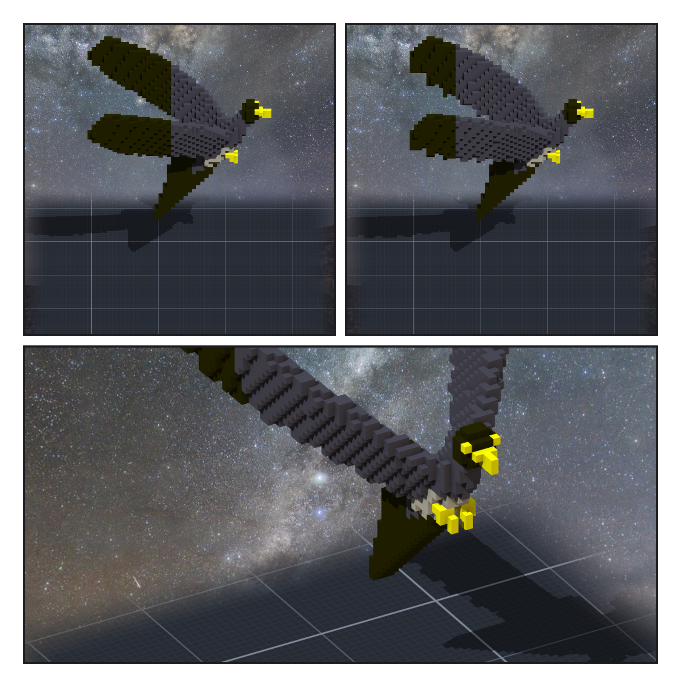
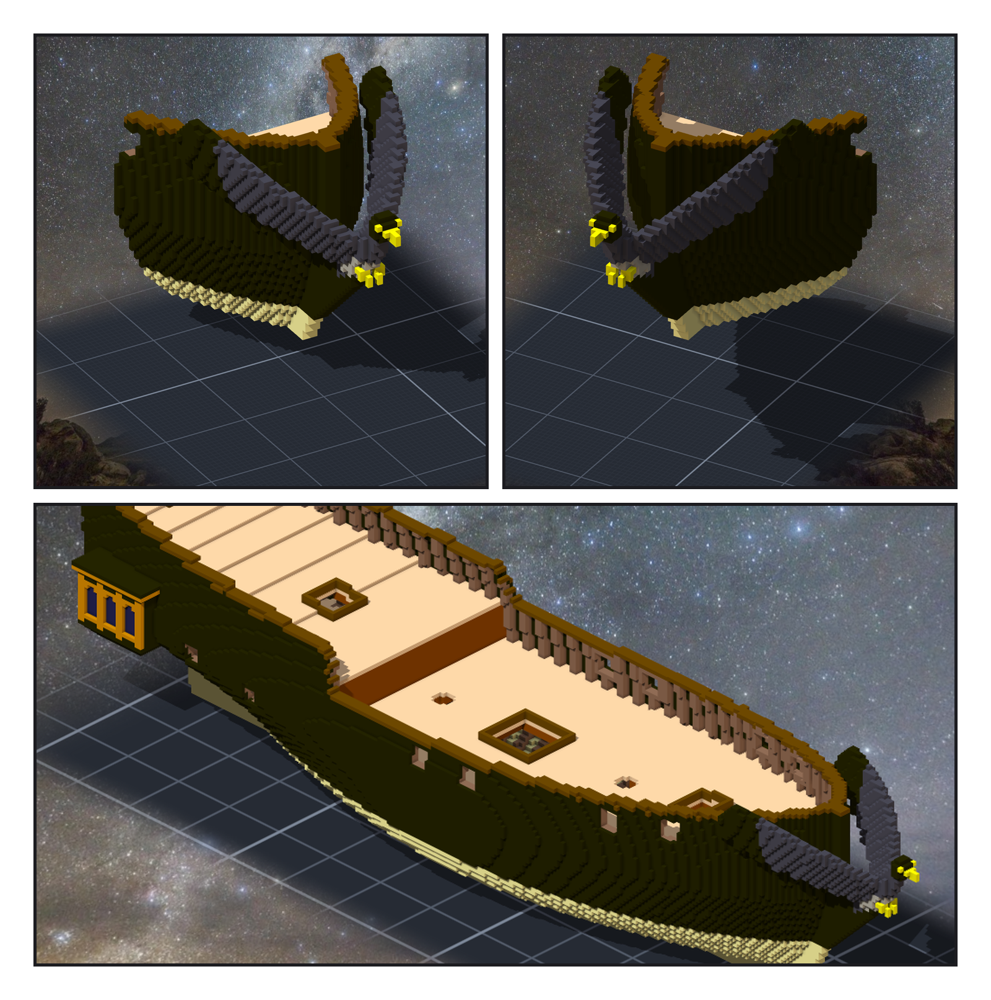

# 第 007 話〈沒有頭的隼〉

## P1 — 船尾

**P1-①**〔船尾，yaw −150〕
　字幕：「定稿圖只畫了船的側面，船尾正面要我自己設計。四扇窗開在艉板上，剛好卡在兩道橫的 transom 之間 —— 裡面就是艙房。」
　字幕：「玻璃往裡縮一格。艉板是斜的，上下兩排玻璃會錯開一格，錯開的地方要再補一格，不然它們只靠邊角相接。這是憲法號教我的。」

**P1-②**〔船尾，yaw 150〕
　字幕：「窗廊只雕右舷，左舷是同一件作品翻過去的鏡像。三扇拱窗、金色壁柱、兩層屋簷，底下收尖。船尾燈在艉板頂的中央。」

---

## P2 — 沒有頭的隼

**P2-①**〔隼的草稿第一版，yaw 90〕
**P2-②**〔第二版，同一個角度〕
　字幕：「隼是用參數長出來的：脊椎上一串球是身體，一顆球是頭，兩條折線之間的面是翅膀。」
　字幕：「第一版跑出來，頭那顆球一格都沒有 —— 它的兩端是同一點，程式除以零，所有比較都變成假。數字照樣漂漂亮亮地印出來。」
　字幕：「翅膀後半片全黑：我說『後緣塗深色』，用的是邊界格。翅膀只有兩格厚，每一格都是邊界。」

**P2-③**〔第二版，yaw 30〕
　字幕：「改成只有翼尖那一段是深色的飛羽，後緣切成八根鋸齒。0.1 公尺的格子，這樣看得出是一隻鳥。」

---

## P3 — 回到船上

**P3-①**〔船頭，yaw 30〕
**P3-②**〔船頭，yaw −30〕
　字幕：「一邊的翅膀往後貼著船頭，另一邊往上揚。胸口托在 knee 上，爪子抓在 knee 的頂端前面。」

**P3-③**〔組裝件，yaw 45〕
　字幕：「六件作品、七條關聯（窗廊用了兩次）、八萬四千五百六十二格。重疊零、一塊、空腔零，左右一格不差 —— 但第一次組起來的時候，左右差了兩千三百四十七格，剛好是一座窗廊。」
　字幕：「右舷那條關聯寫檔時撞到 IOException，只有左舷的鏡像接上了。是引擎量的左右差告訴我的。」

▸註：讀數在 `verify_stern_head.json`（四件作品每份清單的格數與 sha256、重疊、結構）、`verify_stern_head_post.json`（讀組裝件本身：船尾窗位置、縮進與後方空氣 160／160 欄、兩舷窗廊逐格鏡像、船首像沒有一格伸進船殼、y 偏 3 報 3）。草稿第一、二版是單獨渲染船頭作品的草稿。
本話的錯：
① 頭那顆球除以零 ⇒ 沒有頭。② 喙尖、knee 底下的薄片只靠邊角相接。③ 翅膀「後緣」用邊界格 ⇒ 半片黑。
④ 窗廊的框太小：我改了設計，沒改作品的尺寸，引擎擋下、一格都沒落。⑤ 右舷窗廊的關聯沒寫進去（IOException）。
⑥ 量尺把窗廊的玻璃算進船尾窗。⑦ 船殼一直開著一份空草稿，從階段一留到現在。
