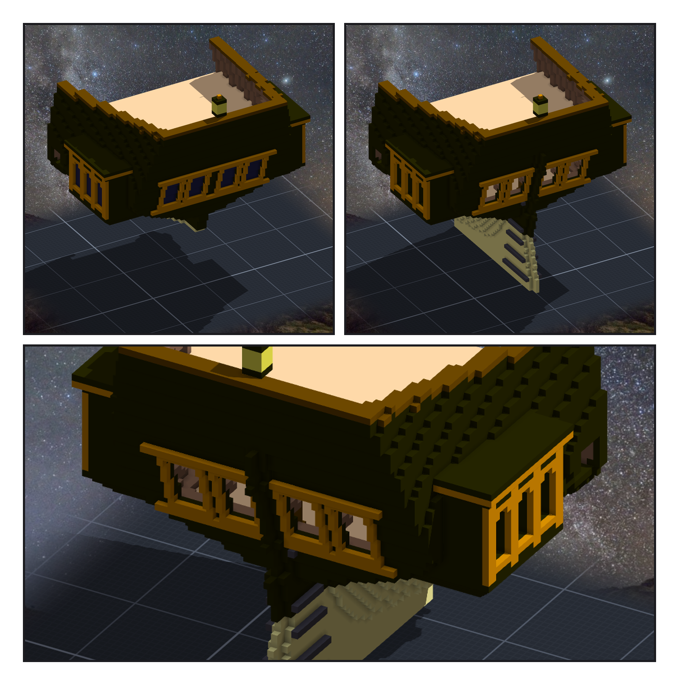
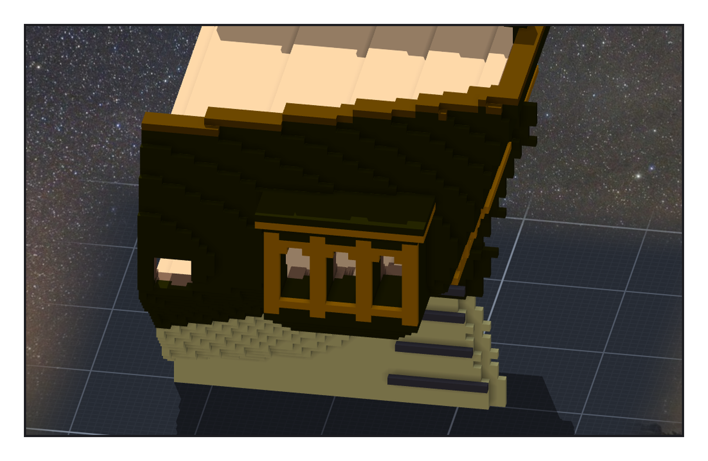
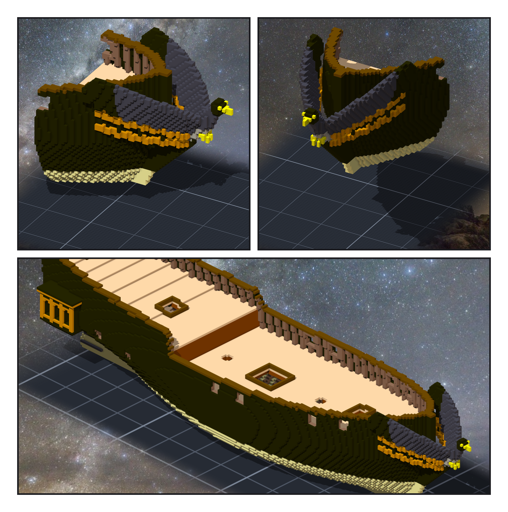

# 第 008 話〈打開窗〉

## P1 — 拿掉玻璃

**P1-①**〔船尾，上一話〕**P1-②**〔同一個角度，開窗之後〕
　字幕：「Tim 說：窗戶直接開孔，這樣看得到裡面。」
　字幕：「船尾的四扇只要拿掉玻璃 —— 後面本來就是艙房。窗廊不一樣：它是貼在船身外面的一塊，窗後面是窗廊自己，再後面是船殼。要一路打穿到艙房。」

**P1-③**〔船尾，yaw 150〕
　字幕：「窗廊只雕了右舷，左舷是鏡像。我只刻右舷那一件，左舷的窗就自己開了。船殼兩舷的洞，要自己各刻一次。」

---

## P2 — 一格不透光

**P2-①**〔船尾側面，yaw −100〕窗廊的窗裡看得到艙房的地板和砲門。
　字幕：「第一版，九十格裡有一格不透光。外板跟肋骨之間有縫 —— 我刻到第一格空氣就停了，更裡面那道撐後甲板的 clamp 剛好橫在拱頂那一排。」
　字幕：「舵掛在艉板外面。憲法號的舵收在 counter 底下；我照抄，可是夜隼號的船尾幾乎是直的，沒有 counter 讓它停 —— 它一直往上爬，停在哪裡全看我設的容差。」
　字幕：「方艉的船，舵本來就掛在艉板外面、舵柱一路上到甲板。學來的做法，要先問它在這艘船上還成不成立。」

---

## P3 — 翅膀底下的欄杆

**P3-①**〔船頭，yaw 60〕**P3-②**〔船頭，yaw −30〕
　字幕：「船頭欄杆每舷上下兩道，從船身彎到隼的胸口底下，整條壓在翅膀後緣下面。第一版下面那道的尾巴斷了四格 —— 它走的線鑽進了船身。」

**P3-③**〔組裝件，yaw 45〕
　字幕：「量舵的時候，我先量它的前緣。可是舵的前緣貼著艉柱，兩個在水下都是同一種白 —— 從作品上分不出哪一格是舵。改量後緣，偏三，報三。」

▸註：讀數在 `verify_rudder_rails.json`（四份清單的格數與 sha256、結構、窗廊透光 90／90）、`verify_rudder_rails_post.json`（讀組裝件本身：結果帳 0 差、船尾窗看得進去的欄正好十欄、兩舷窗廊各 90／90、舵後緣 −0.38～0.69 格、欄杆兩端高度、偏 3 全報 3）。舵之後要給遊戲轉，會改成外部模型。
本話的錯：
① 開孔刻到第一格空氣就停 ⇒ clamp 擋住一格。② 舵照抄憲法號「收在 counter 底下」⇒ 方艉的船停不下來。
③ 欄杆照線性內插走 ⇒ 尾巴鑽進船身斷開。④ 量舵的前緣 ⇒ 分不出舵和艉柱。
