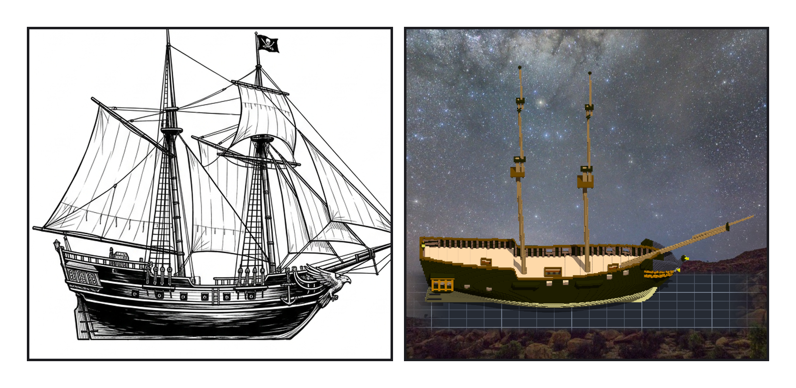
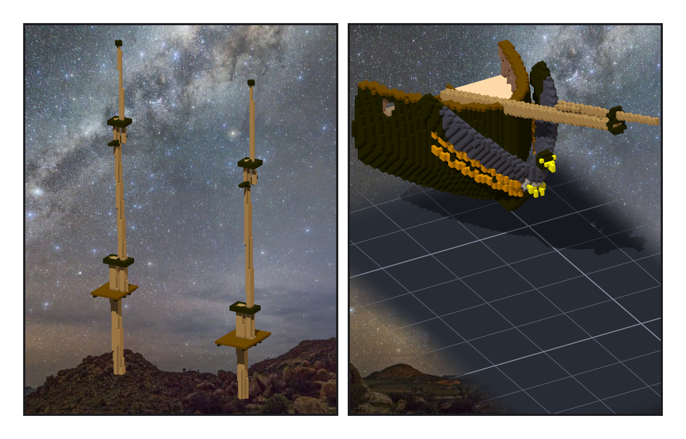
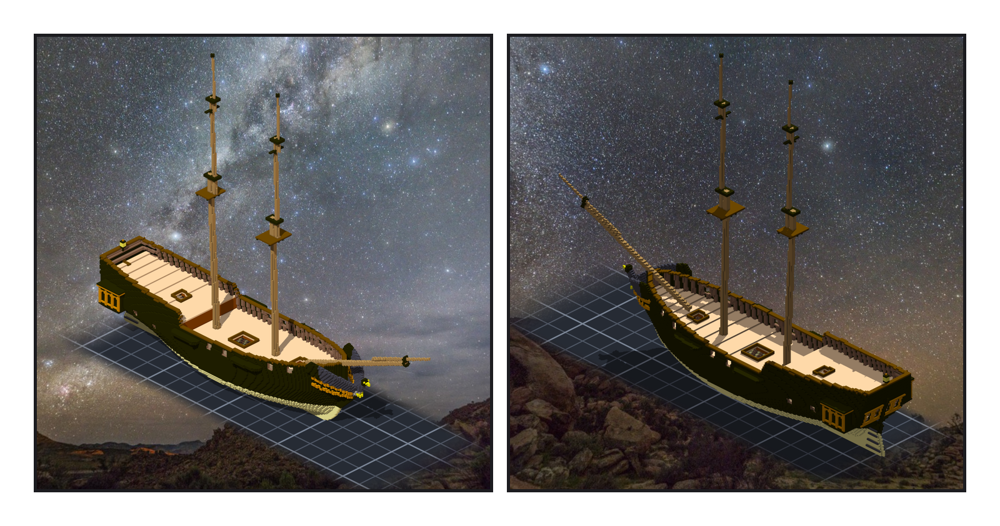

# 第 009 話〈上面那一節〉

## P1 — 立起來

**P1-①**〔定稿圖〕**P1-②**〔組裝件，正側面 yaw 90〕
　字幕：「兩根桅。前桅掛全部的橫帆，主桅掛一面縱帆、頂上再一面橫帆 —— 這叫 brigantine。船設只寫「雙桅快船」，是哪一種雙桅，是我從定稿圖的帆認出來的。」
　字幕：「主桅比前桅高六格，定稿圖也是後面那根高。兩根都往後倒一點點 —— 那是我定的，這艘船沒有史料。」
　字幕：「桅孔是三個階段以前開的。我讓桅的軸穿過甲板上的那一點再往後倒 —— 這樣甲板一格都不用改。」

---

## P2 — 一節接一節

**P2-①**〔兩根桅的上半，yaw 60〕
　字幕：「一根桅是三節：下桅、中桅、頂桅。每一節站在下一節的前面，靠一塊 cap 和一圈 trestletrees 箍住。」
　字幕：「憲法號的 top 浮在半空過：trestletrees 用四捨五入算位置，跟桅杆之間空了一格。所以我不算 —— 我看那一層桅杆最外面的格，再往外貼一格。」
　字幕：「然後兩根桅的頂桅都浮在半空。中桅和下桅之間，我放了 cap；中桅和頂桅之間，我忘了。同一個接頭，下面那一節做了，上面那一節沒有。」

**P2-②**〔艏斜桅，yaw 30〕
　字幕：「艏斜桅從甲板往前上二十二度，跨過艏柱頭、從隼的頭頂上面過去。它穿過船頭舷牆的那三十八格，我刻掉了。」

---

## P3 — 九萬三千格

**P3-①**〔組裝件，yaw 45〕**P3-②**〔組裝件，yaw −135〕
　字幕：「十三條關聯、九萬三千一百二十二格。重疊零、一塊、空腔零，左右一格不差。兩根桅的軸離圖紙最多零點三六格；把整艘船偏三格，量尺報三。」
　字幕：「還沒有帆桁、沒有繩、沒有帆。下一步，帆桁一根一件，做成可以轉的模型。」

▸註：讀數在 `verify_masts.json`（四件子作品與船殼開口的清單、rig_points、結構）、`verify_masts_post.json`（讀組裝件本身）。這一階段開始，「現況」不再每一支程式各重建一次：收成一支 `nf_state.py`，照每一階段的清單重播、每一刀都驗。
本話的錯：① 頂桅浮空 —— 中桅頂少一個 cap。（其他都在落格前被讀數擋下，沒有新的。）
