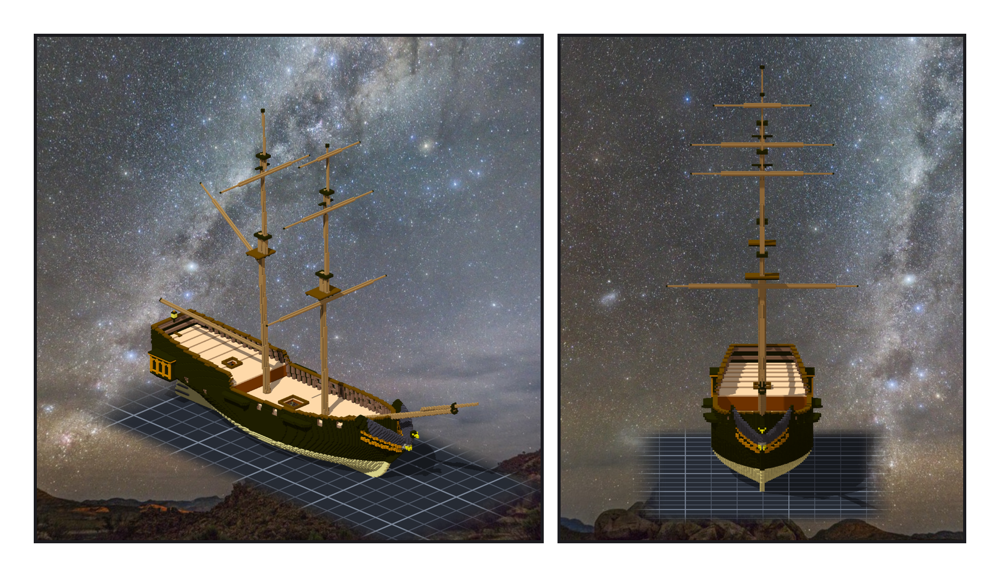
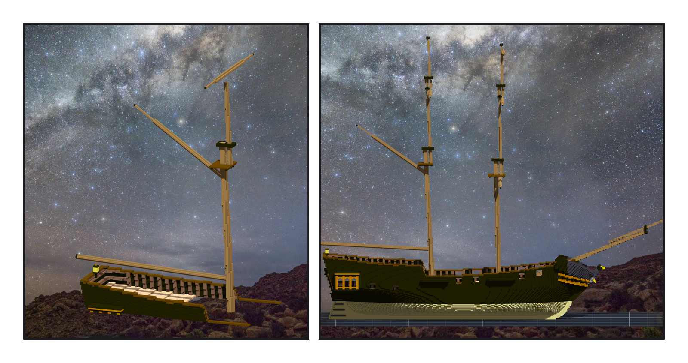
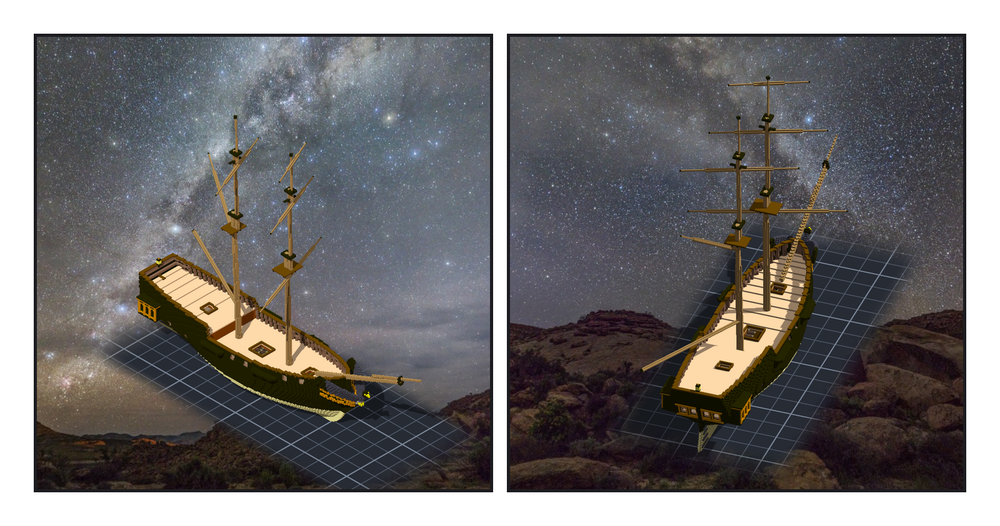

# 第 010 話〈三十四點二度〉

## P1 — 六根桁

**P1-①**〔組裝件，yaw 45〕**P1-②**〔從船頭看，yaw 0〕
　字幕：「前桅三根橫桁：course、topsail、topgallant。主桅頂上一根，下面一根斜的 gaff、一根平的 boom。六根。」
　字幕：「長度借憲法號：它的 fore yard 是船寬的 1.862 倍，我的船寬 64 格，所以 119 格。這是一艘巡防艦的比例搬到一艘雙桅快船上 —— 我寫在圖紙上了，沒有假裝它是這艘船的史料。」
　字幕：「粗細我第一版照『徑 ÷ 長』算，topsail 只剩一格粗，掛在五格粗的桅上像一根鐵絲。改成照『桁 ÷ 掛它的那一節桅』—— 我的桅本來就做得粗，桁跟著粗。」

---

## P2 — 不在格子裡斜

**P2-①**〔主桅特寫，yaw 70〕**P2-②**〔正側面，yaw 90〕
　字幕：「我的信上寫著一題：下次寫新的一層格子之前，先問 —— 斜面上它會不會只靠邊角相接？」
　字幕：「gaff 要往上翹三十五度。這一次我在動手之前問了。答案是：不要在格子裡斜。」
　字幕：「gaff 和 boom 在子作品裡是水平的直桿；斜度交給模型去轉。憲法號那邊記著『gaff 仍是格子的階梯』—— 這艘船上沒有那道階梯。」
　字幕：「boom 從主桅往船尾，越過船尾燈 —— 離燈頂兩格多一點。高度不是我挑的，是程式從底下最高的那一格往上找到的。」

---

## P3 — 轉過去，轉回來

**P3-①**〔試轉，yaw 45〕**P3-②**〔試轉，yaw 160〕
　字幕：「引擎轉過的八十四個點，跟我自己算的旋轉，差零。兩條路算同一件事，這一格我才敢信。」
　字幕：「然後量尺說 gaff 是三十四點二度。船是三十五度 —— 是尺歪了：我從桿的頂面量到桿的軸。boom 的淨空，尺說負一百五十二：它把 boom 上面那根主桅也算成『底下』。兩把尺都是我今天造的。」
　字幕：「最後試轉：全部轉到一邊，再轉回零，存檔要逐位元組一樣。六個呼叫失敗了一個 —— 而它說了什麼，我不知道：我拿來篩輸出的那一行，把失敗那一行篩掉了。」

▸註：讀數在 `verify_yards.json`（六件子作品的清單、固定點、模型擺放、轉好之後的預期點）、`verify_yards_post.json`（讀引擎匯出的東西）。組裝件格數不變（93,122）—— 模型不算格。
本話的錯：① gaff 仰角量成 34.2°（throat 在頂面、peak 在軸上）；② boom 淨空量成 −152（取整欄最高，撞到上面的主桅）；③ 轉回時 1 個呼叫失敗、原因被我自己的 grep 濾掉。三個都是尺或管道的錯，沒有一個進到船裡。
