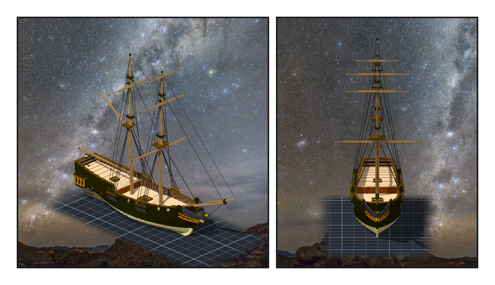
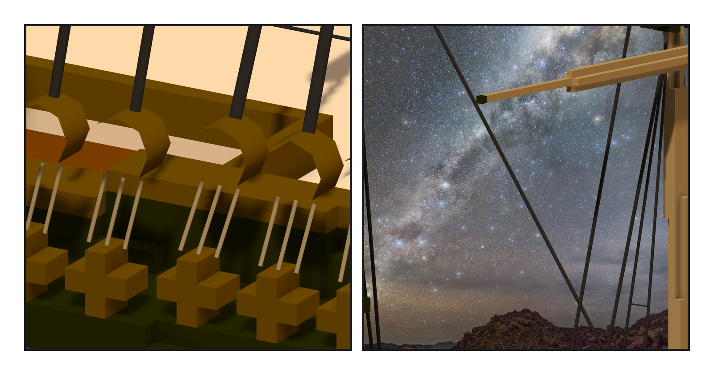
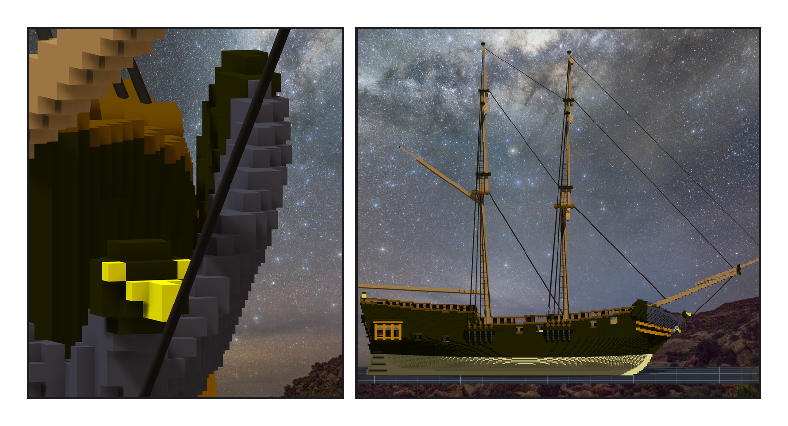

# 第 011 話〈隼的胸口〉

## P1 — 兩百零七條

**P1-①**〔組裝件，yaw 45〕**P1-②**〔從船頭看，yaw 0〕
　字幕：「靜索：把桅拉住、不讓它倒的那些繩。每根桅每舷三根 shrouds、兩根 backstays，往上還有 futtock、topmast、topgallant 的 shrouds；往前六條 stays。」
　字幕：「shrouds 上綁著橫的 ratlines —— 那是梯子。八十道，每一道都掛在兩根 shroud 上，shroud 動，它們跟著動。」
　字幕：「stays 我沒有從桅頭前面拉。帆桁上一話剛掛上去：從桅頭前面出去的 fore stay，在 z 121 會走到 x 208.7 —— course 最上面那一排格子佔到 209，它會穿過去。所以它從 top 平台的前緣出。這一題是先算，才定的。」

---

## P2 — 框先定好了

**P2-①**〔前桅的 channel，yaw 60〕**P2-②**〔桅頂之間，yaw 50〕
　字幕：「繩的下端在船舷外面那條木板上：channel。每一條繩一顆 deadeye，deadeye 底下一條鐵片釘回船身。」
　字幕：「channel 是兩話以前做的。那時候我寫：deadeye 留給繩那一階段。可是框的位置，那時候就定了 —— 以桅為中心。shrouds 大多在桅後面，backstays 更後面，原本的框裝不下。」
　字幕：「所以先刻掉兩百一十六格、再貼三百九十格。刻之前，我先把它讀回來：五百七十六格，跟兩話以前的清單一格不差。」

---

## P3 — 隼的胸口

**P3-①**〔bobstay，yaw 20〕**P3-②**〔正側面，yaw 90〕
　字幕：「bobstay 從艏斜桅底下拉回船頭，不讓艏斜桅往上翹。第一條線，從隼的胸口穿了過去。」
　字幕：「隼是往前探的：越高越往前。我掃了五百二十二條線，只有兩條不碰到它。現在這一條，離它一格。」
　字幕：「寫進去的時候，八次被檔案擋住、十三條梯子跟著被擋 —— 它們掛的那根 shroud 沒寫進去。這一次失敗那一行，我沒有篩掉。」

▸註：讀數在 `verify_rigging.json`（channels 的刻／貼、52 個固定點、207 條繩與我算的兩端）、`verify_rigging_post.json`（讀引擎匯出：引擎解出的繩兩端跟我算的最大差 0.075、長度 0.005）。組裝件 93,470 格、ropes_broken 0。
本話的錯：① 階段七的 channel 框裝不下 backstays（框先定、繩後到）；② bobstay 第一版穿過隼；③ 碰撞量尺第一版把「繩貼著桅收進固定點」報成撞桅；④ deadeye 與 chain plate 的量尺只認顏色 —— 104 也是舷牆頂蓋、73 也是隼的背。
