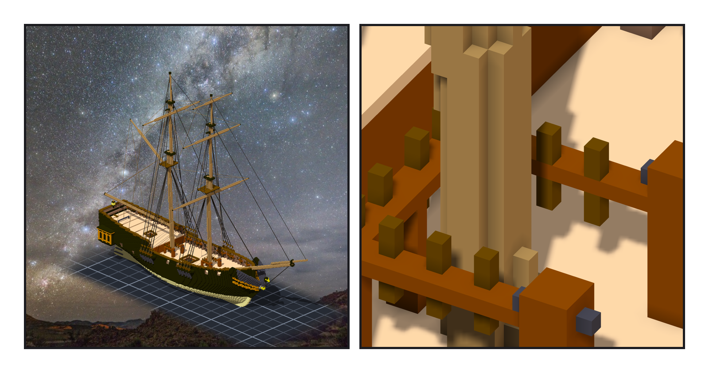
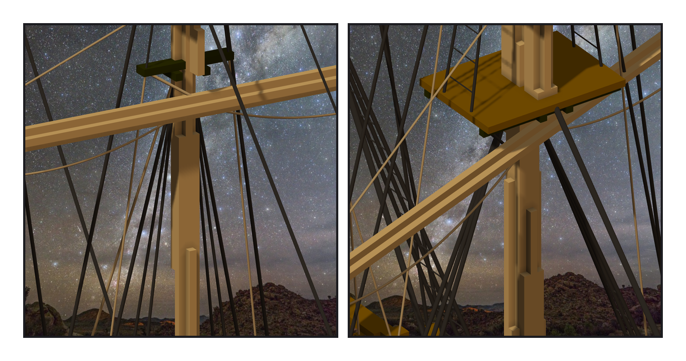
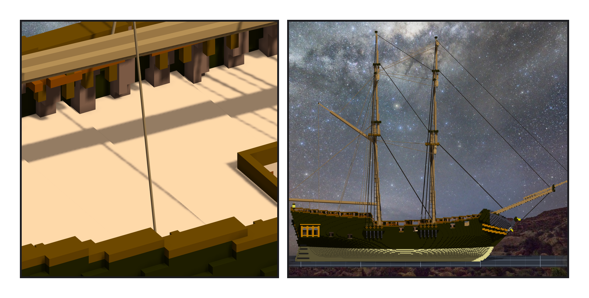

# 第 012 話〈頂蓋底下〉

## P1 — 繩要有地方落

**P1-①**〔組裝件，yaw 45〕**P1-②**〔主桅腳的 fife rail，yaw 60〕
　字幕：「上一話的繩把桅拉住；這一話的繩是拿來拉的 —— 把帆桁升上去、轉過去。拉完要綁在某個地方：belaying pin。」
　字幕：「每根桅腳一圈 fife rail，開口朝前、兩頭是 bitts。前桅那組的 bitts 第一次撞進了甲板：船頭比桅腳高一格，我從桅那一格的甲板量起。」
　字幕：「這一話的走法 —— lifts、braces、halyards、footropes —— 憲法號沒有做過。是我照一般橫帆船定的，沒有一條是查來的。」

---

## P2 — 跟著帆桁走

**P2-①**〔前桅的帆桁，yaw 30〕**P2-②**〔fore course 轉 −20°，yaw 35〕
　字幕：「掛在帆桁上的繩，那一端不是座標，是綁在帆桁模型上的點。帆桁一轉，繩跟著走。」
　字幕：「試一次：fore course 轉二十度。八個繩端，引擎放的位置跟我自己轉的差不到零點零五；其他的繩端，一動也沒動。轉回來，兩個檔逐位元組一樣。」
　字幕：「topping lift 我本來拉在中線上。量出來它穿過 gaff 七格 —— 從 boom 尾往上到桅的線，跟往後上翹的 gaff，在同一個平面裡，一定交叉。真船用一對，一舷一條。」

---

## P3 — 頂蓋底下

**P3-①**〔後甲板，yaw 120〕**P3-②**〔正側面，yaw 90〕
　字幕：「舷牆內面的 pin rails，十二根一舷。我貼著那一層的舷牆內面做 —— 只量了那一層。」
　字幕：「舷牆最上面那條頂蓋往裡多伸一截（最多兩格）。大半的 rail 跟 pin 頭，都縮在它底下。我沒看見；是繩落下來，在最後一格半撞到頂蓋，才替我量出來。」
　字幕：「那時候 rail 已經落格了。我把它讀回來、整根刻掉、往裡挪再貼 —— 三十七根舊的 pin，二十二根挪了一到兩格，十五根本來就沒縮在底下。同一個量尺的病 —— 只認顏色 —— 我上一話才寫進筆記，這一話又寫了一次。」

▸註：讀數在 `verify_belaying.json`（兩件子作品的清單、100 個 pin）、`verify_running.json`（44 條繩、新固定點 29、碰撞）、`verify_running_post.json`（讀引擎匯出：繩端差 ≤ 0.053、轉 −20° 的已知答案）。組裝件 95,339 格、繩 251、ropes_broken 0。
本話的錯：① bitts 撞進甲板（量錯了哪一格的甲板）；② 舷牆 rail 斷成 56 塊（斜面階梯，第四次）；③ pin 縮在頂蓋底下（已落格、v1 刻掉重貼）；④ topping lift 穿過 gaff；⑤ topsail 的 tye 穿過頂桅的跟；⑥ pin 的量尺只認顏色 104（上一話剛記過）。
