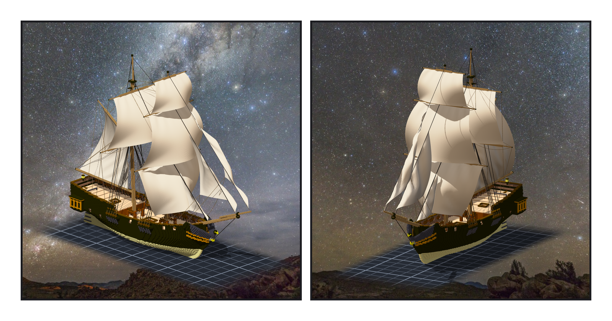
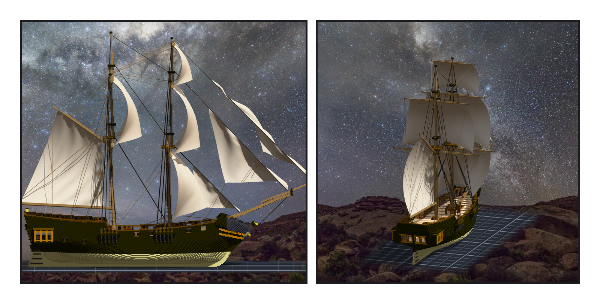
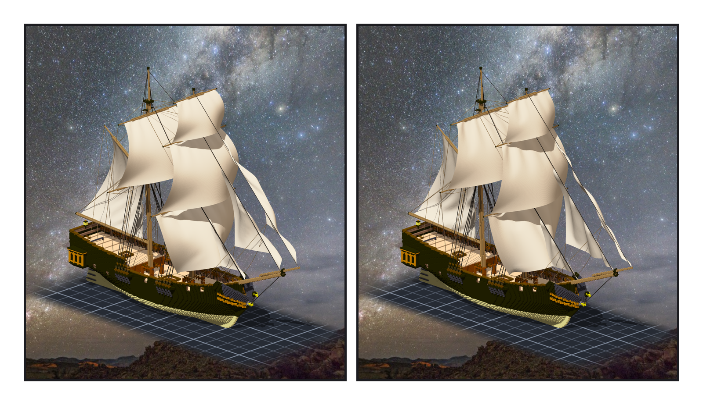

# 第 013 話〈飛起來的那一角〉

## P1 — 八面

**P1-①**〔組裝件，yaw 45〕**P1-②**〔從船頭斜看，yaw −30〕
　字幕：「前桅三面橫帆，主桅頂上一面，後面一面掛在 gaff 上的主帆；船頭三面三角帆。八面。」
　字幕：「帆不是格子。是布：上緣釘在帆桁上，下面兩角用繩拉著，風一吹，四秒之後它停在哪裡，就是它的樣子。」
　字幕：「掛之前我先發現一件事：主桅那面橫帆的下兩角，沒有地方去。三話以前我只給主桅一根頂上的桁，就停了。所以補一根下桁 —— 不掛帆，只用來張住上面那面帆的腳。」

---

## P2 — 同一個平面

**P2-①**〔正側面，yaw 90〕**P2-②**〔船尾往前看，yaw 160〕
　字幕：「三面三角帆都在中線那一個平面裡。第一版最外面那面照裡面那面的比例畫，它的下角就落進了裡面那面的布裡 —— 兩塊布會互相穿過。」
　字幕：「所以加一條規矩：每一面的下緣，要在裡面那一根 stay 之上五格以上。量出來，十三點六、十五點五。」
　字幕：「主帆的上緣我先綁在 gaff 的頂面。風吹過之後，布從 gaff 的身體裡穿出來十二個點。改綁底面。」

---

## P3 — 飛起來的那一角

**P3-①**〔4.7 m/s，yaw 45〕**P3-②**〔2.4 m/s，yaw 45〕
　字幕：「第一次讀數：前桅 topsail 鼓了六十格 —— 一樣大的主桅 topsail 只有三十格。」
　字幕：「下 CLI 的那一趟，失敗那一行我沒篩掉，它就在畫面上：右舷那條帆腳索，寫進去的時候撞到檔案錯誤，沒寫進去。那一角沒有東西拉著，在風裡飛。補上那一條，三十點八。」
　字幕：「帆鼓得比真船深：寬的三成多，真的方帆大約一到兩成。旋鈕是風 —— 右邊是風小一半的樣子。選哪一個，留給 Tim。」

▸註：讀數在 `verify_sails.json`（8 面帆、20 條帆腳索、三角帆的疊放餘裕）、`verify_sails_post.json`（讀引擎匯出的 OBJ：模擬後布碰實心 0；方帆離桅 2.45–3.61 格）。⚠ 模擬前的平布會穿過桅 —— 是風把它推開的，不是我。
本話的錯：① 主桅只做頂上一根桁（掛帆才發現 topsail 的腳沒處去）；② flying jib 落進 jib 的布；③ 主帆綁在 gaff 頂面；④ course 的帆腳索與下桁的 brace 從舷外直落 pin、擦過頂蓋。
