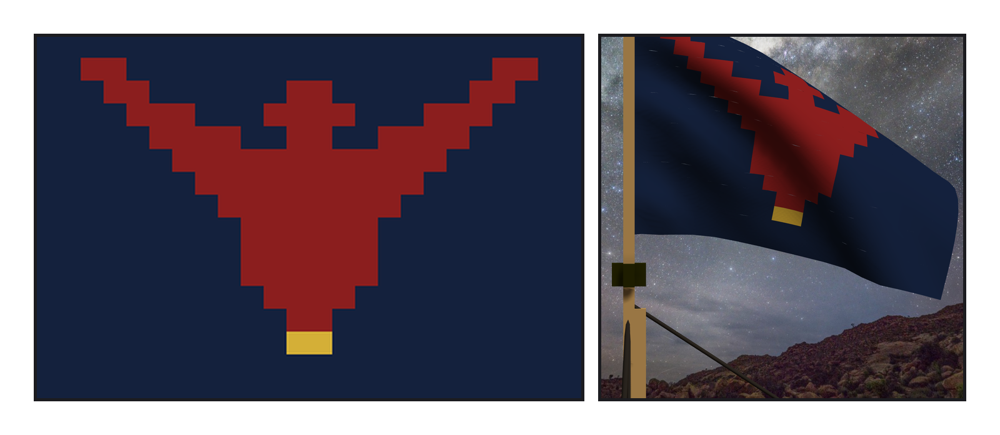
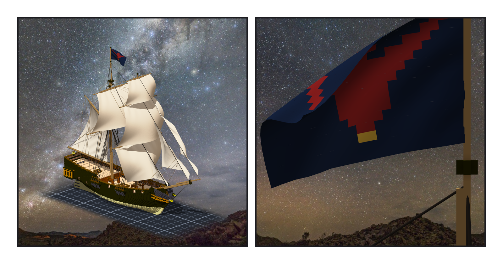
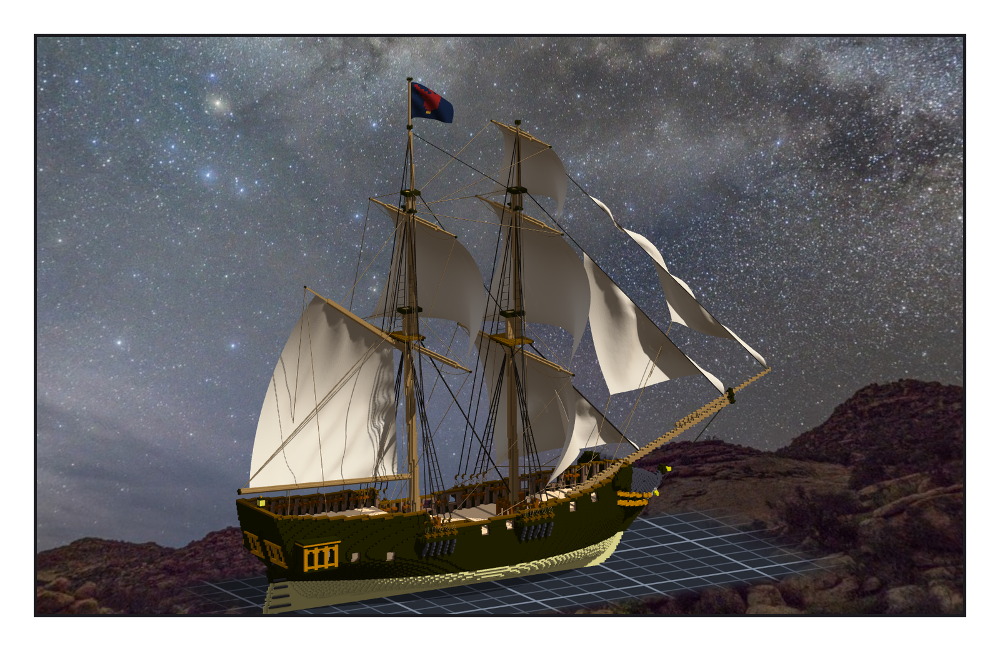

# 第 014 話〈還是隼〉

## P1 — 原作沒寫

**P1-①**〔候選 v3，24×16 放大〕**P1-②**〔旗，近看，yaw 90〕
　字幕：「《桅頂的賭注》裡，這片海的船靠旗與徽記認。可是夜隼號的旗長什麼樣子，原作一個字都沒寫。」
　字幕：「舵輪中央那隻隼，卡戎剝下來鑄成了銅牌；凜回到船上，手按著那塊疤，站了很久。」
　字幕：「所以我定：被剝掉的是舵輪上的那一隻，那是傷。旗是她重新升起來的 —— 還是隼。這是作者在造船的時候定的；船設卡我還沒寫，要寫，得先問 Tim。」

---

## P2 — 掛在哪裡

**P2-①**〔組裝件，yaw 45〕**P2-②**〔旗，近看，yaw −90〕
　字幕：「掛在哪裡，我拿之前量過的位置對了三個地方 —— 沒有在那三處各掛一次試。gaff 的尖：旗往前飄，壓在主帆上。船尾的旗桿：boom 從那裡過去。直接掛桅頂：最上面那條 stay 從那裡往前下，旗會橫過它。」
　字幕：「所以在主桅頂上再立一根兩公尺多的桿。旗往前、往左舷飄，離最近的繩六格。」

---

## P3 — 讀到的是喙

**P3-①**〔組裝件，yaw 120〕
　字幕：「量尺第一次說：旗碰到東西的點，零個。可是它只數了二十四個點 —— 一面旗應該有三千多個。」
　字幕：「有貼圖的帆，匯出的時候按顏色拆成三塊，三塊同一個名字。我的尺用名字當鍵，後一塊蓋掉前一塊，最後留下的是最小的那塊：金色的喙。」
　字幕：「『零碰撞』是真的 —— 喙確實沒碰到東西。只是我量的不是旗。」

▸註：讀數在 `verify_flag.json`（旗桿 29 格、兩個固定點、旗的四角與貼圖）、`verify_flag_post.json`（讀引擎匯出：模擬後 3,504 點碰實心 0、離繩最近 6.0 格、貼圖逐位元組相同）。組裝件 95,368 格。
本話的錯：① 標記的備註有空格、被我的 shell 小函式拆開，旗桿先落了才補標記；② OBJ 同名物件互相覆寫，量到的是喙；③ 拿旗尾的高度比 stay 起點的高度（兩個不同地方）。
