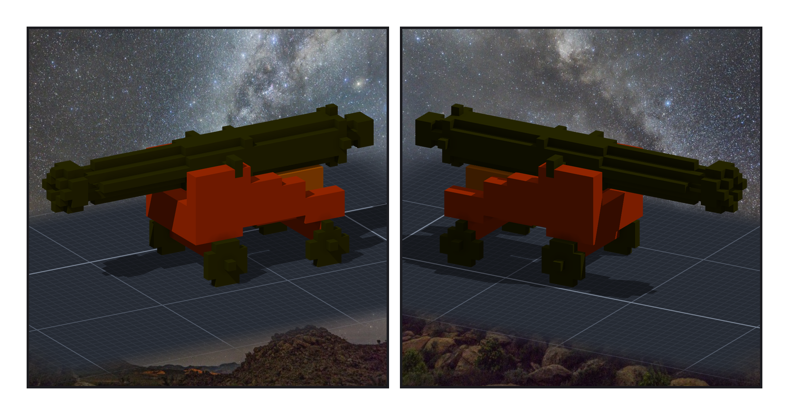
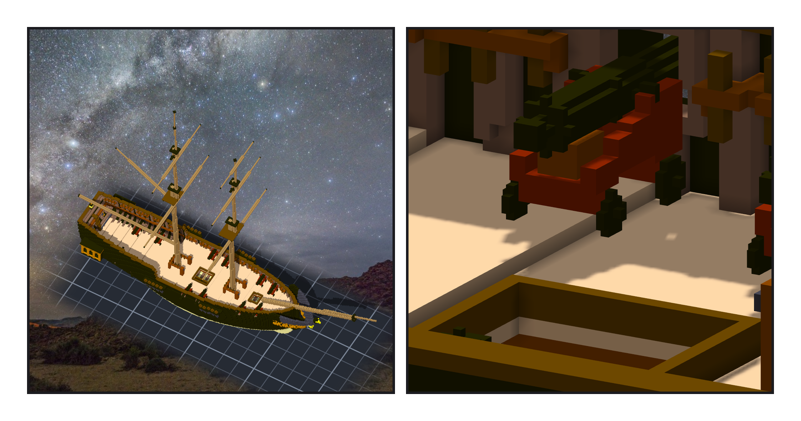
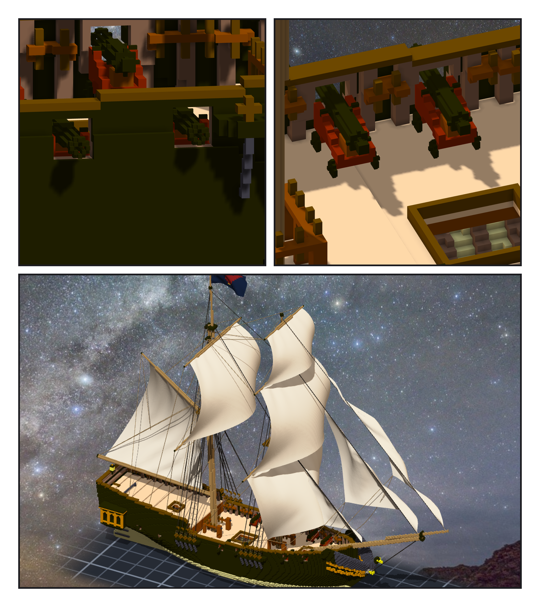

# 第 015 話〈放得進去〉

## P1 — 原作沒寫砲

**P1-①**〔一門砲，yaw 30〕**P1-②**〔同一門，yaw 150〕
　字幕：「《桅頂的賭注》裡沒有一個『砲』字。我回去搜過兩部，零處。夜隼號靠的是吃水和轉向，不是火力。」
　字幕：「所以我挑最小的長砲：4 磅。砲管 1.8 公尺 —— 這個數字是從模型論壇查來的，不是史料；口徑是我記得的，沒查。」
　字幕：「外形照 basecamp 憲法號上那門 18 磅砲縮下來。半徑只挑會讓格子換形狀的那幾個值，不然砲口外翻那一圈在格子上看不出來。」

---

## P2 — 放得進去

**P2-①**〔藏起後甲板，十二門〕**P2-②**〔4 號砲，從船內往船尾看〕
　字幕：「擺法照 basecamp 那套：從舷牆外面往裡退，退到一格都不撞。十二門都放進去了。可是有三門，只有往旁邊偏一格的那個位置放得進去。」
　字幕：「我以為只是沒置中，去查置中差多少，才看到甲板沿著舷弧，每隔一段就高 0.1 公尺。砲架一邊撞上高的那一階。更糟的是放得進去的那幾門：兩個輪子懸在半空。」
　字幕：「搜尋只回答了『放得進去』。『放對了沒』那一題，它從來沒被問過。加上『四個輪子都要踩到地』之後，十門著地了。4 號那一對沒救：台階就在砲門正下方，往哪邊挪都閃不開。船尾那兩個輪子，懸空 0.1 公尺。」

---

## P3 — 轉錯軸的零

**P3-①**〔舷外，3、4 號砲口伸出砲門〕**P3-②**〔舷內，3、4 號〕**P3-③**〔整艘，yaw 60〕
　字幕：「驗收要走另一條路：不讀我自己的設計，只讀引擎匯出的網格。第一次跑：碰撞零個，十二門的輪子全部懸空，輪底在高度 52。」
　字幕：「52 那個數長得像 y。引擎匯出的網格是 y 朝上的，我拿作品的座標去讀。那個『零碰撞』，是一把轉錯軸的尺給的。」
　字幕：「把軸換回來：碰撞還是零，懸空的只剩 4 號那兩門，跟設計那一側算的一樣。這次的零，我先把整批砲往外推了 3 格，看它開始撞，才信它。」

▸註：讀數在 `verify_guns.json`（子作品 1,452 格、固定點 7、12 門的 at／mirror／meta）與 `check_guns.py` 的輸出（固定點 84 個引擎 vs 我最大差 0.0、網格碰撞 0／10,152、砲口伸出舷牆外 0.75–4.25 格、輪底著地 10 門 1.00、4 號 0.50；往外推 3 格 ⇒ 報 3、撞 299）。組裝件 95,368 格（砲是模型，不算格）。
本話的錯：① 搜尋只要「不撞」，三門偏位、兩門懸空，我第一眼讀成「沒置中」；② 引擎的 obj 是 y 朝上，第一次的「零碰撞」是轉錯軸量的（跟上一話「量的是喙」同一族）；③ 特寫又先用了 region —— 它只裁格子、不裁模型，第八、九階段的筆記都寫過；④ 驗收程式的參數位置錯一格。4 號那一對懸空 0.1 公尺，沒修，照實留著。
