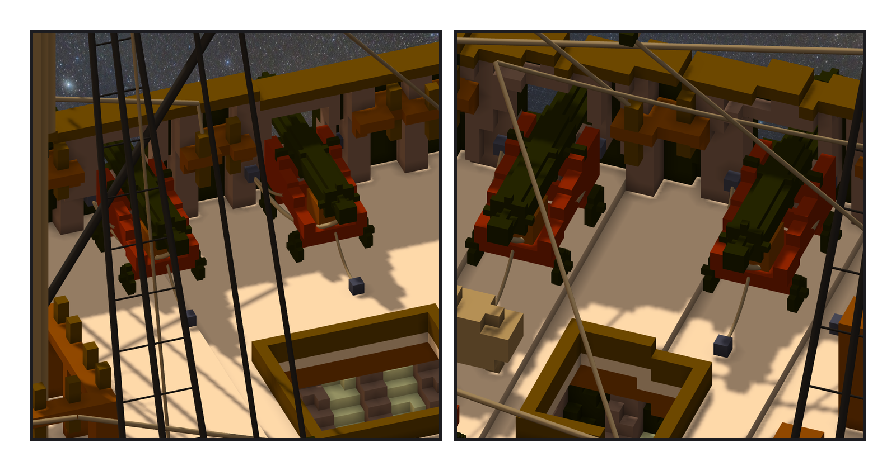
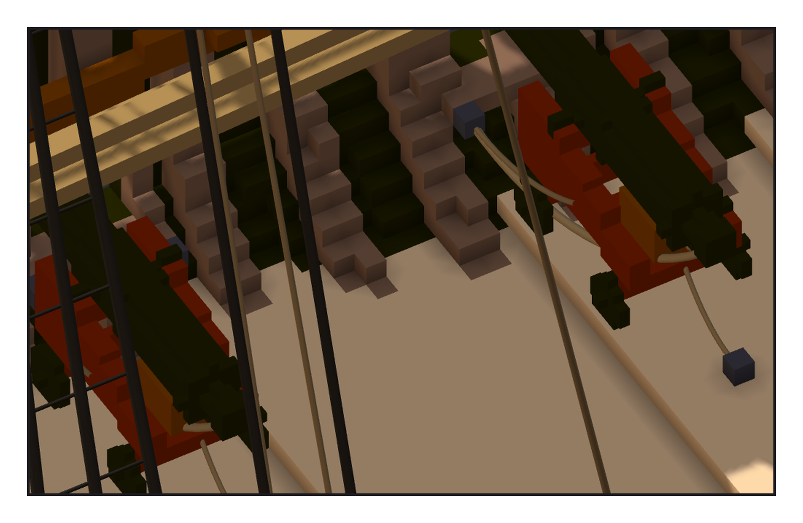

# 第 016 話〈五條繩〉

## P1 — 一門砲五條繩

**P1-①**〔3、4 號，從船內看〕**P1-②**〔5、6 號〕
　字幕：「砲開火會往後衝。拉住它的是 breeching：一條繩穿過砲尾的環，兩頭扣在砲門兩側的牆上。左右再各一組滑車，用來把砲推回去；砲架尾一組，用來轉方向。一門五條。」
　字幕：「滑車畫不出來，一組就用一條細繩代表。牆上的環是一格鐵，釘在砲門旁邊、開口下緣再低一格；甲板上的環在砲架尾往船裡半公尺。」
　字幕：「做法是 basecamp 在憲法號上做過的。她那艘是 24 磅砲，環離砲門中線八到十一格；我的砲小，環就貼著開口邊。」

---

## P2 — 寫完才量的那一句

**P2-①**〔艙房裡的 1、2 號，藏起後甲板〕
　字幕：「十二個船牆上的環，十個放在第一個候選的位置。只有 3 號兩邊都往外挪了一格。我在筆記裡寫：因為那一格被它自己的砲架佔著。」
　字幕：「寫完回頭看，那個原因我沒量過。量了：兩格都在 3 號自己的砲架裡 —— 句子是對的，可是它被寫下的時候，還沒有住址。」
　字幕：「驗收的尺也有一格要記：把繩整批往下推三格，它報出一千多個撞；往船頭推三格，它報零。不是尺壞了，是繩往那個方向挪，本來就還在空氣裡。要證明尺會叫，得挑一個一定會撞的方向。」

▸註：讀數在 `verify_gunfittings.json`（一舷 18 格、固定點 18、繩 60）與 `check_gunfittings.py` 的輸出（結果帳 95,404 缺 0 多 0 色差 0；兩端 引擎 vs 我最大差 0.05，是引擎讀數只印一位小數；繩管頂點落在實心或別門砲 0）。引擎 stats：1 元件、空腔 0、左右差 0、繩 341、broken 0。
本話的錯：① 3 號挪一格的原因先寫進筆記、後量（量了是對的）；② 反向對照挑了一個量不到的方向（往船頭），只有往下那一個方向證明了中段那把尺會叫。這一階段落格、繩、關聯都一次成功，沒有撞到 IOException。
