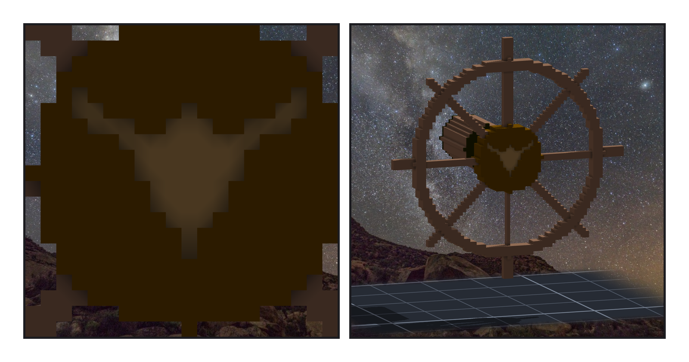
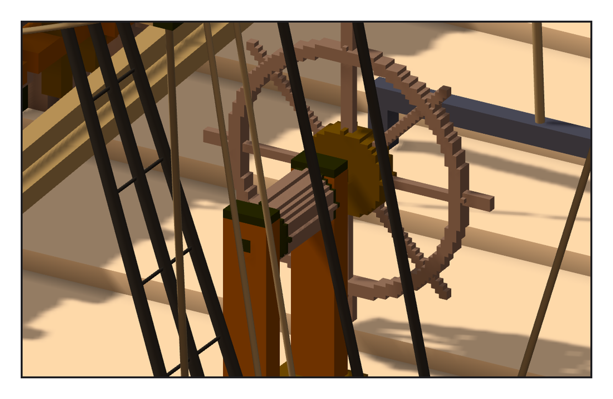
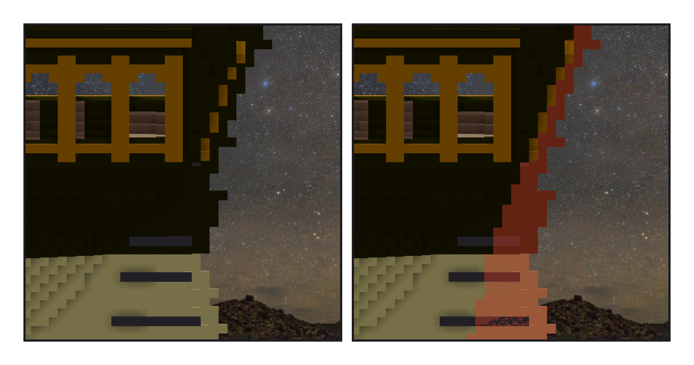

# 第 017 話〈疤〉

## P1 — 原文只寫了一塊疤

**P1-①**〔輪轂，正對船尾那一面〕**P1-②**〔舵輪，從船尾斜看〕
　字幕：「小說裡，舵輪只出現過兩次。一次是卡戎把正中央那隻俯衝的隼剝下來，鑄成對暗號的銅牌。一次是凜回到船上，手按著那塊淺淺的疤，站了很久。」
　字幕：「所以疤的形狀不用我想 —— 它就是那隻隼。我拿旗上的隼，縮小，在輪轂上刻淺淺一層。剝掉之後露出來的木頭，顏色比四周淺。」
　字幕：「旗是她重新升起來的那一隻，疤是被拿走的那一隻。同一隻。」

---

## P2 — 一個人掌舵的船

**P2-①**〔後甲板，舵輪與座〕
　字幕：「憲法號是雙舵輪。夜隼號三十一個人，單輪就夠：輪徑一公尺二，輪軸離甲板不到一公尺。尺寸是照憲法號的比例縮的，沒查到這種小船的史料。」
　字幕：「會轉的（輪、輪轂、鼓輪）跟不會轉的（座、支柱）分成兩件。遊戲要轉輪子，座不能跟著轉。」
　字幕：「量尺這次壞了兩把，兩把都是同一個病：網格的頂點，不代表網格。boom 整根只有一百二十個頂點，擠在兩頭；我拿頂點去量，量到舵輪離 boom 四十五格。拿外框一對，它就在頭頂四格。」

---

## P3 — 削下去會斷

**P3-①**〔船尾側面〕**P3-②**〔同一張，舵染紅：藏起舵再拍一張，兩張的差〕
　字幕：「舵改成會轉的模型。轉軸是舵柱的中心線，往後斜十六度。釘在艉柱上的那一半鐵帶，我搬回船殼 —— 那一半不該跟著轉。」
　字幕：「轉三十五度，舵前緣的角會擦進艉柱。真船會把前緣削斜。我先算了削掉哪幾格：一百多格，而且削完舵斷成三塊。舵柱是一根斜的方棒，每三層往後錯一格；削掉一欄，上下兩段就只剩一個角連著。」
　字幕：「斜面上的階梯，第五次。這次是在動手之前認出來的。所以我沒削，改量它擦進去多深：表面那一層，不到十公分。照實寫在單上，不寫『零碰撞』。」

▸註：讀數在 `verify_helm.json`（舵輪 8,267 格、座 9,036 格、疤 54 格；舵 gudgeon 32 格搬回船殼、轉 ±35° 的取樣）與 `check_helm.py` 的輸出（結果帳 94,827 缺 0 多 0 色差 0；固定點最大差 0.0；三件網格碰撞 0；舵輪離 boom 4.28 格；底座著地 1.0）。舵從側面看不出來（跟船殼同色），藏起來再拍一張，兩張差 110,874 px。
本話的錯：① 舵輪左右差 145 格：水平那兩根輪幅剛好壓在門檻上，浮點讓兩舷判得不一樣；② 想削舵前緣，量了會斷，沒削；③ 量尺兩把：底座著地拿邊界上的頂點（報 0.5）、boom 距離拿頂點對頂點（報 45.6）；④ 筆記第一版抄了修尺之前的反向對照數字，重跑才更正。
