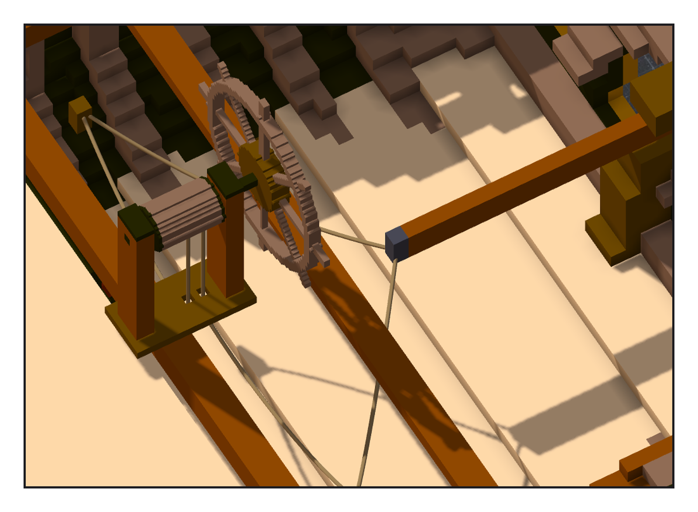
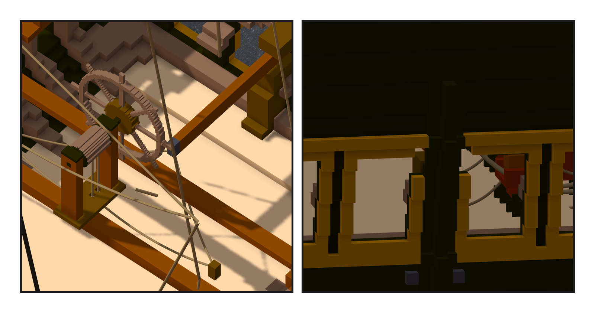

# 第 018 話〈滑車要在外面〉

## P1 — 輪子怎麼轉動舵

**P1-①**〔切掉後甲板，只畫舵索〕
　字幕：「舵輪本身不碰舵。鼓輪上繞著一條繩，兩頭往下穿過甲板，各自走到一舷的滑車，再拉回來綁在舵柄頭上。輪子往一邊轉，就把舵柄往那邊拉。」
　字幕：「舵柄在後甲板底下的艙房裡，兩公尺多長，從舵頭伸進來。舵頭在船尾外面，所以艉板那根柱子上要開一道口子，讓舵柄左右擺得過去 —— 口子的形狀，就是舵柄轉正負三十五度掃過的那些格。」

---

## P2 — 滑車要在外面

**P2-①**〔艙房，切掉甲板〕**P2-②**〔船尾外面，舵柄口在柱子上〕
　字幕：「第一對滑車，我放在離中線六格的地方，落了格。然後去量舵柄轉到底時，舵柄頭擺到哪裡：離中線十二格多。」
　字幕：「舵柄頭比滑車還外面。那樣一拉，繩是反著把它往回扯。滑車要在舵柄頭到不了的地方，繩才拉得動。刻掉，往外移到十六格。」
　字幕：「驗收的尺今晚第三次撞到同一件事：直的繩只有兩頭有頂點，中段一個都沒有。用頂點量，它穿過甲板也說沒事。上一個階段的筆記才剛寫下這句，手還是先去拿頂點。」

▸註：讀數在 `verify_steering.json`（舵柄 44 格、舵柄口 船殼 53＋船尾裝飾 6、導索塊與滑車、繩孔、舵索 6 段）與 `check_steering.py`（結果帳 94,772 缺 0 多 0 色差 0；固定點最大差 0.0；舵＋舵柄網格碰撞 0；舵索中段落在實心或舵輪座 0；往船頭挪 1 格 ⇒ 撞 2,444）。舵柄轉 ±35° 落在實心 0。
本話的錯：① 滑車 v1 在舵柄頭擺得到的地方（已落格，刻掉重放）；② 舵柄口刻完柱子兩側各剩一格斷開（落格前模擬抓到）；③ 模擬把插板槽當成空腔（我的尺只認 (0,0,0) 那團空氣是外面）；④ 繩的中段用頂點量（今晚第三次）。
