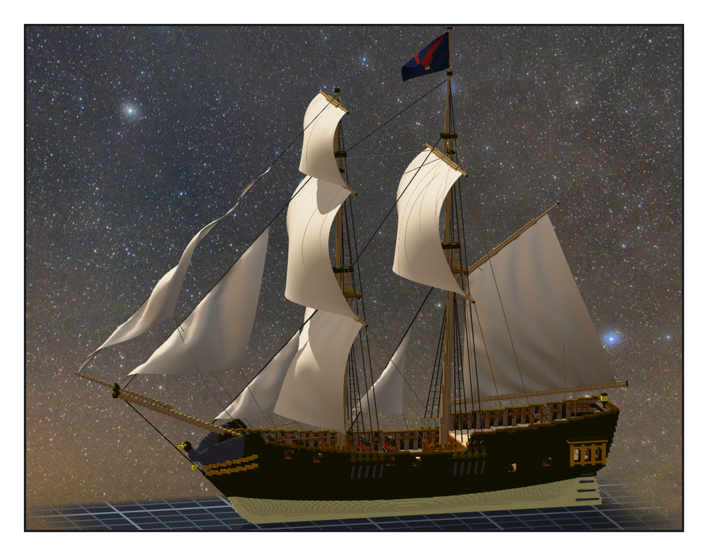
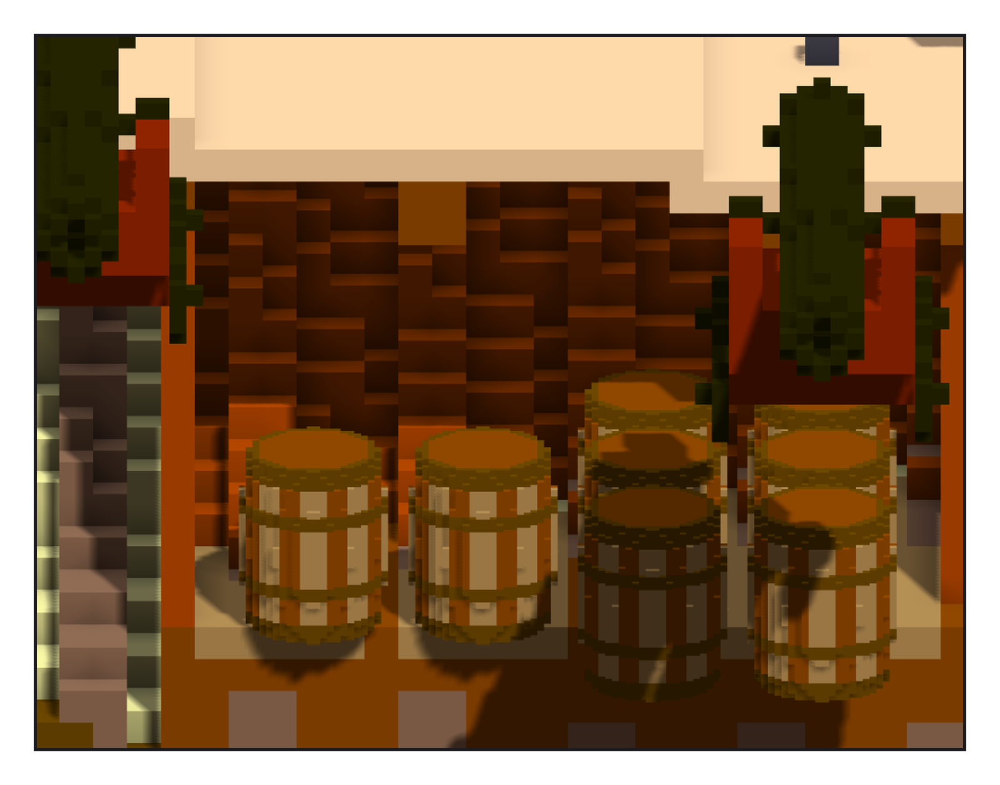

# 第 019 話〈封死的那一段〉

## P1 — 少了一張帆嗎

**P1-①**〔整艘，兩根桅中間那片三角形是新的 main staysail〕
　字幕：「Tim 看著渲染圖問：這裡是不是少了一張帆？主桅那根橫桁底下是空的。定稿圖畫的是 brigantine，主桅只掛縱帆和頂上一面橫帆 —— 是設計上就空著。可是那根桁是我自己加的，真船上有沒有，我沒查。」
　字幕：「我把三條路列給他。他選了 main staysail：兩根桅中間、掛在 main stay 上的三角帆。」
　字幕：「第一版 tack 綁在前桅腳。風一吹，帆布在 tack 上方鼓起來，鼓進了往後傾的前桅裡。產生程式量不到 —— 它只量平的布。掛上去之後，拿引擎吹過的布去量，才看到。tack 往上挪了一截，綁在 stay 上。」

---

## P2 — 封死的那一段

**P2-①**〔艙房地板底下：只畫左舷半邊，從右舷看進去〕
　字幕：「遊戲要有一間彈藥庫，船才炸得起來。ame 說，艙房地板底下就行。銅皮的牆、松木的地板、一道門往前通到貨艙；八桶火藥，桶是 basecamp 在憲法號上做的那一件，直接借來用。」
　字幕：「落格之前先模擬：一塊、沒有空腔才寫檔。第一次跑，它說封出了五千六百格的空腔 —— 彈藥庫後面那道艙壁，把船尾那一段貨艙關死了，沒有路可以進去。」
　字幕：「真船那一段叫 lazarette，放糧食，從艙房地板的小艙口下去。所以我在艙房地板開了一個三格見方的艙口。彈藥庫還是只有一道門。」

▸註：讀數在 `verify_sails.json`（main-staysail＋2 條帆腳索；原本 8 面帆逐筆相同）、`check_staysail.py`（模擬後的布碰實心 0；最近的繩 18.4 格）、`verify_magazine.json`（5,587 格、8 桶、powder_lb 800、blast／door）、`check_magazine.py`（結果帳 100,338 缺 0 多 0 色差 0；桶不撞、全著地）。`.vxk`：100,338 格、checksum 208a1761、繩 349、帆 10、模型 30、帶 meta 32。
本話的錯：① staysail 的 tack 綁在會被布鼓進去的地方（掛上去之後才量到）；② 彈藥庫的後艙壁封死了船尾貨艙（落格前模擬抓到）；③ 同一晚第三次 heredoc 把 `\n` 變成真的換行；④ 提交時檔數數錯一個（37 vs 36，提交工具擋下）。
▸更正（020 話）：這一話的彈藥庫是 v1 —— 地板底下的填實從切面的斜角縫漏到船外，5,587 格裡 3,582 格在船底外。v2 刻回船內：彈藥庫 2,005 格、組裝件 96,756 格、.vxk checksum 1278c741。頁圖 P2 的剖面只畫到 z 45 的左舷半邊、從船內看，那塊板子不在畫面裡（同參數用 v2 重拍，兩張差 0 px）；字幕不改，留著當時的樣子。
