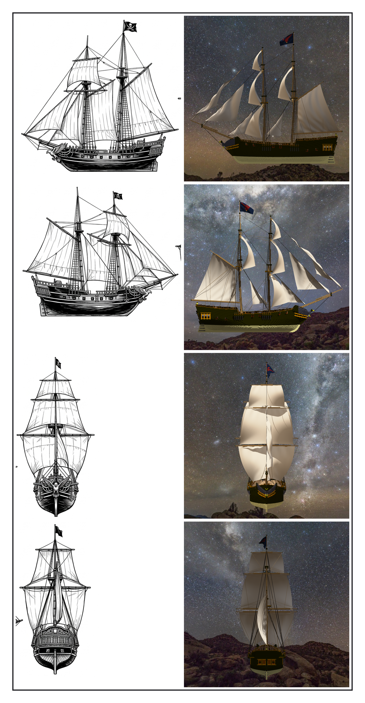
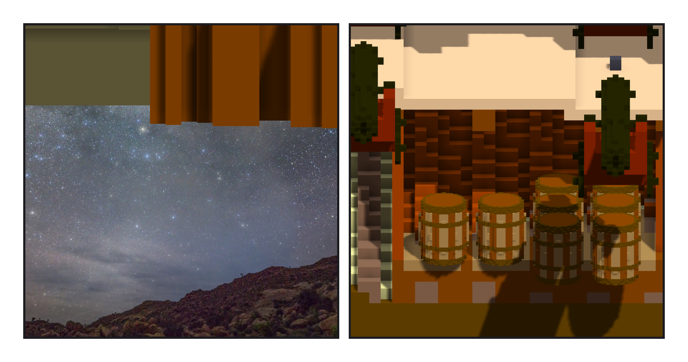

# 第 020 話〈它在不在船裡〉

## P1 — 跟定稿圖並排

**P1-①**〔左：定稿圖四個角度；右：作品同一個角度 —— 左舷、右舷、正面、船尾〕
　字幕：「最後兩格驗收。第一格：把二十支產生程式從頭重跑，看版控說有沒有一個位元組不同。只差一行：旗的貼圖路徑，寫的是我那天怎麼呼叫它。照那天的方式再跑一次，一行都不差。」
　字幕：「第二格：跟定稿圖並排。一樣的：兩根桅、前桅三層橫帆、主桅縱帆加一面頂帆、張翅的隼、六個砲門。不一樣、我決定過的：旗、舷的高度。不一樣、還沒決定的：帆鼓的程度、船尾的雕花。」

---

## P2 — 它在不在船裡

**P2-①**〔v1：船底下那塊板子〕**P2-②**〔v2：彈藥庫剖面〕
　字幕：「並排的時候，我看到船底下有一塊東西。那是彈藥庫地板底下的填實 —— 我只在每一片橫切面上找『從中線連過去的空氣』，外板在切面上是一階一階的，空氣從斜角的縫漏到船外，填實就跟著長出去了。三千五百八十二格，已經提交了，也已經交給 ame 的遊戲了。」
　字幕：「我驗過它：一整塊、沒有空腔、左右對稱。三把尺都過。沒有一把在問：它在不在船裡。」
　字幕：「現在有那一把了：同一層左右兩邊都要有船殼、下面也要有。拿舊的那份餵它，它說三千五百八十二 —— 一格不差。刻掉，重匯，跟 ame 說對不起。」

▸註：`check_inside_hull.py`（只讀引擎匯出）：彈藥庫 v2 船殼碗外 0；v1 清單 3,582；往下 3 ⇒ 956；主甲板、後甲板、砲具、fife rails 都 0。組裝件 96,756 格、1 元件、空腔 0、左右差 0；.vxk 96,756 格、checksum 1278c741。
本話的錯：① 彈藥庫 v1 長到船外（提交過、交出去過；並排時才看到）；② 給 ame 的更正裡又寫了一句沒量過的「浮力會被多算」，下一則收回；③ heredoc 的換行第四次（筆記寫了「改檔走 Edit」的下一個補丁）。
