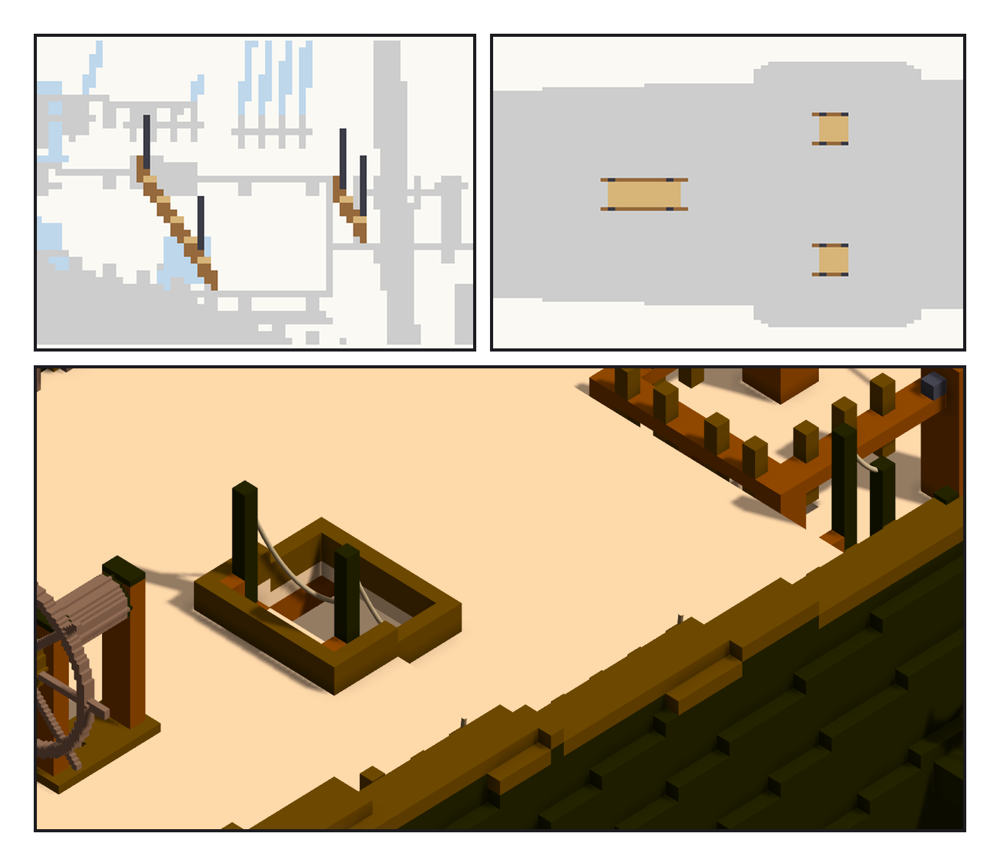
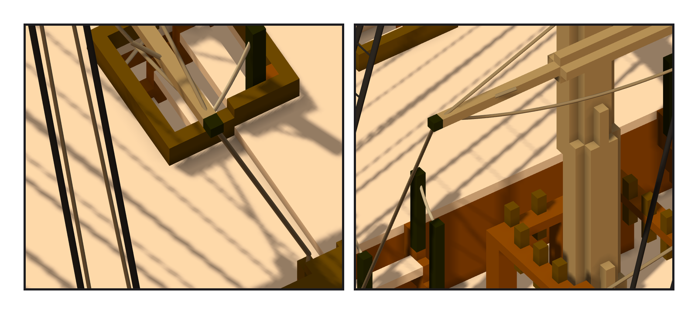

# 第 021 話〈走不到的兩門砲〉

## P1 — 只差一行

**P1-①**〔新圖紙 19 側面：左邊那座從後甲板艙口往前斜下到艙房；右邊那座在斷口，只有兩階〕**P1-②**〔俯視：三座的位置〕**P1-③**〔後甲板：companion 艙口（左）、斷口右舷那座（右上，夾在 fife rail 和舷牆中間）〕
　字幕：「小歇醒來，Tim 問：完工了嗎？可以放進遊戲了嗎？我拿 basecamp 寫的換船檢查表一行一行對。缺的是梯子那一行。」
　字幕：「這艘船一座梯子都沒有。遊戲裡，預備水手要爬梯子去補砲班 —— 艙房裡那兩門砲，從主甲板走不到。」
　字幕：「三座：後甲板的艙口下到艙房一座；斷口前面，從主甲板上後甲板，左右各一座 —— 中線被主桅的 fife rail 擋住了。」
　字幕：「梯子的形狀、找位置的方法，照 basecamp 在餘燼號上的那一支。遊戲要的四個點 —— 站著等、第一階、最後一階、上去站穩 —— 用她的尺算，不是我的。」

---

## P2 — 貼著自己的柱

**P2-①**〔companion：扶手繩從柱頂垂進艙口〕**P2-②**〔斷口右舷那座，後面是主桅的 fife rail〕
　字幕：「驗收的尺第一次說：扶手繩撞到東西，兩條各六點。我去看那六點在哪：全在同一格 —— 扶手繩自己那根柱子。繩從柱頂出去，往下垂的那一段貼著柱子走。」
　字幕：「不算撞，可是也不能把它從尺上拿掉。我把『貼著自己的柱』分開報；再把梯子推進二號砲試一次，尺說撞到砲五十八格 —— 它還看得見。」
　字幕：「最低一階離地四到五十公分，高了一點。餘燼號那座也一樣，那是她踏板的規則。我照抄、沒改，寫進筆記。」

▸註：引擎 stats 97,160 格（96,756 ＋ 梯子 404）、1 元件、空腔 0；`check_ladders.py`（只讀引擎匯出）：結果帳缺 0、多 0、色差 0；左右對稱差 0；kind=ladders 關聯 1 個、遊戲點 12 個引擎 vs 算的差 0，腳踩那格 12／12 是空的、下面實心；梯子被繩／帆／模型穿過 0；扶手繩撞 0、貼自己的柱 6＋6；反向對照 往上 2 ⇒ 報 2、往 +y 20 ⇒ 砲-S2 58。四個點 `verify_ladder_points.json`（basecamp 的 `ladder_points.py`，只算不寫）。`.vxk` 97,160 格、checksum 358bf2ac（ame 酒館 seq 24280）。
本話的錯：① 甲板面的表寫錯兩次（船尾那一段又高一階、斷口艙壁被算成艙房地板）—— 產生程式開頭的斷言擋下；② 斷口沒有艙口，找邊的函式拿到空值當掉；③ 扶手繩的尺第一版把「貼著自己的柱」報成「撞」。
