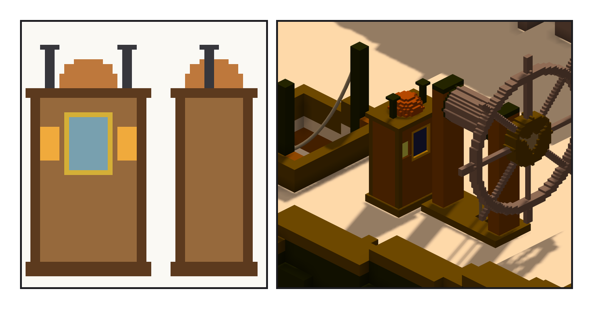

# 第 022 話〈沒寫的那一具〉

## P1 — 羅經櫃

**P1-①**〔新圖紙 20：朝船尾那一面（舵手看的那面）、側面〕**P1-②**〔舵輪正前方；左邊是 companion 艙口〕
　字幕：「檢查表上還有幾種東西，這艘船沒有。Tim 說，先做羅經櫃：羅盤要有櫃子擋風，晚上要有一盞燈。」
　字幕：「原作寫過夜隼號的羅盤：父親傳下來的那一具，嘩變那夜指針被踩斷，帶尖的那半截在主角袖袋裡。可是櫃子長什麼樣、船上現在用的是哪一具，原作一個字都沒寫。」
　字幕：「舵輪上有疤，是因為原文寫了疤。羅經櫃沒寫，我就什麼記號都不加。」
　字幕：「朝船尾一扇羅經窗，兩側兩扇燈窗，頂上一個銅罩、兩根煙囪。擺在舵輪正前方：再往後會撞到東西，再往前會擋住 companion 梯子上來站的那幾格。」
　字幕：「著地的尺，第一版只拿底面三角形的重心 —— 引擎把整個底面合成兩個三角形，兩個點就代表了整個底面。網格的點不代表網格，這一晚第四次。」

▸註：子作品 15,892 格（0.02 m）、1 元件、空腔 0、左右差 0；模型 `甲板-後/羅經櫃` at (102.5, 80.5, 41)、scale 0.2、meta `{kind: binnacle}`。`check_binnacle.py`：組裝件仍 97,160 缺 0 多 0；碰撞三角形 0／534；著地（底面 210 點）1.000；最近的模型 舵輪座 1.75 格；梯子落腳那 9 格沒被蓋到；反向對照 往後 2 ⇒ 碰撞 4、往前 9（艙口上）⇒ 著地 0.067。`.vxk` 格數與 checksum 不變（checksum 只算格子），檔案變了（模型 31）—— 已跟 ame 說（seq 24284）。
本話的錯：① 第一版左右差 62 格：銅罩的中心偏了半格；② 著地的尺只拿兩個重心；③ 高度先寫進筆記才去量：0.94 → 0.92 → 量了是 0.90；④ 筆記裡寫「往後會撞到舵輪座」，那個候選撞的是哪一件沒分開量過 —— 改成照實寫。
