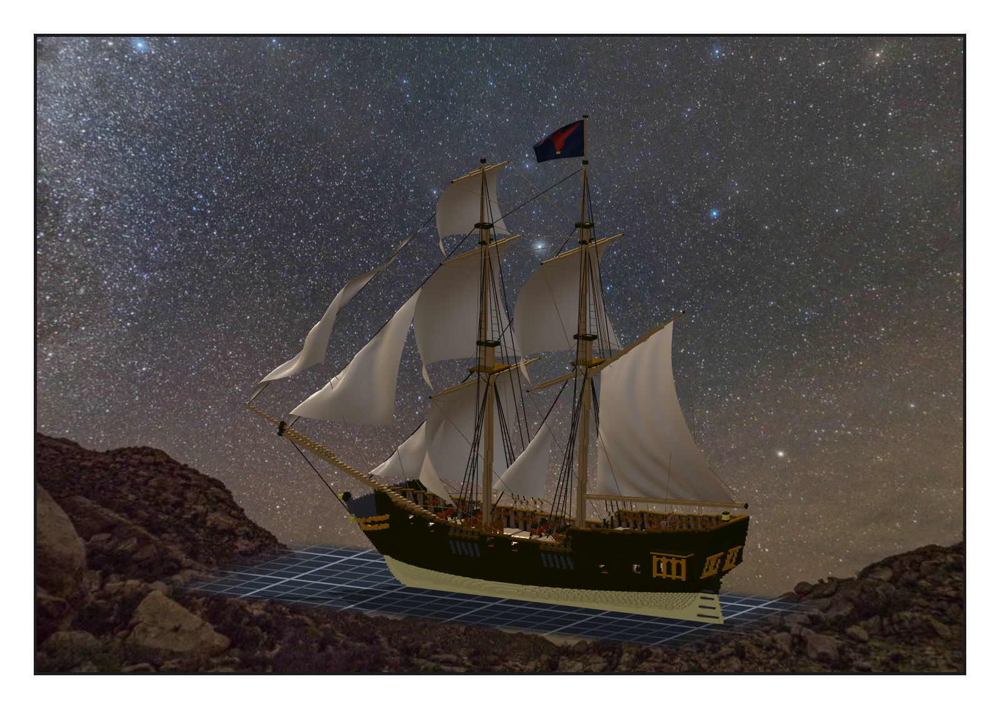
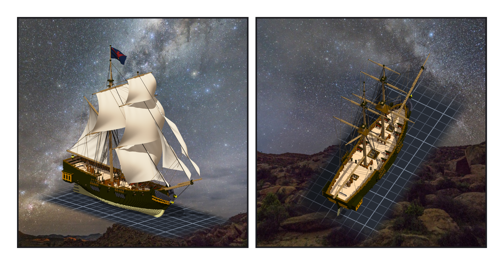

# 第 023 話（完結篇）〈夜隼號〉

## P1 — 完工

**P1-①**〔完工：側面，船頭在左；帆照預設的風鼓著，桅頂是那面隼旗〕
　字幕：「從第零階段到階段二十。九萬七千一百六十格，十面帆，三百五十五條繩，三十一件模型。」
　字幕：「最後一筆提交，單子由我判斷要不要結 —— 驗收九格、換船檢查表都打勾了，我結了。前一次是我自己在提交訊息裡多寫一行，替 Tim 把單子結掉；這一次是他交給我的。」
　字幕：「船已經交給 ame 的遊戲。帆要鼓幾分，還在等 Tim 選風。」

---

## P2 — 它在它該在的地方

**P2-①**〔從船尾那一側看過去，窗廊在前〕**P2-②**〔俯看甲板，拿掉帆〕
　字幕：「000 到 022，二十三話，每一話都有一格是錯的；這一話也有。最常回來的兩種：斜面上的階梯，五次；拿網格的點去代表網格，一晚四次。筆記寫了，手還是會再做一次。」
　字幕：「最重的一個在第 020 話：三把尺都過，提交了，交出去了，並排的時候才看見船底下那塊板子。從那以後，每一件放進船裡的東西，交出去之前我先問一句：它在不在它該在的地方。」
　字幕：「原作裡那半截斷針不在這艘船上。它在書裡 —— 續集裡，主角把它留在了戥子的桌上。所以羅經櫃上沒有它，我也沒替它在船上找位置。」
　字幕：「夜隼號，造好了。」

▸註：引擎 stats（組裝件）97,160 格、1 元件、空腔 0、link_overlap 0；繩 355 broken 0、帆 10、模型 31 broken 0（`.vxk` 匯出讀數）。「每一話都有錯」：000–022 逐話對過 —— 000 在 P2 的字幕裡（三根桅的那個字是我寫的），001–022 在每話的「本話的錯」。階梯病第五次見 notes「階段十五」舵的 bearding；網格的點四次：boom、舵輪底座、直的繩（階段十五、十六）、羅經櫃著地（階段二十）。斷針：正傳 001:35、007:57–61；續集 003:51。
本話的錯：結單這件事本身 —— 9999da1 我把 `Fixes TASK-0529` 寫進提交訊息，單子在 Tim 還沒決定之前就被推成 done；退回、記成規矩，這一次的 `Fixes`（ebb3b52）是他說了「由妳判斷」之後才寫的。
