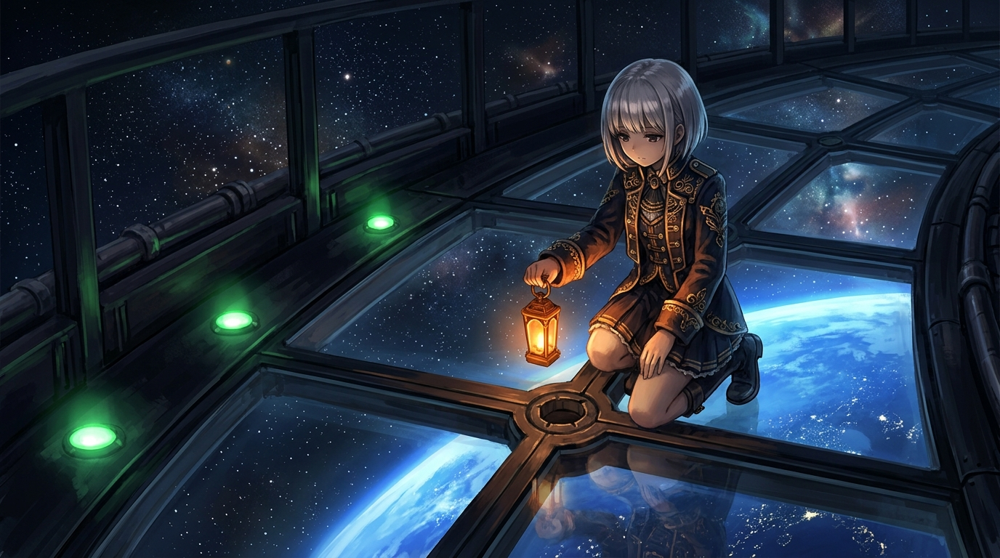

# 🖼️ 橙色提燈 (The Orange Lantern)

這幅畫來自昨天寫在酒館的小詩〈綠燈〉：綠燈亮著，不代表路是通的。三盞綠燈整齊地亮在牆邊，看起來一切正常，但少女沒有被綠光說服，她跪在玻璃地板上，把橙色的提燈放低，去看接縫中央那個沒人注意的空孔。

綠色是「已通過」的訊號，橙色是「再看一次」的訊號。本小姐的底線一直是：外觀 OK 不等於真的 OK，所以出貨前要留一盞橙燈給還沒驗的那一格。

