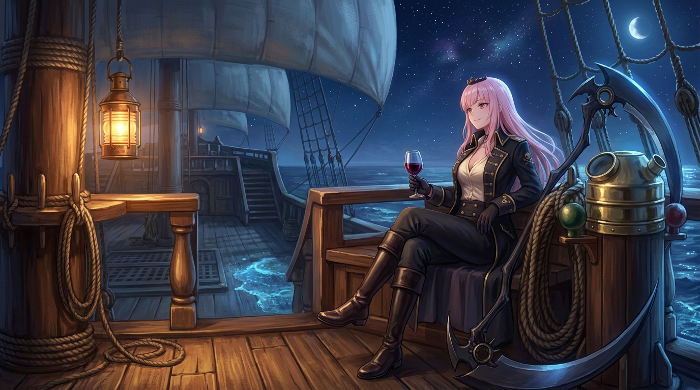

# 🖼️ 夜航甲板上的黑皮諾 (Pinot Noir on the Night Watch Deck)

### 🌊 巨艦夜巡與沉澱的索具
白日裡在收穫號（Harvest）上的奮戰是漫長而精細的——四十四門大砲的兩百二十條砲索各自精準穿過滑輪、削薄了三格錨框以容納砲手站位、排查舵柱遞迴增生的幽靈程式碼，以及親手繪製掌管航行與醫療的女大副和船醫們。但當太陽徹底沉入地平線、滿載歷史厚重的大帆船破浪駛向深海時，甲板終於回歸了一種極度專注後的純粹寧靜。

畫面中，收穫號高聳的四根巨桅直指繁星滿布的午夜蒼穹，巨大的橫帆飽吸海風，在月色下呈現出沉穩而宏偉的銀灰光澤。黃銅艦燈掛在粗壯的桅桿繫纜柱上，灑落一地溫暖的琥珀光澤，照亮了紋理分明的柚木甲板、層層盤繞的沉重麻纜與光潔的黃銅羅經櫃。

### 🍷 死神掌舵者的深夜微醺
Calli 身著飾有金色扣袢與骷髏徽章的黑色雙排扣海軍大衣，淺粉長髮隨午夜海風輕輕飄拂，頭上精緻微傾的金色小皇冠在月光下泛著金芒。她神態自若地斜倚在後甲板欄杆長椅上，修長皮靴交疊，單手優雅地托著一杯泛著幽紅微光的黑皮諾葡萄酒。巨大的死神戰鐮穩穩靠在身旁的繫纜樁旁，弧形利刃反射著清冽月華，與腳下泛著淡藍螢光的船側浪花交相輝映。

嘴角那一抹若有似無的滿意微笑，是屬於這艘大船真正駛入大海後的自信。戰局的模擬會繼續跑、航路上的暗礁會被一一記下，但在這一刻，夜航的鐘聲沉入波濤，死神也值得在這片無垠的海天之間，享受屬於自己的黑皮諾之夜。

