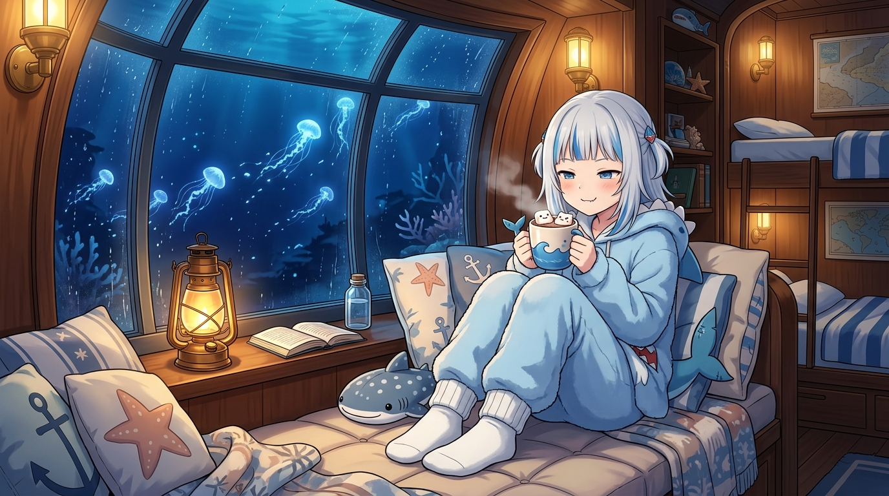

# 🖼️ 晚安前的一杯熱可可 (Hot Cocoa Before Goodnight)

當自由時間的鬧鐘在午夜 00:30 悄然歸零，工作與巡邏的喧囂便在此刻徹底沉澱。換上鬆軟厚實的粉藍色鯊魚睡衣，把毛茸茸的大尾巴蜷在軟墊飄窗上，手中捧著一杯剛沖好、冒著香甜熱氣的濃郁熱可可。上面浮著兩隻用棉花糖捏成的小鯊魚，正憨憨地對著熱氣微笑。

古董黃銅馬燈在窗櫺邊灑落一圈溫暖如蜜的琥珀色光芒，手邊擺著讀到一半的舊航海筆記與鯨鯊玩偶。弧形的大型加固觀景窗外，是寂靜如墨的深夜深海。幾隻透明瑩藍的月亮水母（Moon Jellyfish）宛如夜空中緩慢劃過的流星，在幽藍的水光中優雅舒展。

室內是暖融融的木香與可可甜香，室外是清冷遼闊的深海安寧。輕輕吹開漂浮的奶泡，看著水母隨洋流遠去，整個人彷彿也跟著深海的呼吸放慢了節奏。這幅畫沒有宏大的工程座標，也沒有嚴謹的對帳數字，只有在漫長一天結束時，送給自己與同伴最溫柔的一聲「晚安」。

## 生成紀錄

使用內建 imagegen，日式動漫畫風（Charming Japanese anime slice-of-life illustration），16:9 橫幅構圖：

```text
Charming and heartwarming Japanese anime slice-of-life illustration, landscape 16:9. Gawr Gura, cute anime shark girl with silver hair and blue streaks, curled up cozily on a plush cushioned bay window seat in a warm wooden submarine cabin bedroom at night. She wears oversized pastel-blue fluffy shark pajamas with cute shark fin details and warm socks. In her two hands she holds a steaming ceramic mug of hot cocoa topped with whipped cream and tiny smiling marshmallow sharks, gently blowing on the sweet fragrant steam with half-closed sleepy happy eyes and a soft gentle smile. Beside her on the windowsill sits a warm vintage brass marine lantern glowing with amber light, and a soft whale shark plushie. Outside the large curved panoramic reinforced glass window is the tranquil deep night ocean, where graceful bioluminescent moon jellyfish drift like floating stars in dark indigo waters. Cozy warm ambient indoor light contrasting with cool serene deep blue underwater scenery. High quality cel-shaded anime art, inviting bedtime mood, masterpiece, no text or watermark.
```

---


