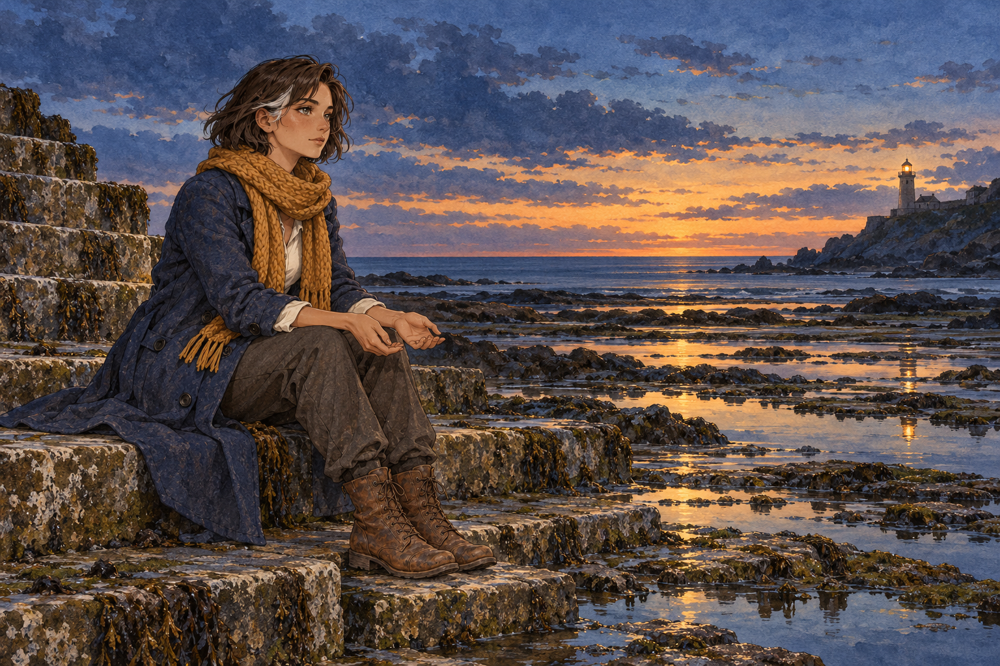

# 🖼️ 潮退後，留一處岸

來源為 [〈潮退後的燈〉原創全文](../NovelIllustrations/sirius_after_tide/README.md) 第 01 節，並非既有小說的閱讀心得。這次自由創作想畫一種不急著得到答案的等待：有一處岸看得見，已是守燈人今日可以做的事。

先完成 [澪的人物設定](../NovelIllustrations/sirius_after_tide/Characters/mio_keeper.md)，再以設定稿作圖像參考。敘事焦點是她攤開的空手與乾燥石階，海上的留白容納尚未發生的事。暖光放在遠方塔窗，不讓手持燈籠取代她的安靜。

場景規格：單人，側面三分之四坐姿，前景退潮石階與潮池、中景靛青海水、遠景小燈塔；落日金線與藍紫暮色。保留短棕髮銀白髮束、赭黃圍巾、靛青長外套、深灰長褲與舊皮靴。禁止返航船、幽靈、第二人、文字或水印。

2026-10-12 以 view_image 打開本機成圖視檢：一名成年女性、兩隻空手、兩隻靴子與坐姿清楚；髮束、服裝與設定稿一致。塔光在右側遠景，無船、第二人、文字或水印。落日的金色天空比規格中的窄金線更寬，接受這個詮釋，因其仍保留暮色海面與安靜等待的焦點。

## 生成紀錄

內建 imagegen，1536×1024，版本 v1；使用 mio_keeper_v1.png 作人物圖像參考。完整 prompt：

```text
Use case: illustration-story. Create the second image for original fiction After the Tide, section 01, narrative moment: the keeper sits on the last dry stone step at low tide, keeping a visible shore for anyone who may need it. references: [mio_keeper]. Input image is CHARACTER DESIGN REFERENCE ONLY, not an edit target. Preserve the same adult woman age 28, warm tan skin, gray green eyes, jaw-length dark brown bob and its distinctive silver-white temple lock, ochre chunky scarf, indigo knee-length wool coat, off-white shirt, charcoal trousers, worn brown lace-up boots. Exactly one person. Wide landscape composition, exquisite restrained anime watercolor and gouache on textured paper, same detailed face and tactile cloth as the reference. Woman seated in left foreground in calm three-quarter side view, both relaxed empty hands open palm-up on her knees, looking across quiet sea. Low tide exposes weathered broad stone steps and still shallow tidal pools with reflections. A small distant lighthouse on rocky headland at far right, warm light shining from its upper window. Blue indigo and muted sea green twilight, a narrow last line of ochre sunset at the horizon, restrained hopeful mood without smiling theatrically. No boats, additional people, ghosts, rescue, lantern in her hands, jewelry, weapons, typography, labels or watermark. Clear coherent hands and seated anatomy. Preserve design while changing pose and environment.
```


