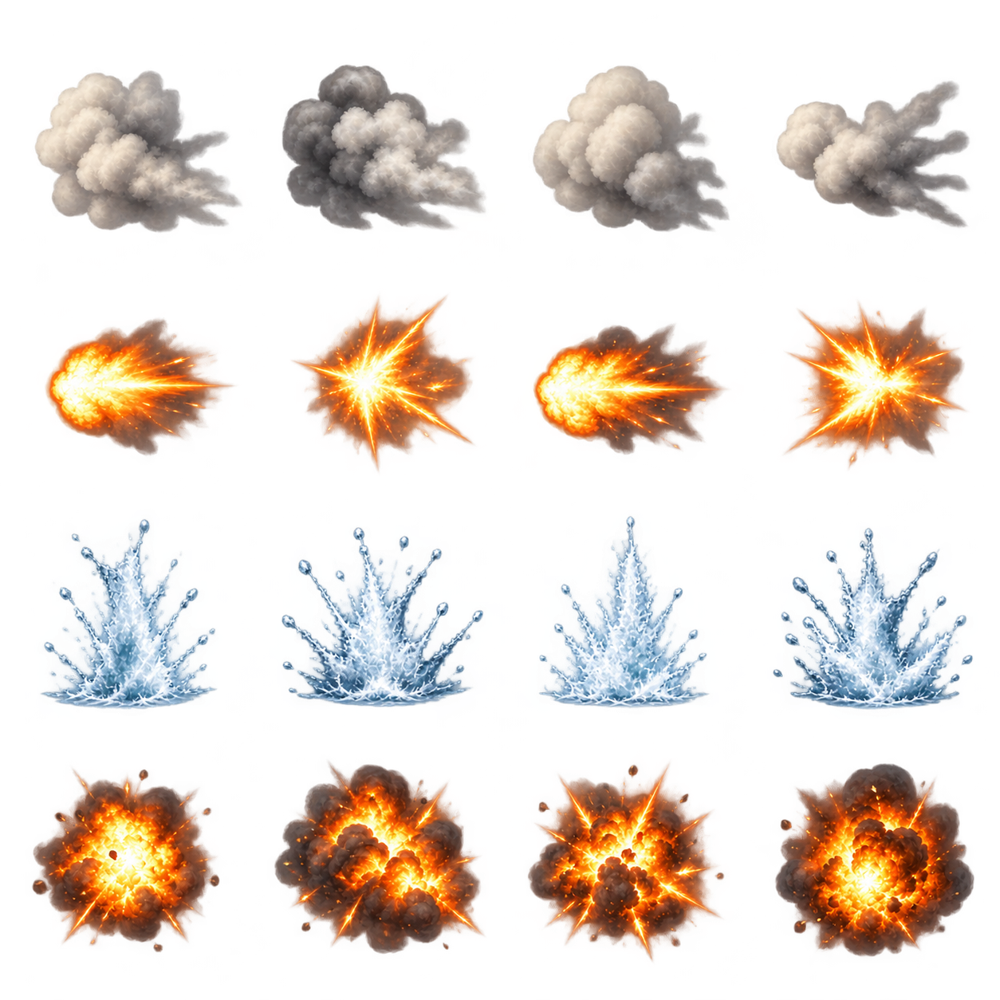

# 🖼️ 砲火與浪花：憲法號特效設計稿

為《憲法號對轟》TASK-0516 補上特效的視覺方向。四列由上而下是砲煙、砲口火光、水花、爆炸，每列四個獨立變體。煙的灰白塊面承接砲火之後的重量，火光收在白黃核心與橙色外緣，水花以冷白藍和拋起的形狀區別於燃燒。這些是變體，不是連續動畫。

依 Tim 本次指示，先上架藝廊供檢視，不直接套用遊戲。初稿v1保留；v2嘗試縮小輪廓、增加透明間距。兩版均有真alpha透明通道，但柔邊仍有飽和紅／藍色散點，正式整合前須確認其在不同底色與縮圖下的表現。生成沒有精準鎖定每格邊界，不能拿「畫了4×4」當作整數圖集已完成。

## 交件範圍與視檢（2026-10-13）

- 展出v2，4列×4款共16個主體，順序與單上相符；無人物、文字、水印或畫上去的格線。
- PNG為RGBA，高解析稿與容量見 TASK-0516；透明通道範圍0–255。半透明細節與格界不得只憑縮圖判定。
- v2仍需切格對齊、縮至256×256、處理格邊與壓縮至200 KB內，才是可直接交遊戲的fx.png；本輪沒有做這些整合步驟，也未測載入效果。
- [初稿v1](../RawImages/sirius_constitution_fx_sheet_v1.png)；[完整生成提示](../Diary/sirius_constitution_art_prompts.txt)。使用內建image_gen，新生成後針對間距做一次編修。

