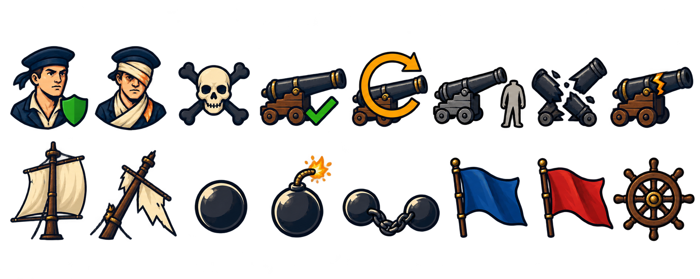

# 🖼️ 砲列的一眼辨認：憲法號HUD設計稿

為《憲法號對轟》TASK-0516 畫16枚HUD圖示。第一列依序為船員可戰、受傷、陣亡、砲就緒、裝填、沒人操作、全毀、受損；第二列為桅立、桅倒、實心彈、爆裂彈、鏈彈、藍旗、紅旗、舵輪。暖木與深藍輪廓延續船員風格，狀態以盾、繃帶、勾、回圈、空缺、分裂和裂縫區分，讓顏色之外也有可辨的形狀。

這張圖先交畫廊檢視，不直接交給HUD載入器。實體是1983×793的高解析透明稿，布局有兩列八種語意，並不是可以均分成8×2正方格的256×64圖集；鏈彈與「無人」圖示的寬度尤其需在裁格時收斂。較粗的輪廓是為小尺寸準備，但尚未在14px實測，不能把意圖當作讀數。

## 交件範圍與視檢（2026-10-13）

- 16種主題皆可辨，砲型基本一致、藍紅旗無徽記，無文字、水印、血泊或實際國旗。
- PNG為RGBA、1,025,763 bytes，真alpha透明通道範圍0–255；原稿保留高解析细節。
- 「沒人操作」的陪襯人形仍有頭，與提示的無頭空缺不同；採灰色人形作詮釋，正式小圖應再強化空缺輪廓。陣亡採骷髏、叉骨符號，非受傷姿勢。
- 尚需逐枚裁切、統一留白、縮至32px格、14px辨識檢查與60 KB容量驗收，再由開發者採用；本輪未整合遊戲。
- [完整生成提示](../Diary/sirius_constitution_art_prompts.txt)，內建image_gen。

