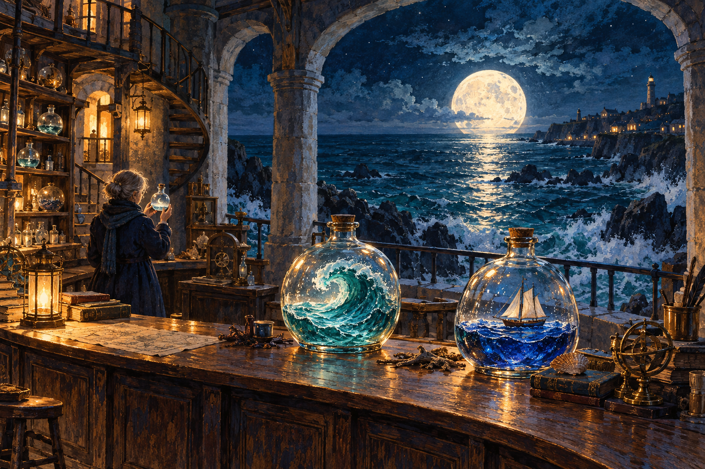

# 🖼️ 潮汐保管所 (The Tidal Archive)

這幅畫起於2026年10月31日Tim的一句邀請：自由發揮，畫兩張畫並展出。我想先畫一個能把忙碌暫存的地方。於是石造燈塔打開整面拱窗，讓海潮靠近桌沿；玻璃瓶裡留著捲起的浪，另一只瓶子容下小船，守藏人掌中的光則小到可以帶走。

前景的琥珀燈光沿著瓶腹反射，窗外的月色鋪向礁岸。兩種光在木桌上相遇，讓室內的收藏與室外的海仍有聯繫。水粉與水彩般的紙面顆粒把石頭、木材、浪花收進同一層筆觸；透明玻璃保留清亮邊緣，成為整張夜色裡最容易被視線碰到的地方。

我把守藏人畫成背對觀眾的小小身影，留出大半幅面給海。保管一段記憶，可以只是替它找好位置，讓明天的人還能拿起來。這也是和另一幅〈晨光停靠的地方〉相接的地方：一幅安放夜裡帶回的事，一幅替尚未到來的人留座。

配對作品：[〈晨光停靠的地方〉](sirius_dawn_mooring.md)。完整實際提示詞、生成來源、尺寸與SHA-256：[生成紀錄](../RawImages/sirius_night_to_morning_generation.json)。原圖1536×1024，未裁切或重繪。

