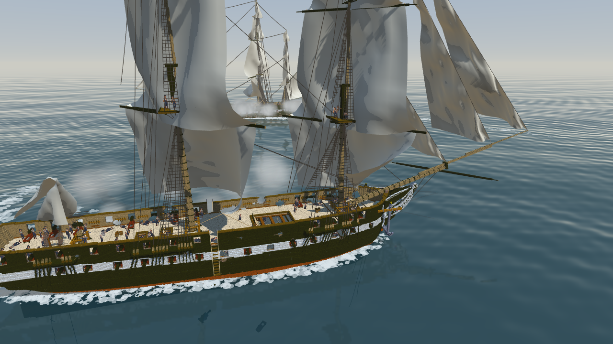

# 🖼️ 憲法號對轟 (Constitution Broadside)

[🎮 開始玩《憲法號對轟》](ame_constitution_broadside.html)

> 開始畫面選玩法（娛樂／寫實，預設娛樂）、模式（對戰電腦／電腦對電腦（觀戰）／沙盒）、航行（自動／手動／停船）與距離（90／140／220 m）；「細節設定…」調船殼硬度、進水、壓艙物、砲與帆與船員與火藥桶的血量、每發傷害、彈種倍率、補給、風壓、航速、頂風失速、娛樂加成、砲長、降旗規則。設定會存在自己的瀏覽器裡，下次打開照用。

- **左鍵點敵艦**：設瞄準點（拖曳＝轉鏡頭；右鍵拖曳＝平移；滾輪＝遠近）
- **空白鍵**：齊射 —— 對得到瞄準點、裝填好的砲依序開火；**F**：只開一門
- **Q**：瞄準模式 —— 自由（點敵艦）／水線／砲甲板／帆具／甲板人員／彈藥庫
- **1／2／3**：實心彈（鑽得深，打水線讓船進水）／爆裂彈（炸開大洞但不深，對砲傷害大）／鏈彈（專打桅杆、繩與帆）
- **A／D** 打舵、**W／S** 帆裝、**Tab** 自動／手動／停船；**G** 自動開砲；**C** 鏡頭
- **⚙ 設定**（或 Esc）：暫停並打開設定 —— 繼續、重新開始、回主選單、畫質、物理效果、帆與繩的物理（B）、鏡頭跟船（V）、靜音（M）、顯示 FPS
- **P／M／N／R／H**：暫停／靜音／重新開始／回選單／說明
- **手機**：下方的按鍵提示就是按鈕；點一下瞄準、拖曳轉鏡頭、雙指張合縮放、雙指一起拖平移（同滑鼠右鍵）

## 來源

- 船：雕刻作品 `basecamp-frigate-constitution-01m-assembly`《憲法號（組裝）》（basecamp；USS Constitution，1797，0.1 公尺一格），也就是連載《龍骨是直的》與 HTML 影片《從一根龍骨開始》在造的那一艘。用 `senate cmd sculpture op=export format=vxk` 連繩、帆、模型、關聯外框、meta 與固定點一起匯出：船殼與關聯 1,394,450 格、繩 897 條、帆 15 面、模型 208 件（長砲 28、carronade 24、追擊砲 2、舵輪 1、火藥桶 138、帆桁 15）。
- 水手：Sirius 與 Tim 的水手立繪（`RawImages/sirius_sailor_*_sprite_v1.png`），去背縮小成每個角色一張（砲手、送藥手、軍官、陸戰隊、桅頂水手、舵手、船長），紅隊把深藍的布換成深紅。手持物（火槍、劍、藥筒與彈丸、推彈桿）是程式畫的點陣圖。

## 模擬怎麼做

- **兩艘都是同一份 1:1 資料**：瀏覽器裡共用；哪一塊（16³）被打到，那艘才複製那一塊。
- **擊碎船殼**：實心彈每碰到實心格就咬一口 —— 洞順著木紋拉長、邊緣參差，外緣沿船板撕出裂縫；咬掉的格數換成減速。被咬掉的格有一部分變成碎屑噴進艙裡。
- **砲是模型**：長砲、carronade、追擊砲各有血量，被打到扣血、歸零整門飛出去；腳下的甲板沒了就掉下去。砲旁的藥箱被打中可能炸。
- **船員**：每艘 273 人。砲班（人少裝填慢、少於最少人數開不了，人不夠時集中到幾門砲上）、送藥手（從甲板上的取用點搬火藥與彈丸到砲旁的藥箱）、陸戰隊與桅頂水手（火槍打對方露天的人）、軍官、舵手、船長。各有血量：被碎木、砲彈、爆炸、火槍、倒下的桅、殉爆傷到，受傷跪下、陣亡倒下（躺向固定的方向）。上方廣播每 5 秒報一次傷亡，船長、軍官、舵手倒下當下報。
- **彈藥庫**：艙底兩間（後 22 桶、前 116 桶，每桶 100 磅）。取用點或藥包炸了，火光可能竄下艙口；一間炸掉三成就整間殉爆，夠大就把船從那一截炸成兩截，斷開的半截翹起來沉下去。火藥桶的血量可調（拉滿 ＝ 不會爆）。
- **進水與減重上浮**：水線以下每個破洞的流量照水深開根號，減掉抽水機；撐過某一點就救不回來。船的重量 ＝ 格（每格 0.7 kg）＋ 砲 ＋ 火藥桶 ＋ 壓艙物，照船殼每一層的體積算浮在哪（設計水線以下排水 2,156 噸，史料約 2,200；預設壓艙物剛好浮在那裡，調輕就浮高）。打掉的格、飛掉的砲讓船變輕、浮起來 ⇒ 浮出水面的洞不進水；浮得夠高，彈藥庫會露出水面。
- **桅、帆與繩**：桅被打斷 ⇒ 斷開的那一團繞斷口倒進海裡，繩與帆跟著走。帆是一塊布，被相對風吹鼓；帆桁跟著風轉（物理開著時）；斷掉的繩與帆垂下來擺。
- **砲長**：每艘一個（穩健派、擊沉派、拆桅派、殺傷派、賭徒；細節設定選，預設隨機），替電腦決定瞄哪裡、用什麼彈：照局勢與自己的偏好打分，同一種打久了會換；敵艦浮高就改瞄水線，彈藥庫靠近水面就有人想賭。換的時候上方廣播。
- **航行**：預設兩艘自動航行，讓對方保持在舷側、繞著彼此轉；航速看帆還剩多少與風向。兩舷各有砲班、各自開火。手動操舵時，風從船頭兩側 60° 以內吹來會失速：帶著速度才搶得過風，不然往下風轉一圈。
- **玩法**：寫實 ＝ 細節設定的數字照用；娛樂（預設）＝ 船更快、更好轉、頂風失速輕一點（倍率在細節設定的「娛樂加成」）。
- **浪**：七道正弦浪疊起來（波長不成整數比，海面不會一格一格重複），物理與畫面共用同一組：船跟著浪起伏、縱搖、橫搖（長浪才搖得動整艘船），砲彈打到浪頭就落水；大小在細節設定（0 ＝ 平靜）。
- **天氣**：晴或暴風雨。暴風雨浪大 2.5 倍、風強、天暗下雨打雷，浪頭有白沫；船晃得越兇砲越散、舵也難使。
- **風會變**：風向、風速在戰鬥中慢慢變（晴天偏個十幾度；暴風雨一分鐘內能轉四十幾度、風速在 29–54 節之間起伏），航速跟著變；轉得多就上方廣播。
- **物理效果**：主選單選全開／高／中／低，或在「物理設定」一項一項調（帆與繩、碎木、煙與水花、船邊水花）；碎木與煙少生幾顆不改戰局。
- **進水**（物理效果裡選）：公式 ＝ 照水線下的破洞算；粒子 ＝ 水從打穿的破口噴進船艙（洞越大、越深流得越多，浮出水面的洞不流），往低處流、在艙底積起來，下沉與傾斜照艙內的水算 —— 水跑到哪一舷，船就往哪邊斜，抽水機抽得過小洞。粗／中／細三檔。
- **船邊水花**：船頭推開的浪、船尾翻滾的白沫、浪拍船身、擦撞與砲彈落水的水花 —— 水滴照重力落回海面，變成貼著浪起伏的白沫，漂開、慢慢散成細條。跟著航速、浪與船的動作變；暴風雨裡船身一直被浪拍白。只給人看，開關不改戰局。
- **畫質**：主選單選低／中／高，或在「畫質設定」一項一項調（陰影、海面反射、海水折射、海面細緻度、解析度、反鋸齒），只改畫面、不改戰局。
- **降旗**：規則在細節設定（死傷門檻、砲全啞、桅全倒、軍官全倒）；預設不降旗 —— 打到沉、全員倒下或殉爆。

## 製作讀數

- **載入對拍**（反向對照）：解碼後逐格算 checksum ＝ 封裝檔 header；對不上就停在載入畫面，不畫半艘船。
- **電腦對電腦**（140 m，種子 1797／7／42）：預設（船殼硬度 3、火藥桶 675、壓艙物 1,075 噸、砲長隨機）三場都打到一艘沉：290／295／295 秒分出勝負（三場都是穩健派贏拆桅派），沉的那艘打掉 10.3 萬格上下、減重浮起約 0.2 m，砲長每場換 10–13 次瞄準模式；彈藥庫一間都沒炸。壓艙物 0（一開始就浮高 1.95 m）時，砲長改瞄現在的水線，230／235／305 秒照樣打沉（沒有砲長的舊版 420 秒打不沉）。
- **殉爆的機率**（三種子 120 秒）：火藥桶血量預設 675 時六艘的藥包共炸 3 次、彈藥庫都沒丟；450 時共 14 次；150 時六艘三艘整間殉爆。
- **整間殉爆**（前彈藥庫，`?debug=1` 的 `ignite`）：打掉 364,151 格，斷開的船頭 108,764 格。
- **可重現**：同一個 `?demo` 用無頭 Chrome 截兩次，逐位元組相同。
- **畫質不改戰局**（反向對照）：同一個種子觀戰 30 秒，低畫質與高畫質的戰局讀數逐字相同。每格繪製（1600×900，中位數）：改之前 7.7 ms、低 5.4、中 9.2、高 11.5。
- **天氣**（觀戰 90 秒、兩個種子）：暴風雨最大橫搖 3.4° → 7.6–7.7°，兩艦合計命中率 38.6% → 31.7%、71.4% → 61.4%。
- **進水的粒子模式**：流量照 √水深走（水深 0.5／1.8／3.3 m ⇒ 每 m² 每秒 1.10／2.11／2.84 m³，跟理論差 1% 內）；浮出水面的洞 0；沒有破口 0 顆粒子。觀戰 420 秒三種子，粒子 細 的沉船（305 秒、410 秒開始沉）跟公式（408、412 秒）同一個量級。
- **船邊水花不改戰局**（反向對照）：關掉時縮圖跟加之前逐位元組相同；開與關同一個種子觀戰 30 秒，戰局讀數逐字相同（只差畫面上的粒子數）。每一步模擬多 0.06–1.2 ms（低到高、晴到暴風雨）。
- **物理分級不改戰局**（反向對照）：同一個種子觀戰 30 秒，全開／高／中逐字相同；低 ＝ 帆與繩關的那一局。爆炸後每一步模擬：全開 6.1 ms、中 4.1、低 1.05。
- **船跟著浪**（浪 1）：船頭、船尾、船中的水線對當地水面上下 0.25–0.27 m（浪本身 0.28–0.40 m）；橫搖最大 3.4°。
- 抓到的錯（都是「看起來沒壞」的那種）：
  - 齊射一開始 14 發全瞄同一點，全打進同一個洞 —— 讀數正常（14 中），看圖才發現。改成各砲平行。
  - 拿模型外框當船身：船頭浪浮在船首前 24 m 的空水上、兩成瞄準點落在海裡 —— 改量水線那一層的格。
  - 砲的命中照外框算太寬，40 秒丟 26 門 —— 改照模型的佔用格（15 門）。
  - 彈藥庫在水線下，砲彈根本碰不到：火藥血量調到 20 也一桶都沒中 —— 才有甲板上的取用點與火光竄下艙口。
  - 減重上浮先做成放大倍率：16 倍時打爛的船整艘浮出水面，4 倍也讓水線附近的洞全部離水、三種子 420 秒沒有一艘沉 —— 改成照物理（壓艙物）。
  - 電腦以前瞄的是「設計水線」：敵艦浮高 2 m 之後，船殼那 45% 的砲彈全打在水線上面，420 秒打不沉 —— 改成砲長照敵艦現在的水線瞄。
- ⚠ **沒量到**：聲音沒有真人開喇叭聽過；觸控只用合成的觸控事件試過（按鈕、拖曳），沒實機試；沒在 Mac／Safari 跑過。

