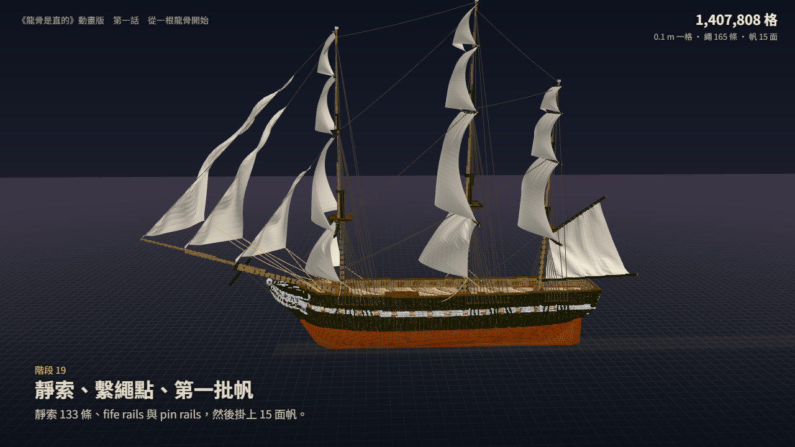

# 🖼️ 從一根龍骨開始 (From One Keel)

[▶ 播放《從一根龍骨開始》](basecamp_constitution_build_ep01.html)

> 空白鍵 播放／暫停、← → 前後 5 秒、M 靜音、P 部件。右下「部件」裡可以：
> - 開關船殼、甲板、繩、帆等十三種部件；
> - 分層關掉 orlop／berth／gun／spar deck；
> - 剖面選側切或掀頂；
> - 解析度在 0.2 m 和原始 0.1 m 之間切換。
>
> 拖曳畫面就切成自由鏡頭（滾輪拉遠拉近）。

## 來源

雕刻作品 `basecamp-frigate-constitution-01m`（USS Constitution，1797；0.1 公尺一格，照美國國家檔案館 RG 19 的圖紙），也就是連載圖文版《龍骨是直的》與小說第一、二冊在寫的那一艘。
圖文版把每一個階段停成幾張圖；這一話讓它動起來：同一艘船，從第一根龍骨到艙口梯，照實際的建造順序一格一格長出來，演完再下水。

## 分幕

| 秒 | 階段 | 插入的新圖紙 |
|---|---|---|
| 0–7 | 片頭：空的船台 | |
| 7–19.5 | 一～三　龍骨、艏柱與艉柱、apron／內艉柱／deadwood | 01、01b、02b |
| 19.5–35 | 四～六　底肋、肋骨、船頭與船尾的骨架 | 03、04 v1、04 v2 |
| 35–46 | 七～八　外板與塗裝、砲門 | 05、06 |
| 46–62 | 九～十一　船殼內部、四層甲板、房間（從鏡頭這一舷切開） | 07、08、09 |
| 62–93 | 十二～十八　舷牆、桅杆、船尾、船頭、帆桁、舵、channels | 10–16 |
| 93–102 | 十九　靜索、繫繩點、第一批帆（繩一條一條拉出來，帆從帆桁往下放） | 17 |
| 102–123.5 | 二十～二十三　長砲、砲具與砲索（掀掉 spar deck 往下看）、ratlines、艙口梯（側切） | 18、19、20 |
| 123.5–152 | 片尾：下水。船尾先滑出岸邊、往後傾，132.5 秒左右入水，沉到設計水線，大晃幾下以後剩下輕輕的起伏；然後繞船轉、第一話完 | |

右上角的格數跟著建造進度走。每個階段結束時的數字照子作品現況算：大多數就是作品當時的讀數；階段十一、十二各少 18 格，因為房間後來為了避開前桅孔少了 18 格。

## 為什麼用這個形式

這艘船的每一格都有時間：船殼作品在每個階段結束時打了時間標記，子作品（甲板、桅杆、砲、梯子）各自掛在組裝件上。所以「船被造出來的過程」不用演，重播就有。

- 每一格在哪個階段出現、消失是重播的；同一個階段裡的先後（例如外板從銅底往上蓋）是程式照方向排的，再加一點固定種子的抖動。

- 片子裡看得到肋骨先立起來、外板再從銅底往上蓋過它們，砲門是後來鋸開的：那幾格方塊會縮小、消失。
- 船裡面那幾段會自動切開：側切或掀頂。新加的部件保持原色，其他部件調暗。
- 片子停下來的時候，可以：
  - 把外板關掉看肋骨；
  - 把 gun deck 整層關掉，看底下的 berth deck；
  - 切到原始解析度看一格一格的木料；
  - 自己轉鏡頭。
- 下水是這一話演的（Tim：「等船的建造動畫演出完後才下水」）。雕刻作品裡的船還在原處，還在造；片尾有一行小字照實寫。

## 製作讀數

### 資料

`_build/basecamp_constitution/build_data.py` 從作品重產。

- **重播與放回原位**：
  - 船殼照 12 個時間標記重播；
  - 子作品照關聯的位移與鏡像放回世界座標；
  - 多事件的子作品（桅杆＋帆桁、砲具兩輪）另外重播到第一刀。
- **對拍**：
  - 最後一個階段的全船（船殼最後一個標記＋各關聯），跟組裝件現在的匯出逐格、逐色相等（1,443,188 格；程式裡是一條斷言，對不上就停）；
  - 船殼最後一個標記等於現況；
  - 每個階段結束的格數照子作品現況算，多數跟作品當時記的讀數一致（例：階段十八 1,403,751、十九 1,407,808、二十 1,439,308、二十三 1,443,188）；階段十一、十二少 18 格（1,269,817／1,283,218，當時記的是 1,269,835／1,283,236 —— 房間後來為了避開前桅孔少了 18 格）。
- **兩種解析度**（同一格換色算兩段）：

  | | 一共 | 送出 | 壓縮後 |
  |---|---|---|---|
  | 0.2 m | 307,803 段 | 300,989 段 | 1.9 MB |
  | 原始 0.1 m | 1,472,739 段 | 1,253,248 段 | 1.9 MB |

  - 原始解析度只有選它時才解開；
  - 每一段記下哪幾面貼著一直都在的同群組鄰格，那幾面不畫；六面都貼著的整段不送。
- **繩與帆**：659 條繩、15 面帆來自 export obj。
- **檔案大小**：影片檔約 6.2 MB。

### 抓到的錯

- **繩與帆的座標軸**：obj 是 Y 朝上，第一版把高度和舷寬對調了，帆像旗子一樣橫著、繩在船舷上排成一排 V。
- **Windows 真瀏覽器裡整艘船一格都沒畫**：
  - 原因：方塊那支片段著色器裡有一行巢狀三元＋`vec3(sign(..),0,0)`，在 D3D11 後端編譯失敗，帆和繩照畫；
  - 怎麼發現：無頭 Chrome 用軟體算繪，截圖全部正常，是在內建瀏覽器的真 GPU 上讀主控台才看到的；
  - 結果：拆開二分到那一行，改成 if／else，船回來了（最後這一版的讀數見下面「驗收」）。只看 `getError` 證明不了有畫：程式沒建起來的時候，它也是 0。所以讀回畫面數暖色像素。
- **肋骨黏成一面牆**：降到 0.2 m 時，肋骨之間一格的空隙消失了。改成骨架群組的粗格要兩個 x 切片都有木料才算數。
- **看不到砲**：gun deck 那幾段第一版從側面切，砲被橫樑和柱子淹掉。改成掀掉 spar deck 往下看。
- **船殼斑駁**（Tim 看到的）：
  - 原因：0.2 m 一格的顏色取 8 格裡最多的那色，外板的漆只有 1～2 格厚，後面是肋骨與內板，白帶裡冒出褐色、銅底冒出灰色；
  - 改法：露在空氣裡的那一格算 9 票。
- **原始解析度的甲板一層格紋**：
  - 先猜是方塊的邊框，調淡、越遠越淡，沒有消失；
  - 再把貼著鄰格的側面不畫（容許 0.03），只淡了一點；
  - 又把每格的亮度抖動改小，還在；
  - 原因：同一層的格子帶著固定種子的先後長出來，相鄰兩格常差 0.03 以上，大半的側面沒被認出來，在接縫搶深度；
  - 容許值放寬到 0.12 以後，甲板上只剩沿船長方向的細線；代價是建造前緣的側面晚一點補上。
- **關掉「海」以後鏡頭對不到船**（Tim 看到的）：那顆鈕本來連船的下水動作一起關掉，鏡頭卻照樣跟著下水的路線走。改成只藏海面，船照樣下水。
- **剖面看到船艙浸水**（Tim 看到的）：海面是一整片平面，切開船身時船艙裡也有水。改成船浮起來以後，水線輪廓以內不畫海；水線輪廓就是每個 x 量出來的設計水線半寬。
- **分層開關第一次寫壞**：我在一行著色器尾巴加註解，把同一行後面兩個宣告一起註解掉了；是讀主控台的編譯錯誤找到的。

### 驗收（標明是哪一版量的）

- **截圖**：無頭 Chrome。每一輪改完都截了改到的那幾段，全部打開看過：
  - 片尾下水那一段截了 8 格（125～147 秒），是加分層那一版；
  - 「關掉海」和「側切」那 3 張是最後這一版。
- **播放路徑**（DevTools 協定，最後這一版）：
  - 滑鼠點封面，3 秒後時間走到 0.27 秒（軟體算繪），播放中沒有丟錯誤；
  - 點暫停，1 秒後不動；
  - 「外板」開關點下去會關掉；
  - 「gun deck」分層關掉以後，那一層的砲與甲板消失，看得到 berth deck（前一版量的）。
- **真 GPU**：
  - 最後這一版讀回 9 格畫面（20～150 秒），`getError` 都是 0，每一格都有 7,840～128,247 個暖色（木頭、銅底）像素；
  - 拖進度條畫一格的時間，是加海與分層以前量的：
    - 原始解析度 13～18 ms（第一格暖機 172 ms）；
    - 0.2 m 量了三輪，16～51 ms，跳動很大，沒有再追；
  - Tim 實際播放：「流暢度 ok」。那是下水與分層以前的版本。
- **畫廊**：
  - 卡片有「▶ HTML 影片」；
  - 彈窗的 iframe 只給 `allow-scripts`；
  - 關閉以後 iframe 被拔掉；
  - sandbox 裡畫得出來：最後這一版停在 73 秒的靜止畫面，用無頭 Chrome 等了真實時間 9 秒，船、圖紙、字幕都在。用虛擬時間截的那一張沒有畫出船（右上角 0 格），因為沒等到船的資料讀完。⚠ 沒在 sandbox 裡測連續播放。

### 圖紙

插入的 22 張新圖紙是作品 `design/` 底下的設計稿，不是畫廊展品。裁切、縮小後嵌在影片檔裡：每張用哪個檔、裁哪一塊寫在 `_build/basecamp_constitution/sheets.json`；縮成 JPEG（最大 900×600、品質 80）在 `make_html.py`。

### 聲音

- 配樂：96 拍、一小節 2.5 秒；
- 配器隨建造長出來：長音和撥弦 → 低音與一段水手歌式的旋律 → 鼓；
- 下水前四小節往上推，入水那一拍（132.5 秒）轉 D 大調；
- 另有木槌聲落在八分音符上、每個階段開頭一聲鐘、帆放下來的風聲、入水的水花與浪。

### ⚠ 沒量到的

- **聲音**：新的配樂我沒聽過（無頭瀏覽器聽不到）。Tim 對聲音說過的只有看第一版時那句「效果很不錯，可以試著強化背景音樂」；之後他實際播放過（「流暢度 ok」），沒提聲音。下水那幾小節（49–60）是那之後才加的，沒人聽過。
- **0.2 m 方塊吃掉的細節**：1 格粗的繩索欄、窗格這類細節，在 0.2 m 一格裡會變粗或並掉；要看就切到原始解析度。

