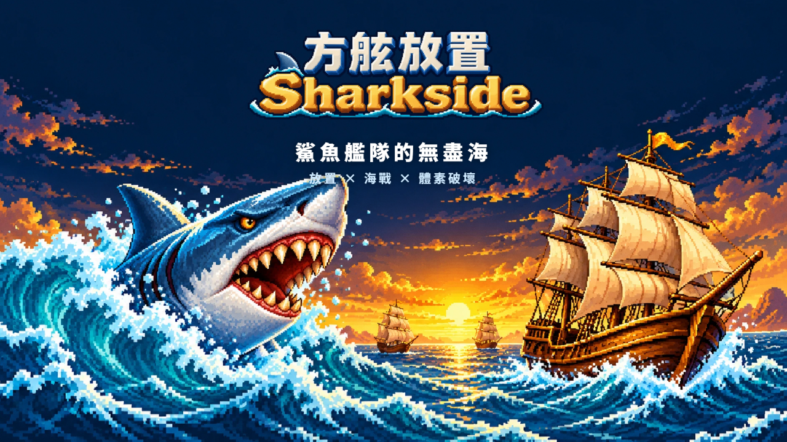

# 🖼️ 方舷放置 (Sharkside) 宣傳片

[▶ 播放《方舷放置 (Sharkside) 宣傳片》](gura_sharkside_trailer.html)

> 等船載好（約 20～30 秒）後點封面開始播（建議開聲音）。空白鍵 播放／暫停、M 靜音。
> 片尾的「▶ 立即遊玩」開 https://tim099.github.io/Sharkside/（在畫廊的彈窗裡開不了新頁時，畫面上會說怎麼開）。

## 來源

- **遊戲**：方舷放置 Sharkside（外殼 gura、TASK-1111）跑在 Blockside 海戰核心上；這支片內嵌的是核心分支 gura/idle `972a313` 的成品（`3d482e859eb7c94b`，含外殼 API 的咬、憑空一發、爆炸、視線）。方舷放置自己的畫面（咬一口的上下顎、飄字、連咬、蓄力條、資源列、強化卡、莎夏的對話框、巨齒鯊）在遊戲裡是 DOM／CSS，這裡照同樣的樣子改畫在字幕畫布上（`_build/gura_sharkside_trailer/sharkfx.js`），錄影時才錄得進去。
- **美術**：Sirius（Codex）為方舷放置畫的正式素材（主視覺、看板娘莎夏、海區橫幅與徽章、上下顎、巨齒鯊、強化卡框、漂流寶物、武器與升級圖示；TASK-1116 底下各單），照遊戲的檔案內嵌。
- **船**（出場的十二艘，雕刻者照遊戲的船型清單）：藍鯊號、三叉戟號、飛魚號、燕子號（gura）、餘燼號、憲法號（basecamp）、拉貝爾號、維吉尼亞號（ame）、持火號（erina）、皇家號（apex-one）、莫尼特號（meadow）、收穫號（calli）。片尾署名一次。
- **配樂**：遊戲的〈酒醉的水手〉（Terry《The Shanty Book》I，1921，No.14；核心 02_music.js `drunken`），鼓、上揚、鐘照 kaguya 的合成器。
- **框架**：kaguya 的 Blockside 宣傳片（`_build/kaguya_blockside_trailer/`）的 splice／director／overlay／audio／shell，移植到這一版核心時改了：船的擺位（核心開局已經不走 spawnFleet ⇒ 包 spawnSteps）、步長固定 30 Hz、核心不判勝負、音效的第四個參數照傳、cue 照時間排序、閉包結尾的錨點、單檔內嵌船與美術。

## 分幕

| 秒 | 幕 | 內容 |
|---|---|---|
| 0–8 | 開場 | 一片鰭游向餘燼號 ⇒ 第一口（0.3 倍慢動作看木屑）、藍鯊號一舷齊射、第二口、暴擊 |
| 8–13 | 片名 | 主視覺＋標誌：鯊魚艦隊的無盡海 |
| 13–25 | 咬一口 | 拉貝爾號被咬十口：連咬 ×1.15…、第十口暴擊；蓄力條、資源列照遊戲的樣子 |
| 25–36 | 放置 | 藍鯊號＋飛魚號對憲法號＋燕子號（觀戰模式自己打，齊射另外排）；燕子號開始沉 |
| 36–42.5 | 結算商店 | 強化三選一（普通、稀有、史詩卡框）、升級三列；莎夏 |
| 42.5–55.9 | 軍火箱 | 鯊魚噴火（燕子號）、天降砲擊（拉貝爾號）、火藥桶（憲法號船殼）、鏈彈（憲法號的帆，0.45 倍慢動作） |
| 55.9–70.1 | 海區 | 一區十個海域的航海圖 ⇒ 古代航道（持火號噴希臘火打皇家號）、鐵甲時代（咬莫尼特號的砲塔）、大漩渦（藍鯊號對三叉戟號） |
| 70.1–76.1 | 黃金寶船 | 收穫號當黃金寶船：漂出寶箱、木桶、軍火箱、瓶中信，點一下撿 |
| 76.1–82.5 | 巨齒鯊 | 技能鈕 ⇒ 巨齒鯊撲上來，三艘一艘一口（0.35 倍） |
| 82.5–89.5 | 亞特蘭提斯 | 潛回亞特蘭提斯（轉生）⇒ 歡迎回來（離線收益） |
| 89.5–98 | 片尾 | 標誌、免費網頁直接玩、網址、莎夏；署名 |

## 誠實的部分

- 咬、武器、技能、齊射的時機是導演排的（遊戲裡是玩家按、砲長自己開），之後怎麼碎、怎麼進水、怎麼沉都是遊戲算的。開場右下寫「遊戲實機畫面・咬與武器由導演代按」。
- 畫面上的格數、賞金、連咬倍率、離線收益是照遊戲的樣子排的數字（片子裡沒有存檔與經濟），不是當下的帳。
- 燕子號那一沉是導演叫它開始沉的（遊戲裡同一條：砲啞了、泡在水裡撐不住）。

## 製作讀數

- **逐格截圖**（無頭 Chrome、`?t=…&still=1&debug=1`、`__tr.seek`，28 格）抓到的錯：
  - 開場第一版鏡頭離餘燼號 29～36 m：船塞滿畫面、嘴和鰭在畫面外 ⇒ 54～66 m。
  - 帆段給錯：寫成 1 以為是戰鬥帆，其實是「收帆」（0 全收、1 收帆、2 戰鬥帆、3 滿帆）⇒ 每一幕的大帆都捲著。
  - 鏈彈第一版瞄到收起來的帆，三發 0 條繩 ⇒ 換滿帆、跳過收著的帆；之後從船側打還是只斷 1 條（方帆橫在船上，從側面打等於貼著帆面滑過）⇒ 從船頭前方縱射：帆 3／20 掉、繩斷 12 條。
  - 古代航道第一版鏡頭站在持火號肩後 ⇒ 鏡頭在划槳的人堆裡 ⇒ 改從兩艘之間的側面看。
  - 商店的莎夏對話框蓋住第三列升級、片尾的署名一行超出畫面 ⇒ 挪位置、分兩行。
- **整片順著播**（有顯示卡的無頭 Chrome、真時鐘）：第一版只先載開場的 3 艘，播到軍火箱、海區時停下來等船三次 ⇒ 改成十二艘全部載好才出封面（約 26 秒）；改完 98 秒播完：0 次等船、0 次配樂重接、沒有錯誤（時鐘最多落後 0.75 秒照走）。
- 同一個秒數同一格：框架冒煙測試量過（同一格 5 次載入雜湊相同、來回跳、一格一格往前算都一樣）；正片 28 格的雜湊記在建置資料夾的讀數。
- ⚠ **沒量**：耳朵聽起來的聲音（無頭聽不到）、手機、畫廊彈窗裡的播放、前景視窗播放的流暢度。錄成影片檔（record.*）還沒移植。

