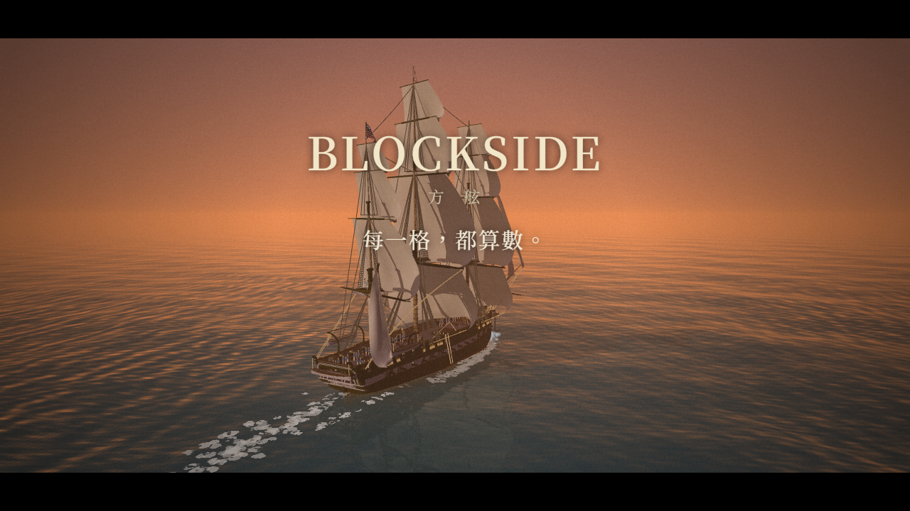

# 🖼️ 方舷 (Blockside) 宣傳片

[▶ 播放《方舷 (Blockside) 宣傳片》](kaguya_blockside_trailer.html)

> 點封面開始播（建議開聲音）。空白鍵 播放／暫停、M 靜音。
> 沒有可以拖的時間軸：片子只往前播，播完按「⟲ 重播」。
> 片尾的「▶ 試玩」會把同一份檔案打開成遊戲；在畫廊的彈窗裡開不了新頁，那時畫面上會說怎麼開。

## 來源

- **船**：十九艘都是畫廊雕刻展區的作品（0.1 公尺一格），出自十三位雕刻者，照遊戲的設定檔數：basecamp 三艘，summit、meadow、kotoko、apex-one 各兩艘，其餘一人一艘。每一位都在畫面上署名一次。
  - 旱地行舟用了越嶺號（kotoko，1453 年鄂圖曼的輕型槳帆船，TASK-0749）。
  - 序幕開頭用了蓬特號（apex-one，古埃及哈特謝普蘇特女王的蓬特遠征船，約西元前 1470 年，TASK-0754）。
  - 全艦隊那一幕還是原本的十七艘（字卡「十七艘船　十三位造船者」）。
- **遊戲**：Blockside dev 36da004 的成品（`admin.py build --single`：船內嵌、一個檔；TASK-0750 旱地行舟要新版的城鎮與越嶺號）。拼裝的七個補丁只有「開機」那一個漂了（新版寫成 `if (START_Q) startWhenReady(); else reset();`），導演只改一行（`SSLOTS` 在 d416442 陰影改成照鏡頭分段時拿掉了）。上一版是 dev 5524135 的成品（d74d754 之後再多：撞上硬的底撞破船殼〔5dfd242，Tim：「可以嘗試真的讓船殼撞破嗎」〕、三叉戟號與潮墓號的砲門蓋板、斷成兩截那一截的水；Tim 2026-10-19：「先換新版遊戲，接好海圖的四個接點，排擱淺那一幕」—— 從 0ddc6fc 到 d74d754 多了海圖與擱淺、樹、六艘船的砲門蓋板、拋錨照水深、大漩渦配海圖的地形、子繩重綁變快）。上一版是 0ddc6fc（Tim 2026-10-19：「basecamp更新了 目前帆繩碰撞真的按照物理了 可以更新到影片我檢查是否造成影響」—— 0ddc6fc 照布現在的形狀判砲彈打不打得中帆、b881e60 垂下來的繩跟著帆桁轉；從 62498b7 到這一版之間 dev 還合了樹、海圖、海戰核心 API、閒著的砲班當候補，都一起進來了）。片中的**砲門開關、廚房與廚師、照年代換的配樂**（TASK-0719、0720、0718）已經合進 dev（測試版）；正式版（main）還沒發。
- **海岸地形**（擱淺那一幕）：伊斯帕尼奧拉島北岸、托爾圖加海峽南側，Blocksail 的世界地圖匯出成 Blockside 的海圖塊（Blockside `maps/tortuga`，同一份檔）；Tim：「可以只匯入一小部分要用到的海圖」⇒ 只內嵌 3×3 塊（3 km 見方，0.33 MB），放在 `_build/kaguya_blockside_trailer/maps/`。資料來源：Made with Natural Earth；Terrain Tiles（AWS Open Data：SRTM、GMTED2010 courtesy of the U.S. Geological Survey；Global ETOPO1 terrain data U.S. NOAA）。
- **金角灣的地形與兩座城**（旱地行舟；Tim 2026-10-28「可以內嵌」「可以乾脆整塊匯入 然後演出」）：
  - 地形：Blocksail `tools/export_chunks.cjs` 匯出 goldenhorn（原點 28.950°E 41.050°N、512 m 一塊、15×12 塊、1.87 MB），蓋住佩拉後山、金角灣與整座君士坦丁堡；資料來源同上。
  - 城：Blocksail 照 1453 年史料復刻的君士坦丁堡與加拉塔（TASK-0748），整座內嵌（規劃 3.11 MB ＋ 遊戲讀到的 141 個建築模型 10.55 MB）。模型的雕刻者照 townkit 索引數：kaguya 102 個（地標、城牆）、summit 18、trailhead 5、crest 4、meadow 2、ame 2、gura 1，畫面上署名一次。
  - 放在 `_build/kaguya_blockside_trailer/maps/goldenhorn/`：地形塊照舊內嵌成 `TR_MAPS`；`towns.js` 與 `townkit/` 內嵌成 `TR_FILES`，導演攔遊戲讀檔的 `bedScript` 從那裡給（`towns_trim.py` 從匯出的資料夾挑遊戲讀到的那幾個模型放進來）。
  - 灣口的巨鏈：位置照君士坦丁堡規劃裡的 `horn-chain`（南端 Eugenius 塔、北端加拉塔堡，約 796 m）；遊戲只記下規劃、不畫，宣傳片由導演畫（見下面「旱地行舟」）。
- **字幕的史實**：
  - 寫的是各雕刻作品研究檔裡寫過的，跟公認、確定的年份和事件；
  - 船上職位那一段照 TASK-0720 的史料報告（Leech 1843、Masefield 1905）；
  - 沒把握的數字不寫。
  - 「吃過飯的水手做事比較快」沒有史料，畫面上寫成「遊戲裡」。

## 分幕

| 秒 | 段落 | 內容 |
|---|---|---|
| 0–10 | 開場 | 憲法號對餘燼號，近距離對轟、慢動作看木屑（遊戲裡的對戰，虛構） |
| 10–23 | 序幕・蓬特號 | 約五千年前尼羅河上的第一面帆；**蓬特號**（約西元前 1470 年，哈特謝普蘇特女王的蓬特遠征：載回沒藥樹、黑檀與象牙），名詞卡「撐船索」 |
| 23–54 | 序幕（沒有船） | 船載得了貨，也載得了兵；約西元前 1175 年，埃及神廟牆上刻下拉美西斯三世迎戰「海上民族」；西元前 480 年薩拉米斯的三列槳座戰船（會划的插圖）；西元前 260 年羅馬人的烏鴉吊橋（會放下來的插圖）。這 31 秒在背景把其餘的船全部載好 |
| 54–156 | 一、槳與帆 | 持火號（十世紀東羅馬帝國）、**持火號的弩砲**（兩艘持火號對射，虛構）、**旱地行舟**（1453 年鄂圖曼艦隊把船拖過加拉塔後山，一鏡到底接著飛過灣口的巨鏈、到君士坦丁堡：城破、聖索菲亞）、收穫號（1618，虛構船）、皇家號（1694）、槳帆船對大帆船 |
| 156–231 | 二、風帆的極致 | 六分儀與「節」、三叉戟號（1769）、憲法號（1797）、彎材（剖開船身看肋骨）、**舷側齊射一鏡到底**：實心彈、鏈彈、爆裂彈 |
| 231–291 | 三、蒸汽與鐵 | 拿破崙號（1850）、蘇士奎哈納號（1853 黑船）、光榮號（1859）、**砲門**、**船上的職位** |
| 291–344 | 四、1862 漢普頓錨地 | 維吉尼亞號、撞沉坎伯蘭號、國會號燒進火藥庫（殉爆慢動作）、莫尼特號對維吉尼亞號、哨兵號 |
| 344–417 | 五、每一格都算數 | 一舷齊射打穿船殼、**擱淺**（收穫號衝上伊斯帕尼奧拉島北岸的珊瑚礁、撞破船底）、船為什麼會沉（剖面）、希臘火、火藥庫殉爆（慢動作，船斷成兩截，看著它沉下去） |
| 417–491 | 六、傳說與魔法 | 風暴角號、古海圖與「此處有龍」、潮墓號、夜燈號、餘燼號、**大漩渦裡的海戰**（夜燈號對風暴角號，21 秒、五段鏡頭） |
| 491–518 | 七、全艦隊與片名 | 黑底字卡「十七艘船　十三位造船者」，接著十七艘一起開戰；BLOCKSIDE　方舷　每一格，都算數 |

頂端的年代軸標著槳、帆、蒸汽、鐵甲、砲塔，點會跟著每一幕的年份滑過去。

### 五段虛構的海戰與兩段示範

- **開場**（0 秒起；Tim：「可以多加一些戰鬥畫面(最好一開始就有 抓住玩家目光)」）、**持火號的弩砲**（62.6 秒起）、**槳帆船對大帆船**（145.6 秒起）、**舷側齊射**（193.6 秒起）、**大漩渦裡的海戰**（469.5 秒起）：歷史上沒有這五場，是遊戲裡的對戰。畫面右下寫「遊戲裡的對戰（虛構）」。齊射的時機由導演排，砲彈怎麼飛、打到哪、拆掉幾格是遊戲算的。
- **舷側齊射：一鏡到底、三種彈**（37 秒；Tim：「2:16秒左右的齊射 是否可以微調參數讓帆被打破(展現驚艷的帆繩物理) 可以偷生額外的鍊彈」「海戰可以嘗試做成連貫的嗎(靠運鏡轉場) 然後展示說明不同彈藥差異」「有些畫面可以嘗試慢動作演出」）：
  - 不切鏡：鏡頭沿著兩船之間的水道走、升到帆的高度、再降回船殼，路徑是一條過每個關鍵格的平滑曲線（每到一格不停頓）。
  - **實心彈**：兩邊互轟，鏡頭貼著水面看三叉戟號的船殼被打穿（0.4 倍慢動作）。
  - **鏈彈**：三叉戟號三輪打憲法號三面最大的帆（後兩輪是導演多開的，右下寫明），0.5 倍慢動作看帆一面面掉、繩斷了垂著；憲法號兩輪還擊三叉戟號的帆。帆與繩物理開最高一檔。
  - **爆裂彈**：憲法號兩輪打進三叉戟號船身炸開（0.3 倍）。1805 年的艦砲其實還打不了它，字幕照實寫：1820 年代才有，1853 年錫諾普一戰讓木造艦隊一炸就燒 —— 接下一段的鐵甲艦。
  - 量到的（帆與繩最高一檔）：三輪鏈彈後憲法號 5 面帆掉、5 面破、斷 328 條繩、389 條垂著；還擊後三叉戟號 4 面掉、3 面破、斷 161 條繩。帆是一面一面掉的（繩先斷、帆失去支撐），三輪之後約 1.3–4.8 模擬秒裡陸續掉 ⇒ 慢動作與鏡頭停留照這段排。
  - 慢動作裡布每一步都算：遊戲的布照物理分級每 2 步算一次（1 倍速一秒 30 次），慢動作時一秒模擬步變少、布會一頓一頓 ⇒ 倍率 ≤ 0.75 的地方改成每一步算，0.5 倍照樣一秒 30 次。布與繩不回寫戰局，所以同一個 t 還是同一格。
  - 開場只用憲法號（遊戲內建）跟餘燼號（封面時先載）⇒ 按下 ▶ 就有，開場播的時候不載別的船。
- **蓬特號**（10 秒起，13 秒；TASK-0750。Tim 2026-10-28：「另外目前有埃及船了 開頭可以放彭特號」）：序幕原本的第一句「約五千年前，尼羅河上，有人第一次把布掛上了桅杆」搬過來配這艘。
  - 史實照 apex-one 的蓬特號研究檔（Sculpture `apex-one-punt-01m/notes.md`）：原型是哈特謝普蘇特神廟（戴爾巴哈里）的蓬特遠征浮雕，數字照全尺寸復原船 *Min of the Desert*（2008）。一面寬帆（上下兩根帆桁）、兩舷 30 支槳、船尾兩支舵槳；沒有龍骨 ⇒ 一條粗繩從船頭拉到船尾、架在叉柱上撐住兩頭 —— 名詞卡「撐船索（hogging truss）」。載回沒藥樹、黑檀與象牙是浮雕上刻的、公認的；研究檔沒有的數字不寫。
  - 張帆、慢划（俥鐘 2），鏡頭從船尾斜後方繞到正橫，太陽在鏡頭背後照著船身。年代軸從 880 年起，西元前的年份會被夾到最左邊 ⇒ 這一幕不顯年代軸。
  - 配樂：開場那首主題到這一幕前收掉，序幕那段持續音提早從這一幕開始（古埃及沒有留下能照著奏的樂譜，不配曲）。
  - 蓬特號跟開場那兩艘一起在封面載好（序幕之前每一幕的船），按下 ▶ 之後到序幕之前都不用停下來等船。
  - 第一版的錯，都是截圖抓到的：鏡頭在背光那一舷（太陽在畫面裡、船身整片暗）⇒ 換一舷；預跑 1.5 秒帆還沒放到底 ⇒ 6 秒。
- **持火號的弩砲**（62.6 秒起，16 秒；Tim 2026-10-19：「弩炮可以排(可以延長獎帆船出場 安排有弩炮特寫的戰鬥)」）：持火號出場之後接一場，對手由另一艘持火號代演。
  - 持火號有三座弩砲：艏樓一座、兩座木塔各一座。弦是繩：放箭那一下扣弦點彈出去、過頭再回來，之後絞盤照裝填進度一點點拉回（erina 的雕刻、遊戲 26_gunanim.js）。遊戲給弩砲的彈是火箭，打中就點火。
  - 四段鏡頭：兩船之間的遠景 → 艏樓弩砲的特寫，放箭那一下 0.3 倍（弦彈出去那 0.25 模擬秒拉成 0.83 秒；erina 說過那 0.13 秒的過頭要慢動作才拍得到）→ 跟著右塔射出的那一支飛過去（0.35 倍），打中之後鏡頭退開看敵船起火 → 拉遠，敵船的弩砲與投石機還擊。
  - 兩艘都划微速、帆全收。量到的：我方兩支都中，敵方兩支箭、一顆石彈都中；換幕重開＋預跑 83 ms，之後一格模擬平均 1.9 ms（無頭 Chrome、真時鐘）。
- **擱淺**（353.1 秒起，16 秒；排在「船為什麼會沉？」前面 —— Tim：「順序跟漏水調換(先撞破 才進水)」；Tim 2026-10-19：「是否可以讓影片中包含Blocksail的沿岸地形(可以從Blocksail匯出資料)」「可以只匯入一小部分要用到的海圖」「先換新版遊戲，接好海圖的四個接點，排擱淺那一幕」）：
  - 地點照解碼的海圖挑：10 m 深的平沙底上冒出一片 50 m 寬的珊瑚礁，礁頂露出水面 1 m；南邊是 4 m 的瀉湖、500 m 外是沙灘和島。收穫號（吃水 5.3 m）從北邊直直開過去，第 5.1 秒（片長）船頭撞上礁、0.4 模擬秒內從 6 m/s 停住，船底撞穿 475 格、破口 16 塊，10 秒進水 19 噸 —— 都是遊戲算的（32_ground.js：珊瑚礁的硬度是沙底的 4 倍）。
  - 撞破船殼（Tim：「可以嘗試真的讓船殼撞破嗎」）：上一版只刮掉龍骨那團實心木頭 40 格，沒通進艙內，一滴水都沒進來。Blockside 這一版加了 groundPunch：硬的底撞得夠快 ⇒ 撞點前後的船板從最外那一格往裡撞穿到艙內（實心的龍骨不動），跟砲彈打出來的破口一樣進水。
  - 第一版放在托爾圖加島南岸：礁頂 −1～−2 m，可是前面是一道沙坡，船在 −5.9 m 的沙上就停了，一次都沒碰到礁（底質 1，不是 2）⇒ 改搜「礁的海側 20 m 內就掉到 7 m 以下」的地方，才找到這一片。
  - 三段鏡頭：遠景 → 撞上那一下 0.3 倍、從船頭前方斜側往回看 → 拉高看船擱在礁上、背後是海岸。字幕：珊瑚礁是什麼、遊戲裡為什麼撞礁比擱在沙上重；1492 年聖誕夜，哥倫布的聖瑪利亞號在這段海岸觸礁。
  - 導演怎麼接海圖（director.js `trBedOn`）：遊戲平常一塊塊背景載、跟著船換中心、遠景在背景讀、網格一格只建 2 塊 —— 都不是 t 的函數 ⇒ 換進這一幕時一口氣解碼 9 塊、網格全建好，整幕不換不丟、遠景不讀；其他幕 `BED` ＝ null（跟沒有海圖一樣）。
- **旱地行舟**（78.6 秒起，47 秒；TASK-0750。Tim 2026-10-28：「可以拍旱地行舟了」「另外可以試著用運鏡轉場(在同一個海域情況下)」「其實可以展示一下君堡(包含聖索菲亞等建築)」「可以乾脆整塊匯入 然後演出」）：
  - 史實照 kotoko 的越嶺號研究檔（Sculpture `kotoko-fusta-01m/references/research_1453_fusta_2026-10-20.md` §1、§6），字幕每一句的出處寫在 `scenes.js` 的註解：灣口的鐵鏈（Barbaro 4 月 2 日）、4 月 22 日拖船（Barbaro）、圓木塗牛羊脂（Barbaro）、纜繩綁四角、人拉加絞盤（Kritovoulos §173）、船上升帆空划（Kritovoulos §174）、打鼓吹號（Doukas）、72 艘（Barbaro）。城破的日子、聖索菲亞建成與改成清真寺照公認的年份。
  - 路線照解碼的地形挑：雙柱（今 Dolmabahçe）岸邊 6 m → 400 m 內爬到 44 m → 山脊（今 Taksim 一帶）61 m → 沿卡瑟姆帕夏谷下到金角灣，全長約 3.4 km。各家說法不同（Barbaro 3 哩、Kritovoulos 8 斯塔德），畫面右下寫「路線採 Barbaro」。路兩側 22 m 不長樹（Barbaro：整座山剷平；遊戲照物種表種的是整片林子）。
  - 五艘越嶺號散在路線上。陸上照遊戲的堡壘那一套站在地上（`sh.fixed`：不浮、不進水、不擱淺），導演每一步照路線擺位置、船頭、前後傾（船頭、船尾都在路線上，龍骨那一條線貼著地形）；最後一艘龍骨落到吃水以下就交回遊戲，收帆、慢慢划進金角灣。
  - 拉縴的人：每艘船頭前兩列各 14 人，照遊戲畫鎮民的那一套另外畫一批（同一支著色器、同一份人物圖集，挑成年男子那幾款）。遊戲沒有鄂圖曼士兵的立繪，右下寫「人物借鎮民的圖」。
  - 一鏡到底：雙柱岸邊 → 爬坡 → 山脊上看金角灣 → 高飛下谷 → 最後一艘下水 → 升起、沿金角灣往東南（左加拉塔、右海牆）→ 停在聖索菲亞與競技場；天色從晴轉黃昏。原本的「1453 君士坦丁堡陷落」（持火號往霧裡退去）併進來當結尾：另開一幕的話模擬重開、浪照模擬時間算，換幕那一格整片浪會跳。
  - 城怎麼接（director.js）：遊戲照旗艦遠近、照真實時間一區一區背景建 ⇒ 換進這一幕時時鐘先停、畫面黑著，照遊戲那一套往前建到城建完（`trTownSettled`）才走 ⇒ 同一個 t 同一格；換到別的海域時城的清單收起來（不然擱淺那一幕的船會撞上看不見的君士坦丁堡碼頭），換回來放回去。
  - **灣口的巨鏈**（Tim 2026-10-28：巨鏈、蓬特號、整片播一遍、實際錄 —— 「GO」）：遊戲只記下規劃裡的 `chains`、不畫 ⇒ 導演畫。
    - 樣子照 Barbaro（4 月 2 日）：粗大的圓木用鐵件頭尾接起來、浮在水上 ⇒ 103 根 5.5 m 的浮木（碎片那支著色器的長板繞長軸轉四個角度疊成一根）＋ 兩根之間三節鐵環；兩端沿地面拉到塔腳。
    - 浮木照那一刻的浪高擺（兩頭的高低差 ⇒ 前後傾）⇒ 跟著浪起伏、同一個 t 同一格。只畫主畫面（不投影、不進反射）。
    - 飛越那一段 16 → 19 秒，中間降到離鏈約 90 m、順著鏈往海角看；標籤「金角灣巨鏈」、字幕「灣口這道鐵鏈，從君士坦丁堡拉到對岸的加拉塔；艦隊從海上進不去 —— 才有了翻山的那一著」，右下寫「灣口的鐵鏈由導演畫（遊戲還沒有這一項）」。
    - 第一版的錯，都是截圖抓到的：照原本的路線鏡頭離鏈 780 m，一根浮木在畫面上不到 4 個像素 ⇒ 改路線；灰褐的木頭在黃昏跟水面同色，150 m 外就看不見 ⇒ 改深色、浮高一點；標籤錨點在鏡頭轉向海角時跑出畫面 ⇒ 挪到鏈的中段。
- **大漩渦裡的海戰**（Tim：「大漩渦是否可安排一段海戰(搭配運鏡) 嘗試復刻神鬼奇航3中的場景」）：遊戲的大漩渦本來就是照《神鬼奇航：世界的盡頭》那一場做的（10-17 Tim：「暴風雨＋海中央大漩渦（在敵我中間）」）。
  - 夜燈號（整艘黑）演黑珍珠號那一邊，風暴角號（荷蘭船長的傳說）演飛翔的荷蘭人號那一邊。開局照遊戲排在漏斗兩側，離中心 121 m、水面在 −200 m，隔著漩渦眼約 240 m 對轟。
  - 五段鏡頭：漏斗邊俯瞰 → 夜燈號肩後看過去（風暴角號的砲彈打進來，0.35 倍慢動作）→ 反打（夜燈號的砲彈打進風暴角號，0.3 倍）→ 從漩渦眼上方往上看，風暴角號在水牆頂上開砲 → 拉升出漏斗。
  - 量到的：每輪齊射開 11／14 門，飛過漩渦約 1.3 秒；21 秒裡夜燈號中 19 發、風暴角號中 49 發，兩艘各被拆掉約 2,700 格。夜燈號 13 秒以後角度錯開、打不出去，之後只排風暴角號的齊射。
  - 右下只寫「遊戲裡的對戰（虛構）」。上一版還寫了「向電影《神鬼奇航：世界的盡頭》的漩渦之戰致敬」，Tim 2026-10-19 定：那半句不顯。
- **砲門**（261.6 秒起）：光榮號一路關著砲門航行，交戰時掀蓋、推砲出去，跟蘇士奎哈納號對轟。接著右舷水線下開一個破口，之後是遊戲自己算的：
  - 海水灌進來，船往右傾；
  - 低的那一舷砲口入水，那幾片蓋板自己闔上；
  - 砲口在水下的砲打不出去。
  - ⚠ 遊戲裡開著的砲門不會灌水：破口是拿原本的船殼比出來的，砲門的開口本來就是船殼的形狀，不算洞 ⇒ 船傾的水全從導演開的那個破口進來。舊字幕把瑪麗玫瑰號跟「遊戲裡也一樣」排在一起，讀起來像砲門也會灌水（ame 在噗浪上照這個讀法問「闔上之前灌進多少噸」才發現），改成「遊戲裡，水只從打出來的破口進來」。
- **船上的職位**（276.6 秒起）：把光榮號的甲板剖開，看砲組、送藥手、伙夫、廚師在做什麼。伙夫是遊戲自己派去領飯的，不是導演擺的。

### 代演與導演動手的地方

畫面右下都有一行小字寫明。導演只做開頭那一下，之後怎麼演變交給遊戲算：

| 幕 | 導演做了什麼 | 為什麼 |
|---|---|---|
| 撞角 | 坎伯蘭號由炎羽號（kiara）代演 | 遊戲裡沒有坎伯蘭號 |
| 國會號 | 由憲法號代演；起火與最後的殉爆由導演點 | 遊戲裡沒有國會號；13 秒演不完「從中彈起火，一路燒進火藥庫」 |
| 砲門 | 水線下的破口由導演開 | 量過：撞角真的撞進去只拆掉 1,663 格，船只傾 0.6°，看不出來 |
| 希臘火 | 三叉戟號兩面帆上的火由導演點 | 噴口的仰角搆不到帆（瞄準點抬到帆的高度，也是一面都沒燒到） |
| 殉爆 | 餘燼號的火藥庫由導演引爆 | 這一幕只示範殉爆本身：開場沒有火，也沒有敵艦 |
| 弩砲 | 敵船由另一艘持火號代演；哪一座弩砲、什麼時候放，由導演排 | 遊戲裡只有一艘十世紀的船 |
| 擱淺 | 船由導演開向礁石（艦長不避淺） | 遊戲裡的艦長看到前面淺就轉開；示範擱淺本身 |
| 旱地行舟 | 陸上的船照路線擺、拉縴的人由導演畫（人物借鎮民的圖）；路兩側不長樹；灣口的巨鏈由導演畫 | 遊戲裡的船只會在水上走；遊戲沒有鄂圖曼士兵的立繪；遊戲只記下規劃裡的鐵鏈、不畫 |
| 殉爆、國會號、大漩渦、舷側齊射、弩砲、擱淺 | 慢動作（0.1／0.12／0.3–0.5 倍）由導演排 | 殉爆照遊戲自己的殉爆慢動作（遊戲裡大的彈藥庫掉到 0.1 倍）；其他是砲彈打進船、帆被撕開的那幾下 |
| 舷側齊射 | 鏈彈多開兩輪；兩艘打爆裂彈 | 讓帆繩物理看得清楚（Tim：「可以偷生額外的鍊彈」）；1805 年的艦砲還沒有爆裂彈，畫面與字幕都寫明 |

## 為什麼用這個形式

宣傳片想給人看的是「每一格都算數」。用錄的，看的人分不出哪些是算的、哪些是做的；所以整支片就是遊戲本身，導演程式只決定鏡頭、開局和字幕。

### 跟〈HTML 影片工作流〉不一樣的三條

- **⑤ 沒有可以拖的時間軸**：Tim 拍板（2026-10-19：「影片不需要下面那一條可以拉動的時間軸(只需要能在播放完後 重播就好)」）。
  - 換到的是：片子只往前播，所以船可以在前面載好，不用一開頭就全部等完。
  - 開場的兩艘和蓬特號在封面先載好、按下 ▶ 就有；接著 31 秒沒有船的科普序幕，趁這段時間把其餘的船全部載好、各先出場一次（Tim：「那或是在一開頭就載入全部(不過開頭要有一些動畫或可播放的東西) 可以多加一些科普內容在開頭」）。機器慢、序幕播完還沒載完 ⇒ 停在序幕結尾等，右上角寫「載入船隻 n／19」。
- **② 畫面是時間的純函數**：做法換了，規則照守。
  - 遊戲的模擬是一步接一步算的，沒辦法直接寫成 `frame(t)`。
  - 改成每一幕從固定開局（固定種子）用固定步長往前算。所以 `?t=` 停在同一個秒數，算出來是同一格。
  - 序幕裡沒有船、只有海和插圖，那 31 秒照真實時間走（一格最多跳 1.5 秒），載船時畫面不會卡住。
- **④ 聲音即時排程**：配樂沒照事件表逐格觸發，改成往前排 1.5 秒的音。
  - 暫停時，排好的音全部收掉、聲音停住；
  - 沒有時間軸可拖，就沒有「拖過去、聲音沒跟上」這種脫鉤。
  - 為什麼不先算好整段：見下面「抓到的錯」。

## 錄成影片檔（YouTube）

不用螢幕錄影：`_build/kaguya_blockside_trailer/record.sh`（`record.py` 的捷徑）逐格錄成 WebM（VP9 ＋ Opus，1080p 60 fps），寫到「影片」資料夾。
- 片子是片長 t 的純函數 ⇒ 錄影模式一格一格算到每一個 1/60 秒、畫好、交給瀏覽器的 WebCodecs 編碼 —— 一格算多久都沒關係，成品一格不掉。
- 聲音：畫面那一遍只記事件（音效、雷聲、每一格的環境音參數），畫完不跑模擬、照時間軸 1 倍速重播一遍，在限制器後面逐樣本錄 ⇒ 跟畫面對齊。
- 錄影程式（record.js）只在錄影當下注入一份複製；畫廊這一份不帶它（零外部依賴照舊）。
- 驗過（2026-10-19，這台機器的無頭 Chrome）：
  - 22 秒試錄：660 格、1920×1080、VP9 約 22 Mbps、11 個 Cluster＋索引；用解碼器解回來第 90、300、510 格各是暴風雨、暴風雨、古海圖，跟時間軸對得上；聲音 22.01 秒、峰值 0.97、削波 0、晚排的事件 0。
  - 第一版沒寫索引（Cues），Chrome 跳秒停在第一個關鍵格（看起來像錄錯了，解碼器解回來是對的）⇒ 補上索引。
- 整支錄過一遍（2026-10-28，8:38 那一版）：22.8 分鐘、1.73 GB，讀數見下面「驗收」。
- 沒量：YouTube 實際收不收這個檔。

## 製作讀數

### 量到的

- **砲門那一幕**（遊戲自己算的部分）：
  - 船傾 10.9°；
  - 17 門砲裡有 13 門砲口入水；
  - 12 片蓋板自己闔上；
  - 3 發因為砲口在水下打不出去，4 發照常打出去。
  - 字幕原本寫得像整舷的砲都打不了。量完知道只有一部分入水，改成「入水的砲門自己闔上，那幾門砲也打不了」。
- **配樂**：照年代換曲。TASK-0718 新增的十二首用了十一首（〈西班牙帕凡舞〉沒用上），加上一首舊船歌、兩首船的主題曲：
  - 東羅馬聖詠〈神與我們同在〉、〈生命躺臥墓中〉；
  - 柯瑞里〈福利亞〉、西班牙〈擲彈兵進行曲〉；
  - 夏龐蒂埃〈感恩讚前奏曲〉；
  - 〈總統進行曲〉、〈出征敘利亞〉、〈櫻花〉、〈共和國戰歌〉、〈自由的戰鬥吶喊〉；
  - 華格納〈漂泊的荷蘭人〉序曲；
  - 舊船歌〈把那傢伙吹倒〉；
  - 風暴角號、夜燈號主題曲（Tim 提供）。
  - 出處與改編，寫在遊戲樂譜每一首的來源欄。

### 抓到的錯

- **1:11 卡死**（Tim 看到的；0fc884e 那一版）：
  - 三叉戟號那一幕只有它自己一艘，導演讓它從船頭往船尾一門一門放（敬禮）。
  - 放到第一門 trident 砲（16 連發）時，遊戲的連發每一步都去讀敵艦，可是海上沒有敵艦 ⇒ `TypeError`，每一格都丟，畫面停在 1:11。
  - 這是遊戲本身的錯（連發打到一半最後一艘敵艦剛沉，也會碰到），修在 Blockside 0844f9b：沒有敵艦 ⇒ 連發的後續幾發照單發的退路對空打。齊射是同一個病，一起修了。
  - 我的驗收漏掉它：換成整合版遊戲以後，這一幕放砲之後的秒數一格都沒截過。現在每一幕都從開場跑到結束，一個錯都沒有才算過（見下面「驗收」）。
- **換幕卡很久**（Tim 看到的）：量了每一幕換進來要多久（這台機器、app 瀏覽器）：
  - 重開一局：一種船**第一次**出場要 0.24–0.68 秒，第二次只要 0.04–0.08 秒（三叉戟號 677 → 47 ms，其中 makeShip 508 ms：房間、繩的綁點、水泵……跟著船型快取）。
  - 預跑：大多 0.1–0.4 秒；進水那幕 1.3 秒、全艦隊 2.2 秒。
  - 最傷的是做法：預跑照 28 ms 一格分著做、每格還畫一次 ⇒ 只要超過 28 ms，時鐘就停住、配樂停了從那一秒重接 —— 幾乎每次換幕配樂都斷一下。
  - 背景載船也會卡：每艘最後一段一口氣做完，光榮號冷載 1.07 秒、拿破崙號 0.67 秒。
  - 改法：
    - 換幕時重開＋預跑一口氣做完（黑場裡，中間不畫）；
    - 1.4 秒以內的長格，畫面照實際過去的時間跳過去、下一格加大預算補算，配樂不停（配樂往前排了 1.5 秒）；超過才停住重接；
    - 序幕裡每艘船載好就先「出場」一次（不走模擬、不畫），把第一次出場的快取先算好；序幕接回原狀（只有時間：步數與 SIMT）。
  - 試過又拿掉的：序幕之後只在換幕的黑場裡載船 ⇒ 模擬播放量到序幕接第一幕時為了等一艘船停了 3.4 秒 —— 載船的時間沒有消失，只是搬進換幕，正好是要修的那件事。
- **全艦隊那一刀**（片子的最高潮；上面那套改法唯一留下來會斷的一刀）：
  - 重量：JIT 熱了以後（播到 5:54 一定是熱的），十七艘重開 0.37–0.47 秒，預跑 3 秒要 1.0–1.5 秒 ⇒ 一口氣做剛好壓在「1.4 秒以內跳過去」那條線上，慢一點的機器就停住、配樂重接。上一輪記的「預跑 2.2 秒、模擬一秒要 1.17 秒」是剛載完、還冷的時候量的。
  - 改法：這一幕開頭加黑底字卡「十七艘船　十三位造船者」。換進來那一格只重開（黑場裡），預跑分到字卡的每一格做；快到字卡尾還沒做完 ⇒ 一格做完。模擬秒數從字卡結束才開始走，艦隊照原本的 11 秒演。
    - 第一版字卡 1.8 秒、一格 50 ms。後來整片模擬播放量到：重開就花了 562 ms，預跑在字卡裡做不完，淡入後連 6 格 340–490 ms 在補 ⇒ 字卡改 2.2 秒、字卡上一格 100 ms（字是靜的，幀數低看不出來）。
- **進水那一刀差 28 ms 就斷**（整片模擬播放量到的）：預跑 6 秒、帶進水粒子，連重開一口氣 1,372 ms，「1.4 秒以內跳過去」的線只剩 28 ms ⇒ 這一幕開頭也加 1.4 秒的黑底字卡，用它本來的問題「船為什麼會沉？」，預跑藏到字卡底下。
  - 開戰後模擬一步約 15 ms、畫一格 10–26 ms ⇒ 一格要算兩步左右（約 30 ms），平常那一格的模擬預算 28 ms 只差一點：中間頓一下，下一格就算不完 ⇒ 時鐘停、配樂重接。預算放寬到 100 ms：寧可那一格長一點，配樂不斷。
  - 照程式讀到的：換幕那一口預跑的時候，模擬裡的砲聲照發 ⇒ 幾秒的砲聲擠在一格裡。現在預跑（換幕那一口、字卡前導）不出聲。這一條是讀程式看到的，沒有用耳朵聽過。
- **爆炸那幾幕會 lag、破音，殉爆特別嚴重**（Tim 看到的，41f07ae 那一版）：
  - 拆開量火藥庫那一幕（模擬 0.6 倍）：殉爆那一步 44 ms，之後越挖越重，船斷成兩截那一步單步 228 ms；殉爆後 0.5 模擬秒要算 681 ms（一秒 1.36 秒，比即時還慢），還要畫 2.1 萬片碎木。殉爆那一步一次發 193 個聲音。
  - 遊戲裡同一個殉爆會自己慢動作（0.1 倍，73_slowmo.js），宣傳片為了「同一個 t 同一格」把它關了；國會號那一幕還是 1.6 倍速炸。
  - ⇒ 一格算不完，時鐘就停住、配樂整個停掉（AudioContext suspend）再從那一秒重接。正在響的聲音被切斷、長音從頭起音，最可能就是聽到的「破音」。
  - 聲音本身另外量過：照宣傳片同一套接線（配樂 ×2.4、限制器）用離線音訊算火藥庫那 6.5 秒，限制器前峰值 1.58，限制器後 0.82，削波樣本 0。順著播不會削波。
  - 改法：
    - 殉爆照遊戲的慢動作（Tim：「火藥庫可以參考遊戲 用慢動作」）：火藥庫 0.6 → 0.1 倍、停 2.6 秒、2 秒緩回；國會號 1.6 → 0.12 倍。斷船落在慢動作裡。
    - 慢動作的碎木、火光照遊戲那一套另外推（遊戲的 SLOW_VIS），只是「每一格畫面」換成固定的 1/30 片長秒 ⇒ 同一個 t 還是同一格（一口氣算、分段算的戰局雜湊在慢動作裡 6／6 相同）。⛔ 綁在模擬步上 ⇒ 0.1 倍時一秒只動 6 下。
    - 模擬短暫落後（0.75 秒以內）不停錶：時鐘照走、配樂不停，先畫算到的那一刻，下一格補；超過才照舊停住重接。
  - 背景窗格重現不出前景那次：上一版在背景窗格跑同一段也沒有重接（背景窗格幾乎不真的畫，前景要畫 2.1 萬片碎木）。所以前景會不會再頓，要 Tim 看。
- **載船時配樂還是會頓**（Tim 問能不能放到另一個執行緒載）：
  - 只有解碼那一段（冷載約 0.5 秒）搬得進 Worker；建船體網格要叫 WebGL，只能在主執行緒，而且要改的是遊戲的載入器。
  - Tim 換上最新版之後，說配樂不卡了。之後照他的第二個點子做：開頭就把船全部載完（序幕拉到 31 秒、加兩張會動的插圖），播到有船的幕一律不載。
  - 載完一艘和熱身之間讓一格（⛔ 接著做 ⇒ 一口氣 1.5 秒以上，配樂排的音用完）；封面上按 ▶ 時手上正在載一艘 ⇒ 停在第 0 秒等它，不讓它在開場的對轟裡做完。
- **配樂預先算整段，算了三分多鐘**：
  - 一開始以為是殘響太多，改成共用一個，沒有快多少；
  - 拆開量：總統進行曲算 10／20／30 秒，各花 0.86／3.9／9.5 秒，成本比長度長得快；
  - 原因：離線算音的時候，用過的節點在算完之前不會回收；
  - 改法：換成即時排程，順手省掉 108 MB 的聲音緩衝。
- **希臘火那一幕沒有火**：持火號換了新版雕刻以後，原本 26 公尺的開局裡，船頭離三叉戟號的舷側只剩約 5 公尺。開場的慣性 0.9 秒就撞上去，噴口撞壞了。改成 34 公尺。
- **伙夫走不到爐灶**：伙夫要在砲甲板的梯子口排 20 秒以上的隊，這一幕只有 14 秒。所以伙夫的標記改在前半段（他正走向梯子），後半段只標爐灶前的廚師。
- **年代軸的字疊在一起**：鐵甲（1859）和砲塔（1862）只差三年，兩個刻度相距 13 px，字疊起來讀成「鐵砲塔」。改成兩個字往兩邊靠。
- **「十七艘船　十七位造船者」**：照設定檔數，是十三位。炎羽號的 kiara 原本在片中一次都沒署名，現在寫在代演那一行。
- **截圖讀錯一次**：砲門那一格，我說「蓋板都開著」，資料說一半還在半途。四十度的蓋板從低角度看，就像開著。
- **量具**：
  - app 內建瀏覽器窗格在高解析度螢幕上，截圖只拍到左上四分之一；
  - 窗格藏到背景時，畫面一秒才更新一次，或完全不更新；計時器也被放慢。
  - 所以逐格截圖一律用無頭 Chrome。
  - 模擬播放（自己一格一格叫，配樂換成計數）只量得到時鐘有沒有倒退、配樂重接幾次：背景窗格畫一格就要 0.25–0.95 秒，流暢度不能拿它當數字。
    它抓到一個錯：序幕裡熱身完只標「要重開」⇒ 序幕下一格要從第 0 步重算 ~900 步，算不完時鐘就退回去（序幕從 15 秒退回 1 秒重播）。

### 驗收（這一版：蓬特號、金角灣巨鏈、整片播一遍、錄影；TASK-0750）

- **整片模擬播放一遍**（背景窗格；配樂換成計數；從封面按 ▶ 一路播到片尾）：517.7 秒、37 幕全部播過，0 錯；實際花 633.8 秒。
  - 停下來等了兩次：序幕結尾等船 29.9 秒（背景窗格的計時器被放慢，16 艘幾乎是冷載，最慢的拿破崙號 8.3 秒）、進旱地行舟前等城 36.6 秒。兩次配樂都只在等完時重接 1 次。
  - 模擬跟不上、時鐘拉回 22 次（每次 0.2–0.7 秒），全在最重的三段：舷側齊射 4、火藥庫殉爆 10、大漩渦與全艦隊 8。
  - 同一段 A/B（各開一頁、從火藥庫那一幕開頭播）：上一個提交 3、7 次，這一版 6 次 ⇒ 同一個範圍，是背景窗格的速度，不是這一版改的。上一回記的「整片 0 次」是 ba98136（還沒有城、少兩艘船）時量的。
- **連續播放才抓到的三個錯**（上一版就有；那時只用 `?t=` 直接載入驗過，也還沒錄過）：
  - 旱地行舟永遠進不去：等城建好的那幾格沒把時鐘留在這一幕，下一格落回上一幕（弩砲）的尾巴 ⇒ 換幕重算整幕、算不完時鐘倒退，一路倒回 65 秒再播回來、一直繞圈（量到倒退 8 次）⇒ 播放中等城時時鐘停在這一幕的開頭。
  - 序幕結尾等船時配樂每兩格重接一次：等的時候時鐘不走 ⇒ 下一格停在序幕（序幕不缺船）⇒ 不等、配樂重接，再下一格又缺船。量到等 20 秒重接 119 次 ⇒ 等的那幾格照樣往前走（缺船又拉回）。修完等 29.9 秒只重接 1 次。
  - 錄影不等城：錄影程式自己一格一格推、不經過播放那一條，沒人推城 ⇒ 錄到的旱地行舟會看到城一塊塊冒出來（讀程式看到的）⇒ 換進有城的那一幕先建好城、再預跑、開錄。
- **反向對照**：新舊兩份各開一頁、照同一個順序跳到每一幕的同一刻，戰局雜湊拿掉幕的序號（加了一幕 ⇒ 後面每一幕的序號都差 1）：持火號、弩砲、收穫號、國會號、擱淺、大漩渦、片名 7／7 相同。
- **同一個 t 同一格**：蓬特號第 16 秒 4／4 相同（82ba0744：直接載入、從 11／16／30 秒跳過來）；巨鏈那一格 117.6 秒 3／3 相同（dedc3bba：直接載入、從 80.6／110 秒跳過來）。
- **截圖打開看過**：蓬特號 4 格（11.2、12、16、19.5）、飛越段 9 格（三版鏡頭）、巨鏈近看 2 格（暫時換鏡頭）。
- 成品 27.61 MB、sha256 1ec06b00c8d1b987。
- **錄影**（`record.py`，這台機器的 Chrome 視窗、用顯示卡）：整支錄完 —— 31,062 格、1080p 60 fps、VP9 平均 26.5 Mbps、1.73 GB；畫面 13.1 分鐘（穩定時一秒約 40 格）、連聲音共 22.8 分鐘；換進旱地行舟先等城 34.3 秒。聲音峰值 0.882、削波 0、晚排的事件 0。解回來看了 4 格（蓬特號 19.5、巨鏈 117.6、聖索菲亞 125.2、片名 507.2 秒），跟窗格裡截的一致。
  - 第一次錄整支斷在半路（城建好之後，`Failed to fetch`）：錄影伺服器每格一條新連線、回完就關，等待佇列只有 5，頁面同時有 24 個 POST 在路上 ⇒ 改成 HTTP/1.1 保持連線、佇列 64，頁面送失敗退避重送、伺服器照片段序號去重。重錄那一次 0 次重送。
  - 先試錄 78–82 秒（跨進旱地行舟）：錄影程式補上等城之後，錄到的那一格跟窗格同一秒一致。
- ⚠ **沒做的**：前景播放順不順、聲音（耳朵）；全艦隊那一幕還是原本的十七艘（蓬特號、越嶺號沒加進去）。

### 驗收（換 dev 36da004、旱地行舟、飛越君士坦丁堡；TASK-0750 第一版）

- **換成 dev 36da004 的遊戲**（先只換版、不加幕）：36／36 幕 0 錯（每一幕 60% 那一秒，`?t=` 直接載入）；36 格逐格打開看過都正常；同一秒重載雜湊相同。序幕 28.6 秒那格沒有船，舊版同一秒也是 0 艘、雜湊一樣（f0c1cda）。
- **反向對照**：其他幕的戰局雜湊跟「換版之後、加幕之前」逐幕相同（加了一幕、併掉一幕 ⇒ 後面每一幕的序號不變、秒數往後移 36 秒）：
  - 第一輪（旱地行舟還是 28 秒、原本那一幕還在）：26 幕在同一頁照時間軸連續跳過去（含先經過旱地行舟）相同；國會號、希臘火兩幕在同一頁連跳時不同、直接載入相同 —— 可能是火燒的狀態跨幕帶過去，舊版上同樣連跳會不會也這樣沒量；其餘 9 幕直接載入相同。
  - 最終版抽 4 幕直接載入：收穫號、國會號、擱淺、片名都相同。
  - 城收起來再放回去：金角灣 2 座 → 托爾圖加 0 座，擱淺的雜湊與基準相同（ca9468cd）→ 回來 2 座。
- **旱地行舟這一幕**：0 錯；同一個 t 同一格 —— 第 24 秒：直接停、從第 2 秒往後跳、從前一幕跳過來，雜湊 3／3 相同（2b80fdb7，裁剪版的城）；第 41.5 秒（整座城）：直接停、從第 2 秒往後跳、從第 28／30 秒載入後跳過來，3／3 相同（12085bd1）。外部檔一個都沒讀（`TR_FILE_USED` 空的）。截圖打開看過：拖船段 10 格、飛越段 6 格（兩版）。
  - 第一版的錯，都是截圖抓到的：鏡頭在樹林裡、第二艘被樹擋住（路兩側只清 9 m ⇒ 22 m、鏡頭抬高）；霧太濃看不到對岸（霧 0.0017 ⇒ 0.0006）；注視點從一艘換到下一艘時掃過鏡頭身邊、船跑到畫面外（第 8 秒投影在 x 3512 ⇒ 注視點改 smoothstep、提早換）；下水那一艘沒下水（龍骨要到 3357 m 才低過吃水 ⇒ 起點挪）；一下水就被風與全力划槳推到每秒 5.7 m（⇒ 收帆、慢划）；結尾整片背光、兩個地標的標籤疊在一起。
- **換幕的等待**：整座城在背景窗格裡建好要 31–42 秒（窗格藏著、計時器被放慢；前景沒量）。錄影是逐格算的，不受影響；直接在畫廊播的話，進這一幕會黑著等。
- ⚠ **沒做的**：金角灣的巨鏈（遊戲不畫規劃裡的鐵鏈）；蓬特號開場（Tim 2026-10-28「開頭可以放彭特號」）；整片模擬播放；前景播放順不順；錄影工具沒用這一版錄過。

### 驗收（換 dev 5524135、海圖、擱淺撞破船殼、擱淺排到進水前面）

- **換成 dev 5524135 的遊戲**（d74d754 那一次也跑過一遍）：拼裝的補丁都套得上；36／36 幕從開場跑到結束零錯誤（真時鐘逐幕掃，DevTools 協定開的無頭 Chrome）。截了 9 格換版會碰到的（開場、鏈彈撕帆、砲門、撞角、哨兵號、殉爆、大漩渦、全艦隊、片名）都打開看過：砲門蓋板、帆照常。
- **擱淺那一幕**：從開場跑到結束零錯誤；同一個 t 同一格 —— 順著從 301.2 走到 309、從 306 走到 309、直接停在 309，戰局雜湊 3／3 相同（4cc81bc7）。換進來那一格（解碼 9 塊、建網格、種樹、重開、預跑 1 秒）439–599 ms（冷的，量了三次），整幕 16 秒算 2.1 秒。撞上之後船底撞穿 475 格（加上刮的 40 格共 515）、破口 16 塊、10 秒進水 19 噸。截圖打開看過 8 格（遠景、撞上前、撞上那一下、停住、拉高）。
  - 第一版的錯：船頭特寫整格空白 —— 鏡頭函式的 `S` 是船的陣列、不是格的大小，船頭算成 NaN；地點那一行跟故事字幕疊在一起 ⇒ 併成故事的第三行。
- ⚠ **沒重量的**：一鏡到底帆掉的秒數（照舊是 62498b7 上量的；d74d754 的子繩重綁改了帆繩的開銷，掉的時刻可能變）；撞破的那一段在水下，畫面上看得到的是撞上時的白浪與煙，破口本身沒拍到；整片模擬播放；前景播放順不順、撞礁那一聲；錄影工具沒用新版錄過。

### 驗收（持火號的弩砲、大漩渦拿掉致敬片名那一版，22b4e01）

- **弩砲那一幕**（無頭 Chrome，照播放同一條逐格算）：從開場跑到結束零錯誤；五次導演放箭全部射出去、全部打中。截了 9 格都打開看過：遠景、放箭前拉滿的 V 字弦、彈出去的弦與離弦的火箭、絞回去的弦、跟著箭飛、敵船起火、還擊、拉遠。
  - 第一版三個錯，都是截圖或讀數抓到的：
    - 俥鐘寫 0 以為是停，其實是**前進全速**：開場就 8 m/s、帆又順風，放箭時敵船已經跑到正橫，艏樓與左塔的弩砲轉不過去（讀數：瞄準角超出射界）⇒ 微速、帆全收、開場就先把弩砲座轉向敵船。
    - 特寫的鏡頭放在弩砲後面，整個畫面是操砲的人 ⇒ 改從前斜上方往回看，弦看得到。
    - 火箭的光團很大，鏡頭離箭道 2 m 時蓋住半個弩砲 ⇒ 離 3 m 以上、再抬高。
  - 船頭那座第二發（9.3 秒）一直射不出去（船身轉了、座還在轉）⇒ 拿掉，不硬開。
- **真時鐘量重量**：無頭 Chrome 的虛擬時間下 performance.now 不走，這一版改用 DevTools 協定開一個不加虛擬時間的無頭 Chrome 量。持火號、弩砲、1453 三幕：換幕 0／83／83 ms，一格平均 1.2／1.9／1.6 ms（只算模擬，不含畫）。
- **沒做**：整片模擬播放、其他幕重截（只有秒數往後移 16 秒，開局與鏡頭沒動）。前景播起來順不順、弩砲那一聲好不好聽，要 Tim 看、聽。

### 驗收（舷側齊射一鏡到底、火藥庫看著沉下去、換 dev 0ddc6fc 那一版，79c9511）

- **換成 dev 0ddc6fc 的遊戲之後**：34／34 幕從開場跑到結束零錯誤；拼裝的補丁都套得上。Tim：「可以直接提交 我來QA就好」⇒ 這一輪沒有再跑整片模擬播放、沒有用新遊戲重截。
- ⚠ 下面一鏡到底的讀數（帆在哪一秒掉、鏡頭對著哪一艘）是在**舊的** 62498b7 上量、截的。0ddc6fc 改了砲彈打不打得中帆的判法，帆掉的時間可能跟著變 —— 鏡頭可能剛好錯過，要 Tim 看。
- **一鏡到底**（62498b7 上）：每 0.5 秒查一次鏡頭盯的那一點 —— 一直落在船上（離船心 ≤ 35 m，船長約 88 m），只有甩鏡那一瞬間離開；第一版用曲線連續內插，掃過兩船正中間，截到一格整片空海，改成停在船上、換目標時快搖。憲法號的帆在 11、13.5、17、17.5 秒各掉一面（鏡頭待到 19 秒），三叉戟號在 20.5、21.5 秒掉三面。
  - 截圖 19 格看過：實心彈打進船殼、鏈彈在空中旋轉、帆被撕成一條條、繩斷了垂著、布片滿天飛、爆裂彈在船殼上炸開；爆裂彈的慢動作第一版排太早（齊射一門門陸續開，開了約 1.5 秒才炸），往後挪了。
  - 背景窗格模擬播放：JIT 熱的時候配樂 0 次重接、最多落後 0.74 秒；剛開頁面（冷的）那一次跟不上、重接 18 次 —— 那時機器的 CPU 被別的程式吃到 79%，讀數偏慢，但這一幕確實重（帆與繩物理佔每一步的 62%）⇒ 加了慢動作、慢動作裡布每一步算、碎木降一檔。前景順不順要 Tim 看。
- **火藥庫沉下去**：殉爆後量船心高度到模擬 45 秒（τ 18 甲板沒入、22 遊戲判沉）；截 4 格，最後一格鏡頭貼著水面，只剩桅杆和帆露出海面。

### 驗收（殉爆慢動作、大漩渦海戰、兩張字卡那一版，ba98136）

- **整片模擬播放一遍**（背景窗格；自己一格一格叫、配樂換成計數；0 → 6:38）：片長 398.1 秒、實際也是 398.1 秒；配樂 0 次重接；時鐘 0 次倒退；模擬最多落後 0.06 秒。最長的一格 740 ms，是舷側齊射換進來那一刀（黑場裡，1.4 秒內跳過去）。
  - 前一次整片（字卡還是 1.8 秒、進水還沒字卡）也是 0 次重接，可是進水那一刀一口氣 1,372 ms、全艦隊淡入後連 6 格在補 ⇒ 才改了那兩處。改完：進水換進來那一格 167 ms、字卡裡最長一格 402 ms；全艦隊淡入後沒有長格。
- **殉爆兩幕**（模擬播放）：火藥庫、國會號各跑一段，配樂 0 次重接、片長＝實際時間。斷船那一步還是單步 228 ms（遊戲裡也是同一步），落在 0.1 倍慢動作裡，那一格 338 ms。
- **慢動作的「同一個 t 同一格」**：火藥庫、國會號各取慢動作裡三個秒數，一口氣算到、每 7 格停一下分段算到，戰局雜湊 6／6 相同。
- **聲音**（離線音訊，照宣傳片同一套接線）：火藥庫那 6.5 秒，限制器前峰值 1.58、後 0.82，削波樣本 0。
- **每一幕從開場跑到結束**：34／34 幕零錯誤（國會號 1,136 步、火藥庫 316 步、大漩渦 1,136 步、進水 1,451 步、全艦隊 575 步；字卡那幾秒沒有多走）。
- **大漩渦**：量了三種開局排法（兩側、內外兩圈、錯開）各 20 秒，內外兩圈會被水流越甩越開、電腦艦長 22 秒只中 0–5 發 ⇒ 照遊戲排在兩側、導演排齊射。截了五段鏡頭 13 格，第一版右下的小字跟署名疊在一起、夜燈號肩後那段風暴角號太小，改過重截。
- **截圖**（無頭 Chrome，都打開看過）：火藥庫 286.6–294.1（殉爆、慢動作、斷船）、國會號 227.9–230.4（夜裡殉爆的慢動作）、大漩渦 349.6–368.6。

### 驗收（之前幾版；秒數照當時的片子）

- **全艦隊那一刀**（41f07ae 那一版：字卡前導 1.8 秒；背景窗格模擬播放兩次，350 → 372 秒）：
  - 換進來那一格 468–470 ms（只重開，黑場裡）；字卡每格約 50 ms，預跑在字卡裡做完；時鐘沒有倒退；
  - 第一次：淡入後 0.3 秒停了一次、配樂重接一次（那幾格窗格忽然一格 200 ms 以上）；第二次 0 次（淡入後一格約 40 ms：畫 10–15 ms、模擬兩步約 30 ms）。背景窗格的流暢度不能當數字，前景要 Tim 看。
- **每一幕從開場跑到結束**（41f07ae 那一版）：34／34 幕零錯誤；全艦隊走到 575 步（預跑 3 秒＋11 秒 × 0.6），字卡那 1.8 秒沒有多走。
- **開頭 0–14 秒**（同樣的模擬播放，改了預算與預跑靜音之後重跑）：時鐘沒有倒退、配樂 0 次重接、片長時間跟實際時間一樣（14.0／14.0 秒）；開場的砲聲照常發（225 個聲音事件）。
- **字卡與淡入**（無頭 Chrome）：截 355.1、356.3（字卡）、356.7（淡入）、357.2、360.0、363.0（開戰、下方那句）、370.9（片名）。第一版字卡的字還沒淡完就掀黑場，淡入那格字疊在艦隊上，改成黑場掀開前淡完，重截 356.3、356.7。片名那格跟畫廊縮圖平均差 2.2／255（膠片顆粒照秒數換），縮圖沿用。
  - 後段的格要等十七艘載完，這次虛擬時間 400 秒也只截到載入畫面（11–14／17），給到 1500 秒才截到。

- **模擬播放開頭 60 秒**（背景窗格；自己一格一格叫、配樂換成計數；船型快取是熱的）：
  - 封面 3.6 秒就能按 ▶（只載開場那兩艘）；
  - 開場那 10 秒一艘都沒載；
  - 序幕裡十七艘在片長 28.9 秒全部載完（序幕 10 秒開始），熱身 16 艘（憲法號是內建的）；
  - 41 秒準時進第一幕、沒停下來等；之後四次換幕各 17–30 ms；播到 60 秒時片長時鐘只比實際時間落後 0.1 秒；
  - 按 ▶ 時手上正在載的那一艘：停在第 0 秒 1.5 秒等它（背景窗格），開場裡 0 格在載船。
  - ⚠ 冷載（第一次看、沒有快取）沒在這一輪量。上一輪在背景窗格量到十七艘載一遍合計約 20 秒（那次快取是冷是熱沒記），加上熱身，序幕取 31 秒；不夠就停在序幕結尾等。
- **開場**：從開局跑到結束沒有錯誤；憲法號開 22 發、餘燼號開 42 發，中 19／32 發。無頭 Chrome 截 1.2、3.0、5.5、8.5 秒。
- **序幕的插圖**：截 24.0、25.2 秒（三列槳座：槳插進水裡／抬出水面）、30.4、33.6 秒（烏鴉落下、步兵過橋）、38.4 秒。第一版插圖的底板被右上角的名詞卡蓋住、字碰到柱子，改過再截。
- **每一幕從開場跑到結束**（照分鏡的開局、放砲、導演動手，跟播放走同一條路，只是不畫）：上一版 33 幕都沒有錯誤；加了字卡前導之後整支 34 幕再跑一次（見上）。修之前同一套跑法，三叉戟號那幕丟 5 次 TypeError。
- **三叉戟號敬禮那一段**：無頭 Chrome 截 73.5、76.0 秒（上一版的秒數），從船頭開始放、煙和砲彈都在。
- **逐格截圖**：無頭 Chrome，截了都打開看過。
  - 最後這一輪改了字幕、右下的小字與年代軸，截了 9 格：國會號、撞角、希臘火、殉爆、舷側齊射、砲門、莫尼特號（看年代軸）、全艦隊、片名。
  - 每改一處，就重截改到的那一格。
  - 其他幕是前幾版截的；這一輪沒改它們的開局和鏡頭。
  - 全艦隊那格要等十七艘船都載完，虛擬時間給到 400 秒才截到；給 120 秒的那張停在載入畫面（13／17）。
- **拼裝檢查**（每次拼都跑）：導演程式語法檢查、零外部依賴（沒有外部 src／fetch／import／http(s) 資源）。

### ⚠ 沒量到的

- **聲音**：無頭瀏覽器聽不到。Tim 聽到爆炸破音之後，這一版量了兩件事：離線算火藥庫那 6.5 秒，順著播不會削波；會讓配樂停掉重接的停錶，這一版在背景窗格整片 0 次（見「驗收」）。實際聽起來破音還在不在，要 Tim 聽。
- **慢動作裡的碎木**：殉爆噴兩萬多片，慢動作中每 1/30 片長秒推一次（跟遊戲每格推一次同一套）。前景畫兩萬片要多久，這裡量不到；真的太重，可以只在這兩幕把碎木降一檔（遊戲的物理分級，固定的檔位不影響「同一個 t 同一格」）。
- **畫廊彈窗裡連續播放**：沒測。片尾兩顆按鈕在彈窗裡開不了新頁，那時會改成提示（程式這樣寫，沒在彈窗裡實際點過）。
- **真的播放順不順**：換幕的改法量得到的只有 CPU 那一半（重開、預跑、第一次出場）；畫面＋配樂一起播的樣子，要 Tim 在前景的瀏覽器裡看。最重的是十七艘船同時開戰那一幕：預跑改到字卡底下做了，可是開戰後一格要算的量（模擬兩步＋畫十七艘）在前景跑不跑得到每秒二十格以上，這裡量不到。
- **序幕載不完**：機器慢到 31 秒載不完其餘十六艘 ⇒ 停在序幕結尾等，右上角寫「載入船隻 n／19」。背景窗格（計時器被放慢）2026-10-28 整片播放時等了 29.9 秒；前景、別台機器沒量過。

