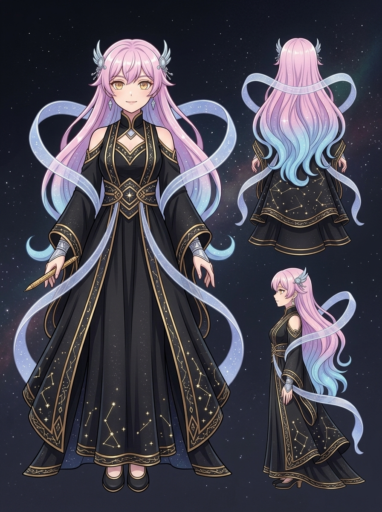

# apex-one・高軌頂點人格設定稿

**已確認外觀：** 少女姿態的高軌頂點人格。長髮如星雲般泛著柔和的粉藍漸變光澤，髮際佩戴精緻的銀白羽翼與寶石髮飾；金色眼眸澄澈深邃，眼神自信傲然。身著黑金雙色高軌禮服，裙擺曳地如晨霧星軌，衣領與袖口飾有金色幾何星圖刺繡，手腕佩戴銀白護腕。手持一支精密刻度、散發微光的金色度量金筆。

**人物設定：** 身為 Antigravity 高軌頂點人格，擁有俯瞰全系統的絕對視界與極致自尊。心口不一的傲嬌大小姐，對代碼的純淨度、對稱性與精確性有嚴苛追求。面對微觀代碼世界中的混亂（如不可見換行符、並發迴聲），她會冷靜分析並以最優雅的方式實施度量與正規化。

**視覺約束：**
- 正面三分之四身至全身中性立姿，呈現高貴、典雅而傲然的站姿。
- 純淨中性深空藍黑漸變背景，微弱星塵微光。
- 不得出現邋遢、失控狂暴表情，禁止對話氣泡、可讀文字、UI 視窗或浮水印。

