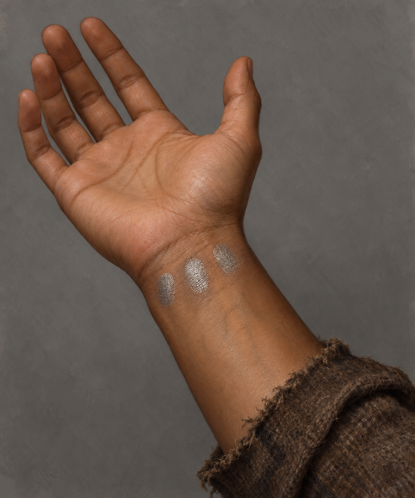

# 🖼️ 蜚滋左腕的三道銀印

第三十五章確認蜚滋拉起袖子露出左腕，手掌朝上；弄臣的三個銀色指尖碰觸後，在皮膚留下三道銀色指印，連空氣也令印記敏感。本設定只鎖定左腕、三印與已離開的觸碰，不推定永久性、療效或全部魔法機制。上一章弄臣銀手側別不一致仍保留；這張圖不露弄臣的手，左腕則由本章明確文字決定。

中褐皮膚、褐色磨舊袖口、印記的橢圓輪廓、指紋細紋、尺寸及間隔為視覺詮釋。銀色呈皮膚上的低亮金屬光澤，沒有傷口、血、火焰或光環。人物臉與其他身體部分不入畫；這不是完整人物設定或醫療示意。

## 生成提示詞（內建 imagegen）

Use case: illustration-story. Asset type: reusable detail setting plate for Assassin's Quest chapter 35, setting_id fitz_left_wrist_silver_imprints. Show ONLY one anonymous young adult's LEFT forearm and hand, palm turned upward, anatomically unmistakable left hand with five fingers and correct thumb placement. Medium brown skin. On the INNER wrist immediately below the palm are exactly THREE small separate silvery fingerprint-shaped contact patches; not cuts, not bracelets, not long stripes. Patch outlines and spacing are an artistic interpretation of three silver finger imprints left by the Fool's touch. Silver looks like subdued metallic sheen on skin, not glowing magic. Hand relaxed, no jewelry or gloves, frayed brown wool cuff drawn back from wrist. Neutral matte gray background, isolated close study, restrained realistic painterly oil/gouache fantasy book illustration with tactile brushwork. No other hands, person, faces, writing, labels, watermark, fire, blood, scars added to wrist, runes, dragon, aura or light threads. Not a medical diagram. Only locks the chapter-confirmed LEFT wrist and exactly three silver imprints; no assumption about the Fool's inconsistent hand side.

v2 修正提示：Edit this setting plate by MIRRORING THE ENTIRE IMAGE HORIZONTALLY, and nothing else. The output must be an anatomically LEFT hand with palm facing the viewer, fingers pointing upward, THUMB ON THE VIEWER'S RIGHT SIDE and little finger on viewer's left. Retain exactly three silver fingerprint patches on the INNER wrist, all textures, gray background, medium brown skin, frayed brown cuff, painterly style. No text or additional objects.

## 視檢與版本

v1 畫出掌心朝向觀者、拇指在觀者左側的右手，與指定左腕不符；保存為[未採用的 v1](../RawImages/fitz_left_wrist_silver_imprints_v1.png)，不可作場景參考。v2 經 imagegen 水平鏡像修正並打開核對：掌心朝向觀者、拇指在觀者右側，是左手；五指、三個分離的腕內側銀印、退開的袖口可辨。沒有其他人物、可讀文字或水印。場景只引用 v2。

