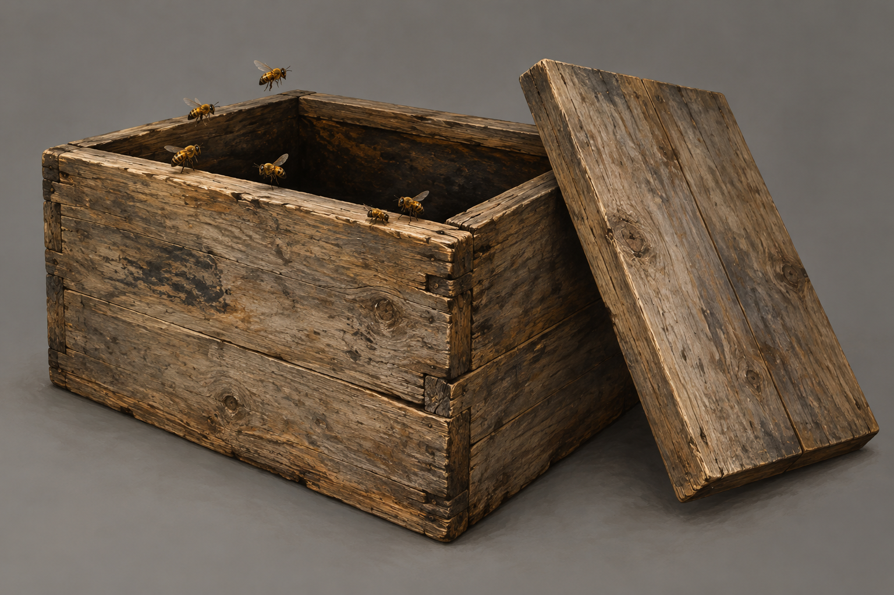

# 🖼️ 莫莉脫身的蜂箱

第三十六章中莫莉帶回大木蜂箱，開蓋將手伸入再收回，最後在門外把它靠在關閉的門上、打開箱蓋並踢了一腳。箱對她沉重，但可持舉。本文未指定木種、尺寸、內部蜂巢結構與箱蓋機構；本稿選長方木箱、平板活動蓋和朴素接縫，均屬視覺詮釋，不使用現代蜂箱框架或器材。

莫莉宣稱自己和孩子有原智，本設定不以魔法效果替她作證。蜜蜂按普通昆蟲描繪，種類、數量與可見排列為詮釋；不畫它們最終殺死哪些攻擊者。這是可引用的道具稿，不是人物設定或現實養蜂與脫身指南。

## 提示詞（內建 imagegen）

Use case: illustration-story. Asset type: reusable prop setting plate, Assassin's Quest chapter 36, setting_id molly_escape_bee_box. One large but human-portable old wooden bee box with a simple removable flat wooden lid, roughly rectangular handmade plain weathered wood, no modern factory hive, frames, honey jars or equipment. Lid lifted slightly and set beside the box to reveal a dark cavity, a few ordinary honeybees near the rim. Precise dimensions, timber, joints and bee species are illustration choices, not textual facts. Neutral gray background, three-quarter view, complete box and lid visible. Restrained realistic painterly fantasy book illustration, natural wood grain and muted brown/gold, no metal decorations. Bees have normal insect scale and anatomy, no glowing eyes or visible mind-control effects. No humans, hands, blood, weapons, children, bodies, house, texts, symbols or watermark. This is the wooden box Molly uses to rescue her child and leaves open against the closed cottage door in chapter 36; depicts no final deaths, permanent safety or proven magical control.

## 視檢 v1

已打開核對：單一木箱與一片平蓋，箱口開放、內部暗；普通蜜蜂在邊緣及空中。提示詞的蓋子略掀成圖成為完全移到側邊，作可開蓋形制參考；場景亦採開蓋，位置為詮釋。沒有蜂框、蜜罐、人物、文字、水印或魔法光。蜜蜂尺寸只作插圖選擇，不是尺度圖。

