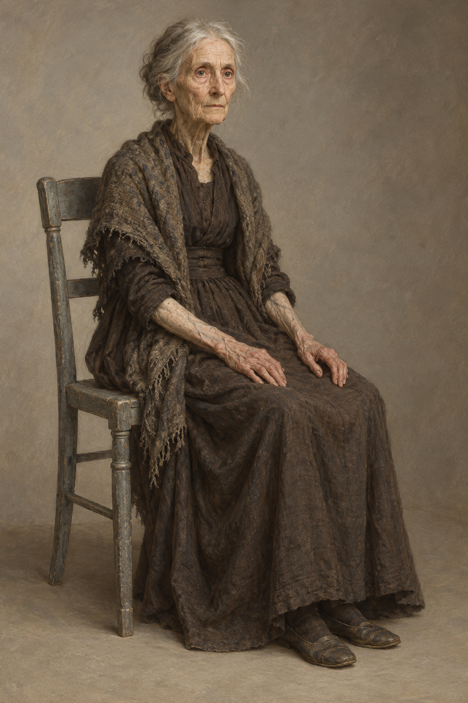

# 🖼️ 德爾加多夫人

第52章，身形極瘦、年事極高，坐在灰木椅上仍挺直身體，雙臂搭腿；薄而有紋的蒼白皮膚下可見青色血管，胳膊有褐斑。她不答訪客問話，注視灰貓，章末忽然躍起歡叫。耳聾、混亂是訪客猜測；血統說法不一致，身分與門後行動仍未知。

灰髮鬆束、灰褐長裙、破舊披肩、鞋子與臉部細節為視覺詮釋。保留人類解剖與年老的尊嚴；正文的魚與蛛網比喻不轉成魚鰭、蛛絲或變形，無民族或宗教徽物。

## 設定稿視檢（2026-10-13）

v1一位坐姿女性，全身、雙手、椅與鞋可見；極瘦面貌、蒼白紋理、褐斑與手臂血管可辨，無動物肢體、文字、水印或魔法。手臂衣袖略卷起以露出皮膚，屬詮釋。設定稿的朝向中性，場景可轉頭注視貓。
