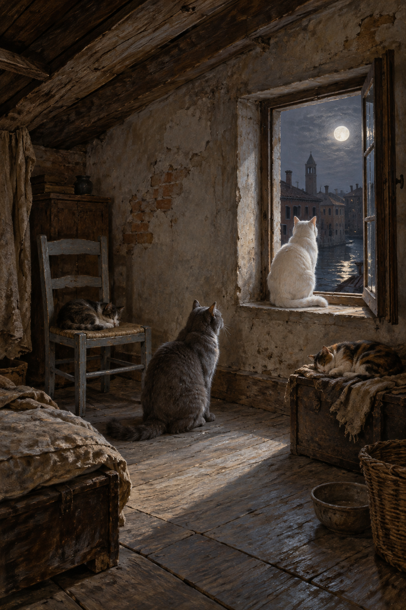

# 🖼️ 卡納雷吉歐的月光貓閣樓

第52章，威尼斯猶太聚居區高屋頂樓的小閣室：破裂、粗糙、褪色發灰的物件，小窗敞開，月光與夜風進來，灰木椅與許多貓。正文寫約五十隻貓，參考圖只取部分，不作總數對帳。

大灰貓看白貓，白貓望月是正文動作；貓的位置、屋頂斜梁、窗框、家具、器皿與窗外運河屋影是詮釋，不指认地標或宗教場所。房間不同於第51章斯特蘭奇的研究頂樓，不沿用其獅鷲桌與木像。

## 設定稿視檢（2026-10-13）

v1無人物；四隻貓可見，大灰貓抬頭向窗台白貓，白貓朝窗外；椅上與右側箱上另各一隻眠貓。敞開窗板、月光、剝落牆與灰椅清楚。場景需移開椅上貓供夫人坐下；不畫精確五十隻、死鳥、食物、文字、水印或魔法光效。
