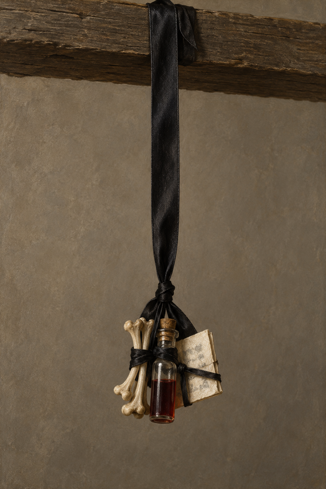

# 🖼️ 頂樓的黑綢懸帶束物

第53章，一條黑綢带從屋頂垂下，底端把幾根小骨、一管深色液體和寫字的紙綁在一起；走動時可能碰到，章末擊中斯特蘭奇印堂。液體被他猜作血，這不是確證；束物用途不以後文補答。

玻璃管塞、綁結、骨頭形狀、紙摺、固定於木梁與比例為視覺詮釋，不確認骨骼來源。黑色布帶保有光澤，三種材料在同一末端，不画成三個分散掛飾。纸片有模糊痕跡而無可讀文字；不加入法術光效、徽記或血液滴落。

## 視檢（2026-10-13）

v1無人物；一條長黑布帶、小骨、透明塞管與深紅褐液體、摺紙均可辨，共綁一束。骨形呈縮小長骨樣式，是生成詮釋，不能由圖判斷物種。無可讀文字、水印、骷髏、光效或血滴。場景中維持小型尺度、懸於眉心高度附近，尚不撞額。
