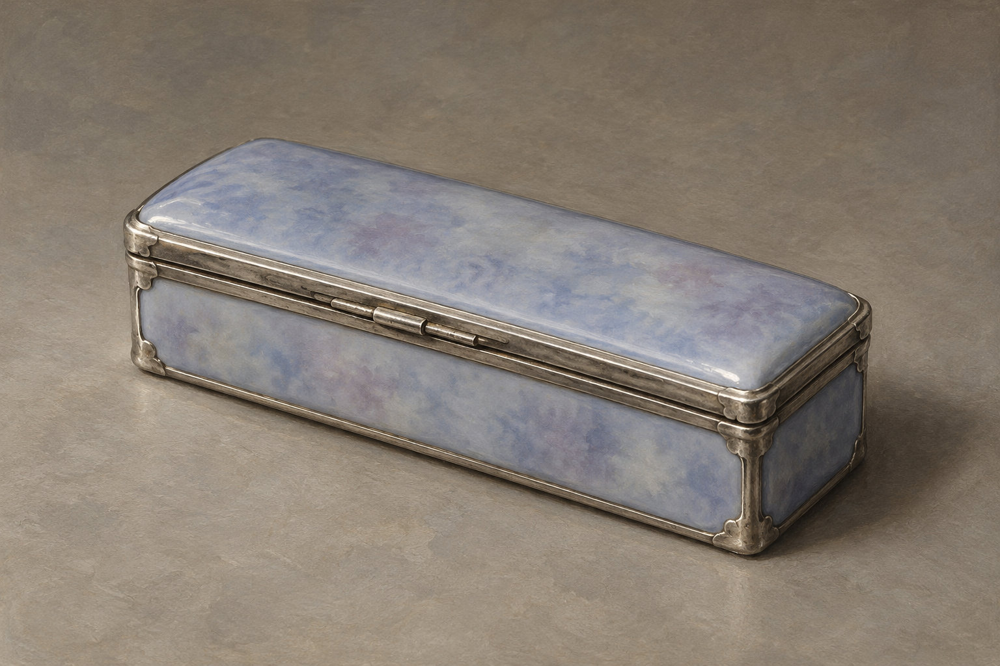

# 🖼️ 色如心傷的銀瓷小匣

第54章送至格家餐室的小匣：尺寸小、長方形，看似銀與陶瓷，顏色近藍、丁香紫，又帶淡灰。斯特蘭奇可以放入衣袋。具體尺寸、鉸鏈、包角和釉面雲紋是本設定的視覺詮釋，不確認產地。

匣內為真人小指，斯特蘭奇尚未認出主人；本設定保持閉蓋，不畫內容物或傷口。銀邊與瓷釉不發光、不添加姓名、家徽、魔法符文或珠寶裝飾。

## 視檢（2026-10-13）

v1單一閉蓋長方匣，銀色金屬邊框與淡藍紫灰瓷面可辨，無人、文字、水印、內容物或光效。鉸鏈位於可見長側，比例無量尺，不從圖推導確切厘米。場景圖保留掌心／衣袋尺度，不能放大成寶箱。
