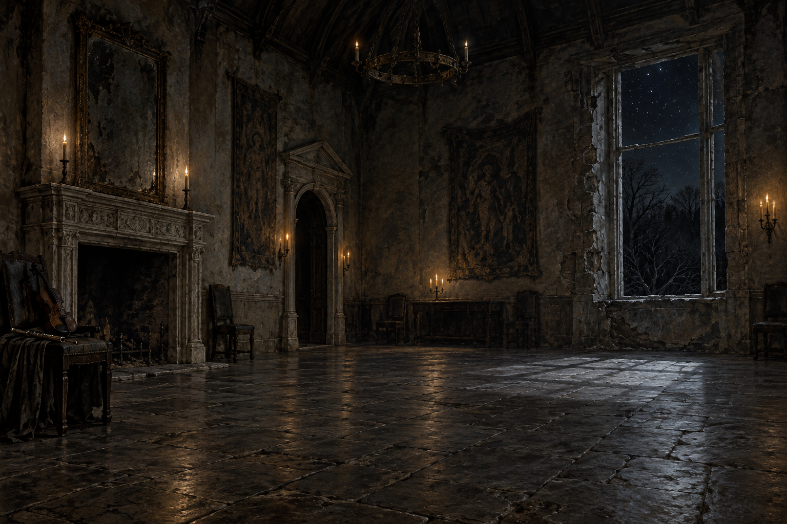

# 喪冀舞會的石廳

## 已確認的場景元素

- 第十六章中，史蒂芬隨白髮主人被帶到一處破敗宅邸的舞會廳。
- 粗糙石地與石牆、沒有玻璃的窗洞、窗外星空與黑暗樹林，使空間顯得寒冷而荒廢。
- 悲傷的小提琴與笛聲伴隨舞會；畫面不指定演奏者，也不替宅邸命名。

## 視覺約束

保留荒涼石廳、夜色與窗外樹林，不加入第十六章沒有確認的人物、宅邸背景或超自然符號。
## 第55章引用（Sirius，2026-10-18）

第55章已確認斯特蘭奇進入喪冀舞會，看見破敗大廳、一面倒塌的牆、瓦礫與廉價蠟燭。新場景沿v1冷夜石材作局部參考，牆面幾何、燭台、濕亮地面與舞者位置為詮釋，不把v1陳設當作055逐項確認；畫面沒有完整呈現倒牆，不作全景紀錄。

最近引用055，場景為〈她握住的手〉；原設定圖保留不覆寫。