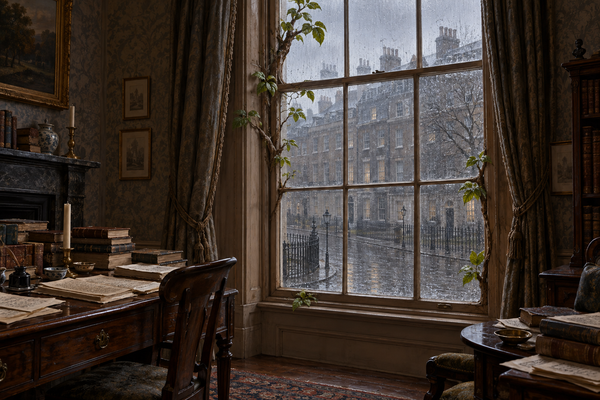

# 🖼️ 長葉窗框與雨中蘇活廣場

《英倫魔法師》第49章（1816年3月）：萊維使窗框生出枝葉，自己與斯特蘭奇均不知道如何復原。章末斯特蘭奇走到客廳窗旁，窗外只有密雨中的蘇活廣場。這兩項已確認元素是設定核心。

攝政時期木框長窗、灰褐壁紙、普通磚屋、濕路與有限枝葉是視覺詮釋；不鎖定建築立面、植物品種或房間精確平面。書稿堆在近旁承接本章凌亂，牆上筆記僅為不可讀墨痕。第26章搬家稻草、箱子和鏡子不沿用到此刻。

英國歷史奇幻油畫質地，室內暗褐、雨景冷灰。設定稿無人物，無荒野、仙靈、光效、可讀文字或水印；不以長葉窗框推斷通往仙境。v1已視檢：無人物；木窗仍有可辨窗格，葉枝沿框而生，雨街與書稿可見，無光效、文字標示或水印。壁上畫框與家具細節屬詮釋，不作正文確定物件。畫廊索引與 --check 通過。

