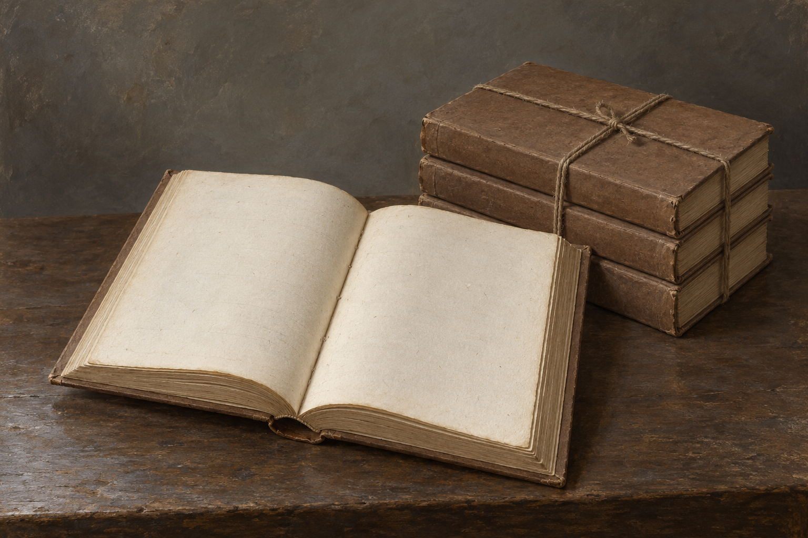

# 🖼️ 文字被抹去的魔法史書冊

第50章《英格蘭魔法的歷史與實踐》首卷印行，倉庫一萬本書仍捆著，打開檢查後發現所有頁面一片空白。設定只锁書冊實體、捆束與無字紙頁。棕色紙板封面、八開比例、粗繩與奶油色紙是年代質地的視覺詮釋，並非正文指定裝幀。

設定稿無人物：一冊打開的全白內頁與一小捆閉合書冊置於中性桌面。封面及書脊不寫書名；無光效、焚燒或消散粒子。未確認的兩本倖存不使用這張無字狀態作其內容證據。

## 視檢（2026-10-12）

v1已打開檢視：一冊攤開、兩頁無字，後方閉合書冊以粗繩捆束，無人物、標示或魔法光效。棕色表面與紙纖維可見；畫廊索引對帳通過。生成提示見同作品 050_ten_thousand_blank_spec.txt。
