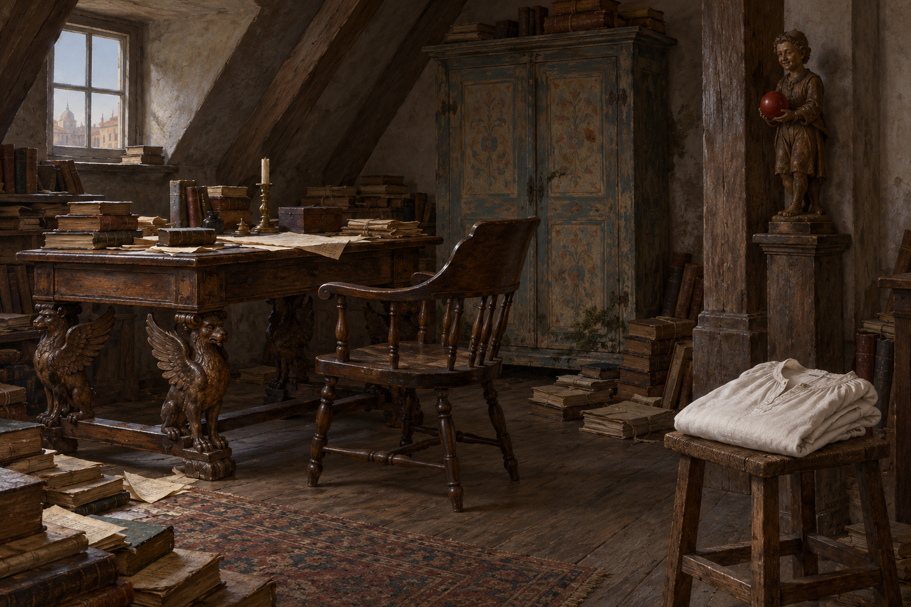

# 🖼️ 威尼斯頂樓與疊好的白睡衣

第51章，威尼斯百合聖母堂廣場住處頂樓小暗室：古桌四腿雕為獅鷲、船長椅、潮濕發霉的彩繪木櫥、地上的書稿、柱上兩三尺高的微笑木像。木像手中紅圓物究竟是果實或球，正文未定；不替雕像命名。

白睡衣為阿拉貝拉在剛結婚數年時替丈夫縫製。史蒂芬將它抖平、仔細疊好放在屋角小凳。本設定以摺好的衣物及小凳作主焦點；簡單亞麻領口、袖形、家具位置和建築輪廓屬詮釋，不加姓名繡字、花紋或亡者幻影。

設定無人物、刀、血與法術光效，服裝在主焦點上需要保持可辨。場景圖可取局部，不要求全部背景物同時出現。

## 設定稿視檢（2026-10-12）

v1無真人；白睡衣領口與摺袖清楚，小凳、彩繪木櫥、獅鷲桌腿、船長椅、地上書稿與柱上紅球木像可見。桌子角度只露部分腿，未把四腿全部可見當成已驗證；場景圖以局部取景避開此數量問題。窗外建築、地毯、燭台為生成詮釋，不指認地標。無文字、水印與光效。
