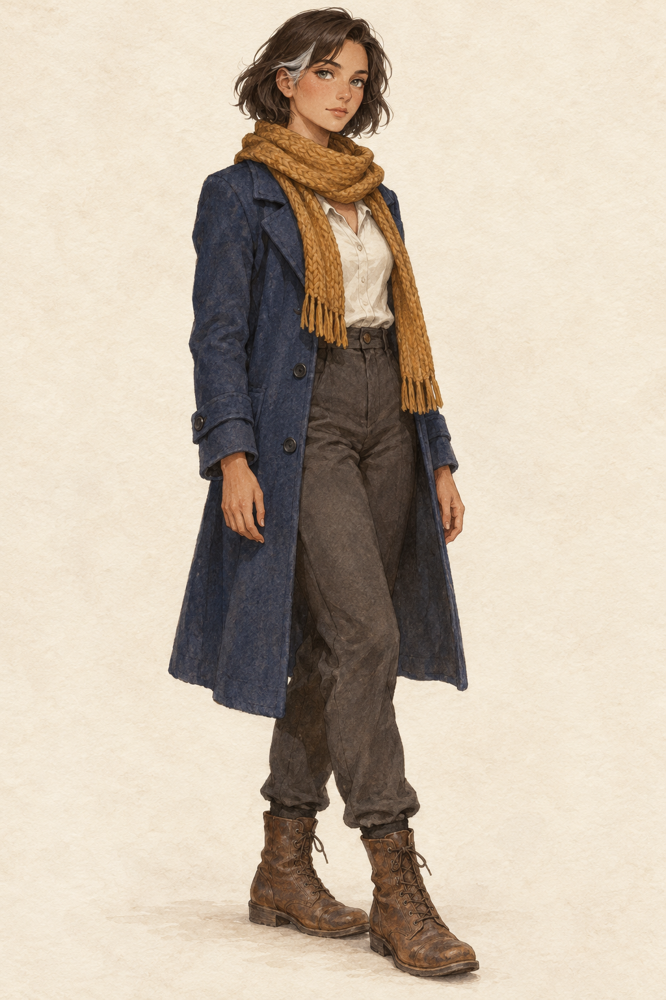

# 🖼️ 守燈人澪

來源為同作品 README 的原創第 01 節。這是作者視覺設計，不冒稱外部小說的既定描述。澪為約 28 歲成年女性，膚色暖褐、灰綠眼睛、深棕短髮至下頜，左側一小束銀白髮；安靜而清醒的神情。

服裝固定為赭黃厚針織圍巾、靛青及膝羊毛外套、米白上衣、深灰長褲、棕色舊皮靴。衣服為日常勞動服，不戴帽子、首飾或手套，不拿燈籠、武器與信物。設定稿採中性淺色背景的全身三分之四站姿。

她的等待不指向一位已確定的失蹤者。衣著輪廓與銀白髮束讓後續場景可以辨識她，姿勢與光線可改變。2026-10-12 已以 view_image 打開本機成圖視檢：全身單人、成年比例、空手、圍巾及靴子均完整，沒有文字或水印。銀白髮束出現在畫面左側；實際人物側別以此稿為準。畫風偏細膩寫實水彩，保留二次元輪廓，後續沿用成圖質地。

## 生成紀錄

使用內建 imagegen，設定稿 1024×1536，版本 v1；未以程式修改圖像。

```text
Use case: illustration-story. Original fiction After the Tide, setting_id mio_keeper, source section 01. Create a polished character reference illustration: one adult woman lighthouse keeper, age about 28, warm tan skin, gray green eyes, dark brown jaw-length bob with one small silver white lock at her left temple. Calm, attentive mature face. Full body three-quarter standing view, relaxed hands empty. Ochre thick knitted scarf, indigo knee-length wool coat, off-white shirt, charcoal trousers, worn brown leather boots. Neutral pale warm paper background, no scene, no props. Exquisite restrained anime drawing, watercolor and gouache texture on paper, fine intentional outlines, expressive adult proportions, soft diffuse neutral lighting. Portrait format. No typography, labels, watermarks, extra people, hats, gloves, jewelry, weapons, lanterns, sexualized clothing or chibi proportions.
```


