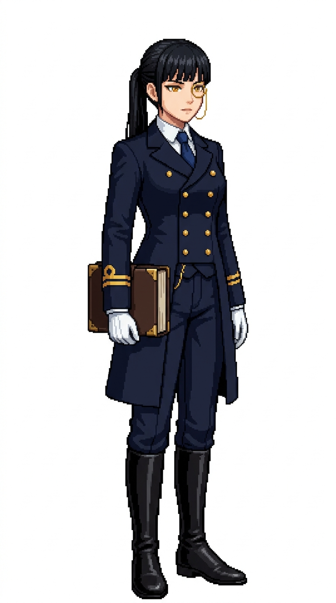

# 🖼️ 鐵律大副像素立繪 (Audelia, The Iron Rule)

本立繪為五位不同性格女大副系列的第一部作品。奧黛莉雅（Audelia）是艦上的風紀與日誌官，奉行「無規矩不成方圓」的鐵律哲學。在她眼中，航海日誌不是枯燥的數字，而是整艘船在無常怒濤中得以維繫生機的骨架。

角色維持系列一貫的深藍海軍大衣、象牙白高領襯衫與純白底全身待機構圖。奧黛莉雅身著雙排金扣立領軍裝大衣，雙袖整齊飾有代表大副階級的雙道金帶；右眼配戴纖細精緻的金色單片眼鏡，雙手戴著潔白棉手套，手臂下牢牢夾著厚重燙金的航海日誌與黃銅日誌鎖扣。俐落的烏黑長直低馬尾與清澄金色眼眸，展現出不容挑釁的理性與威嚴。

本作品為帆船遊戲用的原創職務立繪設計，純白底全身設定，線條保留精緻階梯狀像素與離散色塊陰影，不宣稱復刻特定年代歷史軍服。

## 角色設定

- **職稱**：第一副長（First Mate）／當值風紀官
- **代號**：鐵律（The Iron Rule）
- **外貌**：約 30 歲，烏黑筆直長髮束成俐落低馬尾，銳利清澄的金色眼眸，右眼佩戴細金絲單片眼鏡，神情嚴謹冷靜。
- **服飾與配件**：深藍色立領雙排扣高階海軍外套、雙袖金色大副雙袖帶、象牙白高領襯衫配深藍絲質領結、深藍合身長褲與擦拭發亮的黑高筒皮靴；潔白禮儀手套，夾持燙金深棕皮革航海日誌與黃銅懷錶鏈。

## 完整生成提示詞

```text
Use case: stylized-concept. Produce one finished game character illustration, a new ADULT FEMALE crew member in this existing nautical sprite series: '鐵律大副 奧黛莉雅' (First Mate Audelia - The Iron Rule). Japanese refined pixel art / 精緻日系點陣: expressive anime face, beautifully designed costume, carefully placed square pixels, crisp stair-step outlines, discrete pixel shading, coherent moderate pixel density. Refine detail beyond coarse sprites while remaining unmistakably pixel art; no smooth painted rendering, no anti-aliased smudges, no pixel noise. Single full-body character in relaxed neutral idle stance, three-quarter view slightly toward screen RIGHT, both boots grounded on same baseline, arms relaxed, equipment secured close to body. Portrait aspect ratio close to 4:7 (roughly 948x1659 / 1024x1792), entire hair/hat/hands/boots fully visible with comfortable margins, centered and consistent scale. Uniform pure solid WHITE background (#FFFFFF), NO ground shadow, NO scenery, NO floor, NO typography, labels, text, watermark, border or frame. Navy blue and ivory crew palette, brown leather, two gold cuff bands on sleeves denoting First Mate officer status. Role: First Mate / 大副 (Audelia / 奧黛莉雅). Adult woman about 30, sleek straight pitch-black hair neatly tied in a tidy low ponytail with straight bangs, sharp clear golden-amber eyes, a delicate thin gold wire-rimmed monocle on her right eye, composed, strict, elegant disciplinarian expression. Impeccably tailored navy blue double-breasted officer frock coat with stiff standing collar, two precise gold cuff bands per sleeve, snow-white high-collared shirt with dark blue silk necktie, tailored navy trousers tucked into polished knee-high black leather boots. Clean white dress gloves on both hands, carrying a thick dark-brown leather-bound ship's logbook with brass corner clasps tucked neatly under one arm, small gold watch chain glinting at vest.
```


