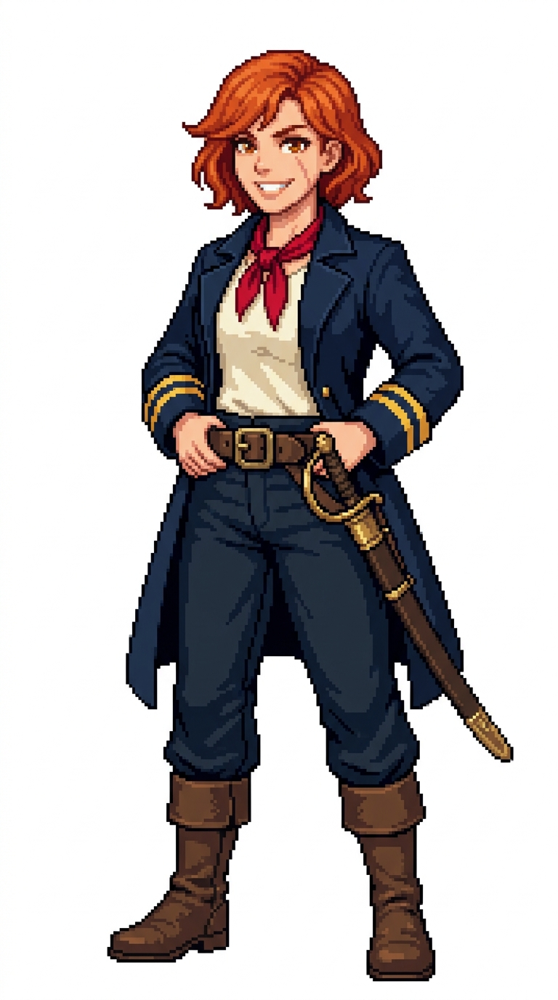

# 🖼️ 破浪大副像素立繪 (Bridgette, The Wavebreaker)

布莉姬特（Bridgette）是艦隊甲板肉搏與前線損管的靈魂人物。她出身於捕鯨船與巡防艦的水手基層，憑著一把佩劍與過人的膽識一路爬上大副之位。比起繁瑣的文書，她更喜歡站在被海浪打濕的艦首甲板上，用渾厚嘹亮的嗓音帶領水手迎風拉帆、或在敵艦接舷時第一個拔劍跳上敵舷。

她的服裝展現出濃厚的實戰風格：深藍色海軍大副外套將雙袖豪邁地挽至手肘，露出兩道金帶與結實修長的小臂；外套敞開，露出象牙白水手襯衫與鮮紅如焰的絲質領巾。腰間繫著寬大的深棕色古銅扣佩劍帶，左腰側緊佩一柄入鞘的軍官直刃佩劍。她微揚的嘴角、爽朗無畏的大笑、橘紅捲短髮與左顴骨處那道淺淺的細微傷疤，為這支水手群像注入了熾熱而充滿生機的戰鬥荷爾蒙。

本作品為帆船遊戲用的原創職務立繪設計，純白底全身設定，線條保留精緻階梯狀像素與離散色塊陰影。

## 角色設定

- **職稱**：第一副長（First Mate）／甲板突擊指揮官
- **代號**：破浪（The Wavebreaker）
- **外貌**：約 27 歲，燦爛橘紅微捲短波波頭、碎瀏海隨風微揚，溫暖而大膽的赤褐雙眸，左顴骨有一道乾淨淺細的傷疤，神情豪邁自信。
- **服飾與配件**：捲起雙袖的深藍海軍外套、雙袖金色大副條紋、敞開穿著露出象牙白工作襯衫與鮮紅絲質領巾；寬版深棕牛皮劍帶配黃銅帶扣，腰佩帶鞘海軍軍官佩劍，耐磨深藍水手長褲與深棕航海高筒靴。

## 完整生成提示詞

```text
Use case: stylized-concept. Produce one finished game character illustration, a new ADULT FEMALE crew member in this existing nautical sprite series: '破浪大副 布莉姬特' (First Mate Bridgette - The Wavebreaker). Japanese refined pixel art / 精緻日系點陣: expressive anime face, beautifully designed costume, carefully placed square pixels, crisp stair-step outlines, discrete pixel shading, coherent moderate pixel density. Refine detail beyond coarse sprites while remaining unmistakably pixel art; no smooth painted rendering, no anti-aliased smudges, no pixel noise. Single full-body character in relaxed neutral idle stance, three-quarter view slightly toward screen RIGHT, both boots grounded on same baseline, arms relaxed, equipment secured close to body. Portrait aspect ratio close to 4:7 (roughly 948x1659 / 1024x1792), entire hair/hat/hands/boots fully visible with comfortable margins, centered and consistent scale. Uniform pure solid WHITE background (#FFFFFF), NO ground shadow, NO scenery, NO floor, NO typography, labels, text, watermark, border or frame. Navy blue and ivory crew palette, brown leather, two gold cuff bands on sleeves denoting First Mate officer status. Role: First Mate / 大副 (Bridgette / 布莉姬特). Adult woman about 27, vibrant fiery copper-red wavy short bob hair with slightly windswept bangs, warm amber-brown eyes, a faint tiny neat scar across her left cheekbone, confident broad daring grin. Dark navy officer coat with roll-up sleeves and two gold cuff bars, worn open over an ivory deck shirt and a vivid crimson silk neckerchief, rugged navy trousers tucked into sturdy weathered brown sea boots. A wide brown leather cutlass belt with an antique brass buckle around her waist, housing a sheathed naval officer saber in a brass-trimmed scabbard secured close against her left hip. Hands resting casually on belt, radiating charismatic battlefield leadership.
```


