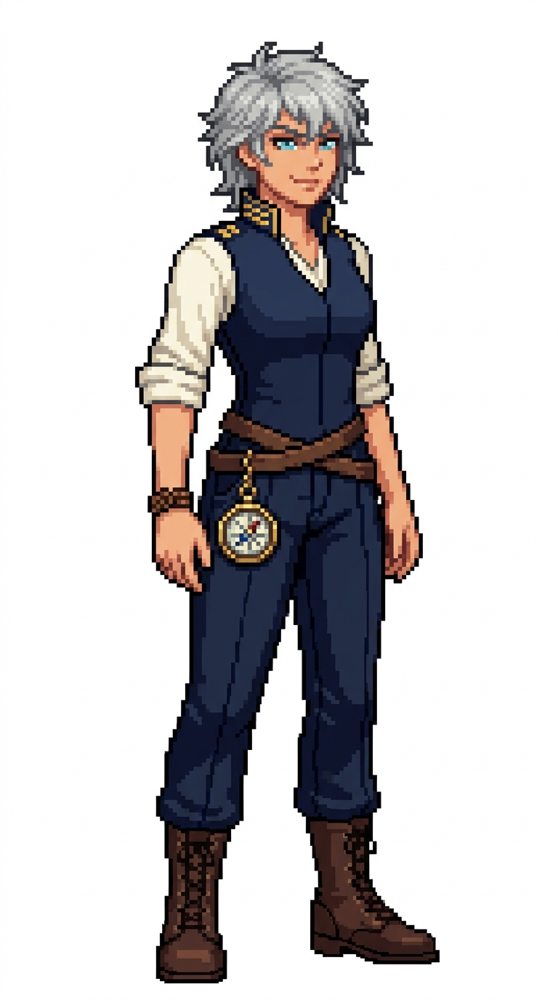

# 🖼️ 風暴之眼大副像素立繪 (Sylphia, The Storm Eye)

席爾菲雅（Sylphia）是艦上天生的舵手與湧浪之子。在海圖尚未繪測的狂暴海域或暗礁群中，她僅憑耳畔的風嘯聲、海鳥的折返掠水、以及皮膚感受到的氣壓震顫，就能在舵輪前做出最神乎其技的航向避險。

她的著裝風格透露出強烈的海角野性與靈動：深藍色海軍高領背心襯衫將袖口整齊捲過手肘，雙手手腕繫著象徵水手平安祈願的深棕編織繩結；領口與袖帶綴有兩道精緻金帶，證明其大副的幹練資歷。雙層牛皮腰帶上懸掛著一只經過精密校準的黃銅萬向懸浮羅盤與舵輪造型金屬扣。一頭隨興不羈的銀灰碎狼尾短髮、微帶日曬健康小麥色的膚質，以及那一雙宛如冰海般澄澈冷冽的碧藍雙眸，散發出隨時準備與風暴正面肉搏的自信傲氣。

本作品為帆船遊戲用的原創職務立繪設計，純白底全身設定，線條保留精緻階梯狀像素與離散色塊陰影。

## 角色設定

- **職稱**：第一副長（First Mate）／首席當值操舵官
- **代號**：風暴之眼（The Storm Eye）
- **外貌**：約 26 歲，銀灰碎狼尾不對稱短髮、隨性微亂，銳利如鷹的清冽蔚藍眼眸，健康日曬小麥膚色，帶著自信不羈的微挑嘴角。
- **服飾與配件**：捲起雙袖的深藍海軍高領背心制服、雙袖金色大副雙帶、象牙白內襯、深藍寬鬆水手航海褲與綁帶深棕高筒皮靴；左腕佩戴皮革編織水手繩結，雙層牛皮腰帶上懸掛小型黃銅萬向航海羅盤與舵輪銅扣。

## 完整生成提示詞

```text
Use case: stylized-concept. Produce one finished game character illustration, a new ADULT FEMALE crew member in this existing nautical sprite series: '風暴之眼大副 席爾菲雅' (First Mate Sylphia - The Storm Eye). Japanese refined pixel art / 精緻日系點陣: expressive anime face, beautifully designed costume, carefully placed square pixels, crisp stair-step outlines, discrete pixel shading, coherent moderate pixel density. Refine detail beyond coarse sprites while remaining unmistakably pixel art; no smooth painted rendering, no anti-aliased smudges, no pixel noise. Single full-body character in relaxed neutral idle stance, three-quarter view slightly toward screen RIGHT, both boots grounded on same baseline, arms relaxed, equipment secured close to body. Portrait aspect ratio close to 4:7 (roughly 948x1659 / 1024x1792), entire hair/hat/hands/boots fully visible with comfortable margins, centered and consistent scale. Uniform pure solid WHITE background (#FFFFFF), NO ground shadow, NO scenery, NO floor, NO typography, labels, text, watermark, border or frame. Navy blue and ivory crew palette, brown leather, two gold cuff bands on sleeves denoting First Mate officer status. Role: First Mate / 大副 (Sylphia / 席爾菲雅). Adult woman about 26, stylish tousled silver-ash shaggy wolf-cut short hair, piercing icy azure-blue eyes, healthy light sun-kissed skin tone, fearless spirited slight smirk. Fitted navy officer tunic-vest with sleeves rolled up past elbows, showing leather woven sailor rope-knots around her left wrist, ivory undershirt, navy officer deck trousers, and rugged laced brown leather boots. Two gold embroidered bands along the high stiff collar and cuffs. A polished brass gimbaled mariner's pocket compass hanging from a double-wrapped brown leather belt. Wild, intuitive helmswoman who commands the ship through deadly typhoons.
```


