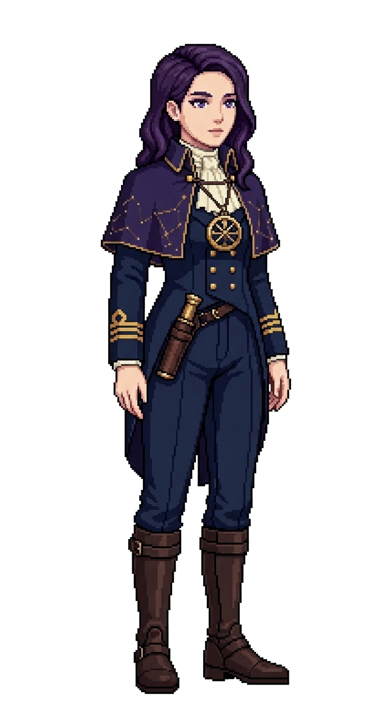

# 🖼️ 晨星大副像素立繪 (Violette, The Morning Star)

當夜幕籠罩大洋，整座艦船的命運便交託給了晨星大副薇爾莉特（Violette）。她具備超凡的天文鐘校正與星位推算能力，能在狂風暴雨雲層破開的瞬間，僅憑北極星與南十字的微光計算出船位的分秒偏差。

薇爾莉特的造型帶有學者與星空觀測者的神秘沉靜氣質：深藍色燕尾軍裝外罩一件短款立挺肩部小斗篷，斗篷內襯映出深邃的星夜靛藍色；雙袖繡有金帶，內著高領褶邊象牙白襯衫。胸前懸掛著一枚精巧繁複的黃銅微型星盤項鍊，腰帶右側則佩帶著黃銅鏡筒圓柱皮套。她那一頭夜色深紫的柔和微鬈及肩長髮與清澈溫柔的薰衣草紫眸，透露出無與倫比的知性與安寧。

本作品為帆船遊戲用的原創職務立繪設計，純白底全身設定，線條保留精緻階梯狀像素與離散色塊陰影。

## 角色設定

- **職稱**：第一副長（First Mate）／夜航天文觀測官
- **代號**：晨星（The Morning Star）
- **外貌**：約 29 歲，深紫夜色微鬈及肩長髮優雅側分，深邃聰慧的薰衣草紫眸，平靜溫柔、洞悉星辰的神情。
- **服飾與配件**：深藍色燕尾大副外套外加小斗篷（內襯深靛藍）、雙袖大副金色雙袖帶、高領荷葉褶邊象牙襯衫、深藍緊身長褲與深棕軍官馬靴；胸前懸掛黃銅微型星盤吊墜，腰間掛載精巧圓柱形皮革望遠鏡套與航海單筒望遠鏡。

## 完整生成提示詞

```text
Use case: stylized-concept. Produce one finished game character illustration, a new ADULT FEMALE crew member in this existing nautical sprite series: '晨星大副 薇爾莉特' (First Mate Violette - The Morning Star). Japanese refined pixel art / 精緻日系點陣: expressive anime face, beautifully designed costume, carefully placed square pixels, crisp stair-step outlines, discrete pixel shading, coherent moderate pixel density. Refine detail beyond coarse sprites while remaining unmistakably pixel art; no smooth painted rendering, no anti-aliased smudges, no pixel noise. Single full-body character in relaxed neutral idle stance, three-quarter view slightly toward screen RIGHT, both boots grounded on same baseline, arms relaxed, equipment secured close to body. Portrait aspect ratio close to 4:7 (roughly 948x1659 / 1024x1792), entire hair/hat/hands/boots fully visible with comfortable margins, centered and consistent scale. Uniform pure solid WHITE background (#FFFFFF), NO ground shadow, NO scenery, NO floor, NO typography, labels, text, watermark, border or frame. Navy blue and ivory crew palette, brown leather, two gold cuff bands on sleeves denoting First Mate officer status. Role: First Mate / 大副 (Violette / 薇爾莉特). Adult woman about 29, deep midnight-purple wavy shoulder-length hair parted gracefully, intelligent lavender-violet eyes, serene calm and observant expression. Dark navy officer tailcoat with a short tailored officer shoulder capelet lined in muted starry indigo, twin gold braid stripes at cuffs, high-necked ruffled ivory shirt, and navy trousers with dark brown officer riding boots. A brass miniature astrolabe pendant hanging over her chest, and a compact cylindrical leather case holding a brass nautical spyglass slung on her belt. Elegantly intellectual, watchful astrogator.
```


