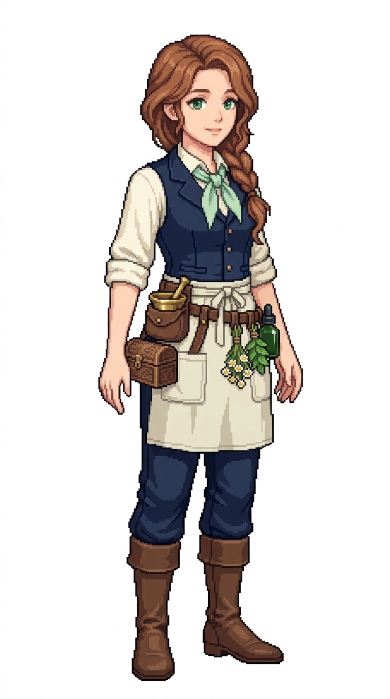

# 🖼️ 晨露船醫像素立繪 (Flora, The Morning Dew)

芙蘿拉（Flora）是航行於遠洋大洋時全艦最受愛戴的溫柔天使。長途航行中最令人聞之色變的不是風暴，而是壞血病與不知名的熱帶疫疾。芙蘿拉精通各類柑橘浸劑、酸漬甘藍防腐、薄荷醒神與洋甘菊鎮靜療法。每當受傷或思鄉的水手踏進醫務艙，看見她溫柔的微笑與撲鼻的藥草清香，心靈的創痛往往已先癒合了一半。

她的裝束充滿草藥師的親和與生機感：柔和溫暖的栗色微捲長髮編成一條隨性的側辮垂在肩頭，翡翠綠雙眸溫潤含情；象牙白捲袖工作襯衫外罩海軍藍修身醫用背心，繫著薄荷綠亞麻絲巾。腰間圍著淡象牙色的多口袋草藥圍裙，深藍長褲與柔軟的深棕航海靴。皮革工具腰帶上掛著一個小巧的黃銅研缽套、精緻的小木質藥箱，腰側皮圈則固定著幾束乾燥的洋甘菊與薄荷藥草包，以及一只深綠色的藥草萃取滴劑玻璃瓶。

本作品為帆船遊戲用的原創職務立繪設計，純白底全身設定，線條保留精緻階梯狀像素與離散色塊陰影。

## 角色設定

- **職稱**：船醫（Ship's Surgeon）／草藥調劑與內科醫官
- **代號**：晨露（The Morning Dew）
- **外貌**：約 28 歲，柔順暖栗色微捲長髮梳成蓬鬆側長單辮垂於肩前，溫柔清澈的翡翠綠眼眸，帶著慈愛撫慰人心的甜美微暖神情。
- **服飾與配件**：象牙白捲袖襯衫、深藍醫官背心、薄荷綠絲巾、淡象牙色多口袋亞麻圍裙、海軍長褲與深棕海軍皮靴；腰帶掛載黃銅研缽袋、雕花小木藥盒、乾燥藥草捆（洋甘菊/薄荷）與深綠玻璃滴劑小瓶。

## 完整生成提示詞

```text
Use case: stylized-concept. Produce one finished game character illustration, a new ADULT FEMALE crew member in this existing nautical sprite series: '晨露船醫 芙蘿拉' (Ship's Surgeon Flora - The Morning Dew / 草藥調劑醫). Japanese refined pixel art / 精緻日系點陣: expressive anime face, beautifully designed costume, carefully placed square pixels, crisp stair-step outlines, discrete pixel shading, coherent moderate pixel density. Refine detail beyond coarse sprites while remaining unmistakably pixel art; no smooth painted rendering, no anti-aliased smudges, no pixel noise. Single full-body character in relaxed neutral idle stance, three-quarter view slightly toward screen RIGHT, both boots grounded on same baseline, arms relaxed, equipment secured close to body. Portrait aspect ratio close to 4:7 (roughly 768x1376 / 948x1659), entire hair/hat/hands/boots fully visible with comfortable margins, centered and consistent scale. Uniform pure solid WHITE background (#FFFFFF), NO ground shadow, NO scenery, NO floor line, NO typography, labels, text, watermark, border or frame. Navy blue and ivory crew palette, brown leather, herbal green accents. Practical age-of-sail fantasy clothing with trousers and boots, no modern stethoscope, no modern syringe, no red-cross, no nurse miniskirt. Role: Ship's Surgeon & Apothecary / 船醫與草藥調劑師 (Flora / 芙蘿拉 - The Morning Dew). Adult woman about 28, soft warm chestnut-brown wavy hair styled in a loose side plait resting over her shoulder, gentle emerald-green eyes, compassionate, reassuring, tender expression with a kind slight smile. Ivory roll-sleeve work blouse under a tailored navy blue medical vest, pale mint-green neck scarf, pale ivory multi-pocket linen apothecary waist apron tied over navy trousers, soft brown leather sea boots. Leather tool belt carrying a small brass mortar and pestle in a pouch, a small carved wooden medicine chest at hip, and leather loops holding dried herbal bundles (chamomile and mint) and a dark green glass tincture dropper bottle. Hands empty and relaxed.
```


