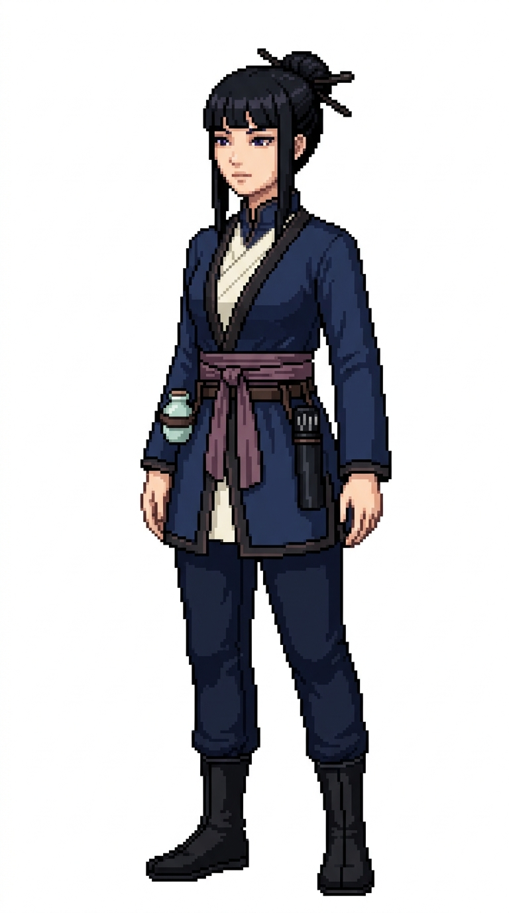

# 🖼️ 霜針船醫像素立繪 (Jinghua, The Frost Needle)

靜華（Jinghua）是航線延伸至東方海域時加入艦隊的傳奇醫官。在吵雜的西式帆船上，她的醫務室永遠瀰漫著艾草與檀香的沉靜微香。西方外科慣用截肢與烈酒麻醉，而靜華僅憑數枚極細的銀針與穴位按壓，便能在數息之內平息水手劇烈撕裂傷的劇痛。她同時也是全艦最頂尖的毒理學家，對於深海劇毒水母、刺魟與腐壞傷口的拔毒術造詣極深。

她的裝束融合了古典東方雅緻與實用航海制服：烏黑柔順的姬髮式長直髮挽成高雅的傳統髮髻，以黑檀木簪固定；幽暗神秘的深紫眼眸平靜如潭，帶著一抹若有似無的孤傲冷靜。身穿改良自海軍立領的深藍色交領盤扣醫官外套，邊緣帶有低調暗色滾邊，內襯象牙白交領長衫；腰間束有暗梅紫色的絲質寬腰帶與外層皮革工具帶，深藍束口航海長褲與黑色軟底短靴。腰間隨身佩掛著一只精巧的黑漆竹筒針灸套盒，以及一只裝有特製解毒膏的青瓷小藥罐。

本作品為帆船遊戲用的原創職務立繪設計，純白底全身設定，線條保留精緻階梯狀像素與離散色塊陰影。

## 角色設定

- **職稱**：船醫（Ship's Surgeon）／針灸與毒理官
- **代號**：霜針（The Frost Needle）
- **外貌**：約 30 歲，烏黑長直姬髮式髮髻配黑檀木簪，幽邃神秘的深紫雙眸，清冷高雅、深藏不露的神情。
- **服飾與配件**：深藍色海軍立領交領盤扣醫官外套、象牙白交領內襯、暗梅紫色絲質寬腰帶、皮革工具腰帶、深藍束口長褲與黑色軟底航海靴；腰佩精緻黑漆竹筒針灸套盒與青瓷小藥罐。

## 完整生成提示詞

```text
Use case: stylized-concept. Produce one finished game character illustration, a new ADULT FEMALE crew member in this existing nautical sprite series: '霜針船醫 靜華' (Surgeon Jinghua - The Frost Needle / 毒理針石醫). Japanese refined pixel art / 精緻日系點陣: expressive anime face, beautifully designed costume, carefully placed square pixels, crisp stair-step outlines, discrete pixel shading, coherent moderate pixel density. Refine detail beyond coarse sprites while remaining unmistakably pixel art; no smooth painted rendering, no anti-aliased smudges, no pixel noise. Single full-body character in relaxed neutral idle stance, three-quarter view slightly toward screen RIGHT, both boots grounded on same baseline, arms relaxed, equipment secured close to body. Portrait aspect ratio close to 4:7 (roughly 768x1376 / 948x1659), entire hair/hat/hands/boots fully visible with comfortable margins, centered and consistent scale. Uniform pure solid WHITE background (#FFFFFF), NO ground shadow, NO scenery, NO floor line, NO typography, labels, text, watermark, border or frame. Navy blue and ivory crew palette, brown leather, muted plum/indigo accent. Practical age-of-sail fantasy clothing with trousers and boots, no modern stethoscope, no modern syringe, no red-cross, no nurse miniskirt. Role: Ship's Acupuncturist & Toxicologist / 船醫與針石毒理官 (Jinghua / 靜華 - The Frost Needle). Adult woman about 30, glossy raven-black straight hime-cut hair with hair pinned in a sleek traditional bun secured by a dark ebony hair stick, deep mysterious dark violet eyes, aloof, serene, enigmatic expression. Navy blue oriental-crossover mandarin-collar surgeon tunic coat with subtle dark trim, ivory cross-collar inner garment, muted plum-silk waist sash over dark leather utility belt, fitted navy trousers tucked into black soft-soled boots. Compact cylindrical black lacquered bamboo case holding acupuncture needles secured at her hip, small celadon porcelain medicine jar in a leather ring pouch. Hands empty and relaxed.
```


