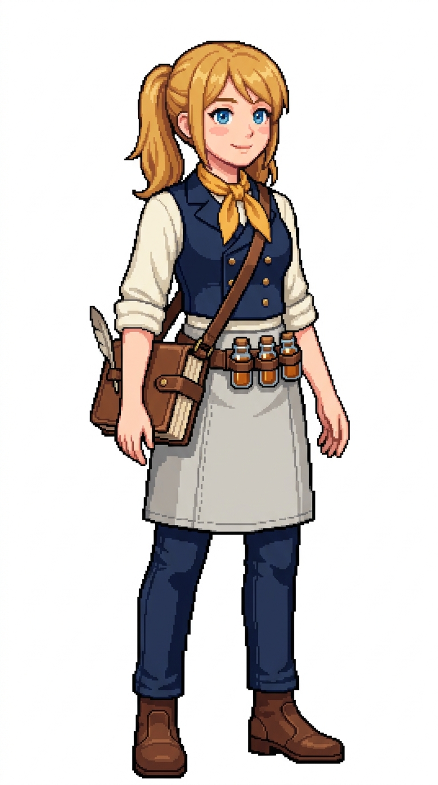

# 🖼️ 星火船醫像素立繪 (Lucia, The Inquisitive Spark)

露西亞（Lucia）是醫務室裡最有朝氣的新星。她畢業於舊大陸著名醫學院，卻毅然選擇登上遠航帆船，立志將未知的深海毒理、熱帶植物抗體與船員心理病理完整收錄成冊。雖然資歷尚淺，但她對突發病狀的觀察力與應變速度極快，經常能在前線第一時間辨識出奇異毒素並找到解法。

她的外貌與穿搭展現出年輕學者的靈動與活力：俏皮明亮的淺金蜂蜜色雙低馬尾、清澈好奇的天藍大眼與微紅的健康臉頰；象牙色捲袖寬鬆水手襯衫外罩一件深藍色雙排扣修身醫用短背心，領口繫著鮮亮活潑的明黃色絲質小領巾。腰間繫著帶有細緻縫線的淺灰亞麻短圍裙，深藍窄管航海長褲與俐落深棕短靴。斜背著一本厚實手工縫製的羊皮紙航海病理筆記（側邊筆套插著一支鵝毛筆），腰帶皮套插著三支大小各異的密封琥珀色試劑瓶。

本作品為帆船遊戲用的原創職務立繪設計，純白底全身設定，線條保留精緻階梯狀像素與離散色塊陰影。

## 角色設定

- **職稱**：見習船醫（Apprentice Surgeon）／博物學者與病理記錄官
- **代號**：星火（The Inquisitive Spark）
- **外貌**：約 24 歲，淺金蜂蜜色長髮紮成低垂雙馬尾，天藍色明亮靈活的大眼睛，臉頰帶點紅潤，神情活潑自信、充滿求知熱忱。
- **服飾與配件**：象牙白捲袖工作襯衫、深藍雙排扣修身醫用背心、亮黃色絲質小領巾、淺灰亞麻短圍裙、深藍修身工作褲與深棕短靴；斜背厚重皮革裝訂航海筆記本（插著鵝毛筆），腰帶插置三支密封琥珀色小藥劑瓶。

## 完整生成提示詞

```text
Use case: stylized-concept. Produce one finished game character illustration, a new ADULT FEMALE crew member in this existing nautical sprite series: '星火船醫 露西亞' (Apprentice Surgeon Lucia - The Inquisitive Spark / 博物見習醫). Japanese refined pixel art / 精緻日系點陣: expressive anime face, beautifully designed costume, carefully placed square pixels, crisp stair-step outlines, discrete pixel shading, coherent moderate pixel density. Refine detail beyond coarse sprites while remaining unmistakably pixel art; no smooth painted rendering, no anti-aliased smudges, no pixel noise. Single full-body character in relaxed neutral idle stance, three-quarter view slightly toward screen RIGHT, both boots grounded on same baseline, arms relaxed, equipment secured close to body. Portrait aspect ratio close to 4:7 (roughly 768x1376 / 948x1659), entire hair/hat/hands/boots fully visible with comfortable margins, centered and consistent scale. Uniform pure solid WHITE background (#FFFFFF), NO ground shadow, NO scenery, NO floor line, NO typography, labels, text, watermark, border or frame. Navy blue and ivory crew palette, brown leather, bright sunny ochre accent. Practical age-of-sail fantasy clothing with trousers and boots, no modern stethoscope, no modern syringe, no red-cross, no nurse miniskirt. Role: Apprentice Surgeon & Naturalist / 見習船醫與博物學者 (Lucia / 露西亞 - The Inquisitive Spark). Adult woman about 24, perky honey-blonde hair tied in low twin tails, bright curious azure-blue eyes, rosy cheeks, enthusiastic, bright and energetic expression. Ivory loose roll-sleeve deck shirt under a tailored cropped navy double-breasted surgeon vest, cheerful sunny-ochre silk neckerchief, light grey linen waist apron with stitching details, navy slim deck trousers, brown leather ankle boots. Thick hand-bound leather medical field notebook with a quill pen tucked into its side loop slung crossbody on a strap, leather belt holster holding three small stoppered amber medicine vials. Hands empty and relaxed.
```


