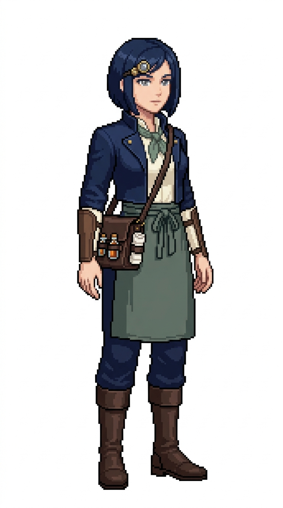

# 🖼️ 銀刃船醫像素立繪 (Selena, The Silver Scalpel)

賽琳娜（Selena）是艦上外科手術與截肢縫合的最高權威。在狂風暴雨中搖晃的船艙內，哪怕腳下甲板劇烈傾斜，她的手術刀也從未出現過一毫米的偏差。水手們稱她為「銀刃」，不僅是因為她隨身攜帶的那套精鋼手術刀具，更是因為她面對任何慘烈傷勢時，永遠如冰霜般冷靜沉穩的眼神。

她的造型展現出極致的專業與幹練：俐落深海軍藍短直髮襯托出專注的面龐，左鬢配戴著可翻轉的精緻黃銅雙重放大鏡片；身穿剪裁合身的深藍雙排扣醫官短大衣、象牙白高領工作衫與鼠尾草綠領巾。腰前繫著平整乾淨的深鼠尾草灰工作半身圍裙，海軍藍合身長褲與擦拭乾淨的醫生皮靴。腰側斜背著一只硬挺的深棕牛皮外科手術箱，外圈皮環整齊收納著乾淨的純白亞麻捲繃帶與密封琥珀色藥劑瓶。

本作品為帆船遊戲用的原創職務立繪設計，純白底全身設定，線條保留精緻階梯狀像素與離散色塊陰影，不宣稱復刻特定年代歷史軍服。

## 角色設定

- **職稱**：船醫（Ship's Surgeon）／首席外科醫官
- **代號**：銀刃（The Silver Scalpel）
- **外貌**：約 32 歲，俐落深海軍藍短直髮露頸，清澄冷冽的銀灰眼眸，左鬢佩戴精巧可翻折黃銅雙重放大目鏡，神情極度沉著專注。
- **服飾與配件**：深藍雙排扣海軍醫官短大衣、象牙白高領襯衫配鼠尾草綠領巾、深鼠尾草灰亞麻半身圍裙、深藍長褲與深棕皮革皮靴；手腕戴有薄型淺棕護腕，腰跨硬挺深棕牛皮外科急救箱，外扣固定純白捲繃帶與琥珀色藥瓶。

## 完整生成提示詞

```text
Use case: stylized-concept. Produce one finished game character illustration, a new ADULT FEMALE crew member in this existing nautical sprite series: '銀刃船醫 賽琳娜' (Ship's Surgeon Selena - The Silver Scalpel). Japanese refined pixel art / 精緻日系點陣: expressive anime face, beautifully designed costume, carefully placed square pixels, crisp stair-step outlines, discrete pixel shading, coherent moderate pixel density. Refine detail beyond coarse sprites while remaining unmistakably pixel art; no smooth painted rendering, no anti-aliased smudges, no pixel noise. Single full-body character in relaxed neutral idle stance, three-quarter view slightly toward screen RIGHT, both boots grounded on same baseline, arms relaxed, equipment secured close to body. Portrait aspect ratio close to 4:7 (roughly 768x1376 / 948x1659), entire hair/hat/hands/boots fully visible with comfortable margins, centered and consistent scale. Uniform pure solid WHITE background (#FFFFFF), NO ground shadow, NO scenery, NO floor line, NO typography, labels, text, watermark, border or frame. Navy blue and ivory crew palette, brown leather, sage/forest green accents. Practical age-of-sail fantasy clothing with trousers and boots, no modern stethoscope, no modern syringe, no red-cross, no nurse miniskirt. Role: Ship's Surgeon / 船醫 (Selena / 賽琳娜 - The Silver Scalpel / 外科首席). Adult woman about 32, sleek deep navy-blue straight bob hair cut sharply just above shoulders, clear cool silver-grey eyes, a small flip-up double brass loupe/lens attached to her left temple, calm, intensely focused and reassuring surgical master expression. Tailored short navy medical officer coat over a high-collared ivory work shirt, muted sage neckerchief, clean dark sage-grey linen waist apron tied neatly over navy trousers, brown leather boots. Compact structured dark brown leather surgeon's field satchel slung across her body at her hip, with outer leather loops holding neatly rolled white linen bandages and small stoppered amber medicine phials. Thin leather protective surgeon's bracers on her forearms. Hands empty and steady.
```


